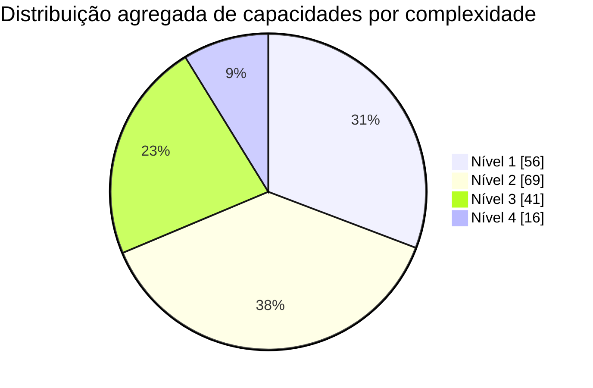

# HubSpot no Brasil com foco técnico e estratégico

## Resumo executivo

Pesquisa compilada em **25/05/2026** no fuso **America/Sao_Paulo**. O estado do produto considerado é a documentação pública da HubSpot, do HubSpot Marketplace, da documentação de desenvolvedores e do catálogo legal de produtos disponível nessa data. A HubSpot hoje opera como uma **customer platform** unificada com **Smart CRM, Marketing Hub, Sales Hub, Service Hub, Content Hub, Data Hub, Commerce Hub e Breeze**, além de um modelo de **Seats** e **HubSpot Credits** que impacta diretamente adoção, governança e custo operacional. As APIs de nova geração usam **versionamento por data** (`2026-03`), e a disponibilidade de APIs e limites varia por produto e tier.

A leitura mais importante para uma consultoria RevOps brasileira é a seguinte: a HubSpot continua extremamente competitiva quando o problema do cliente é **unificar CRM, marketing, vendas, atendimento, conteúdo e automação** com tempo de implantação menor que suites enterprise clássicas. O valor aparece cedo em **Nível 1 e Nível 2** com forms, pipelines, templates, meetings, dashboards, shared inbox, lists, automações leves e governança básica. O ROI relevante de médio prazo aparece em **Nível 3 e Nível 4** quando o cliente depende de **workflow avançado, custom objects, programmable automation, journey analytics, customer agent, sandbox, sensitive data, conteúdo multi-site, billing/quotes/subscriptions e integrações estruturais**.

Para o mercado brasileiro, há quatro conclusões pragmáticas. Primeiro, **PT-BR é suportado** na interface, em parte do suporte e em vários recursos de conteúdo/IA, mas **phone support segue apenas em inglês**, e nem toda feature de IA publica garantia específica de qualidade para português. Segundo, **HubSpot Payments não opera no Brasil**; as opções nativas verificadas hoje ficam concentradas em **Estados Unidos, Reino Unido e Canadá**, o que empurra projetos brasileiros para **Stripe** e/ou integrações locais. Terceiro, **LGPD não é um “modo pronto”**: há ferramentas úteis como cookie banners, consentimento, sensitive data, permissions e auditabilidade, mas a conformidade continua dependendo de desenho de processo, base legal, retenção, DSR/DSAR e arquitetura do cliente. Quarto, em clientes de alto volume, o principal risco econômico não é licença “de entrada”, mas a combinação de **marketing contacts, seats, créditos de IA e operação mal governada**.

**Leitura decisória para venda e implantação no Brasil**

| Tema decisório | Leitura objetiva | Implicação prática | Fontes |
|---|---|---|---|
| Melhor encaixe | HubSpot é mais forte quando o cliente quer plataforma integrada e rápida de operar, não uma arquitetura enterprise “best of breed” extremamente fragmentada. | Boa aderência para RevOps B2B, SaaS, B2C lead-gen e operações mid-market. | Oficial.  |
| Principal cliff edge | O salto real costuma ocorrer de **Starter para Professional**; em vários Hubs é aí que entram automação séria, reporting customizado, IA útil e escala operacional. | Processo comercial deve vender “capability unlock”, não apenas mais usuários. | Oficial.  |
| Principal cliff edge enterprise | O salto de **Professional para Enterprise** é de governança, segurança, objetos customizados, sandbox, partitioning e operações multi-time/multi-site. | Vende melhor para grupos regulados, franquias, multi-BU, multi-marca e operações complexas. | Oficial.  |
| Risco de adoção | Falta de modelo de dados, ownership, lifecycle stage, permissões e estratégia de integração. | Sem desenho prévio, o cliente “compra automação” e recebe caos em escala. | Oficial + inferência analítica.  |
| Risco Brasil | Pagamentos nativos restritos geograficamente; suporte telefônico não localizado; WhatsApp e telefonia exigem checagem por país e fornecedor. | SOW brasileiro deve sempre prever stack complementar de billing/pagamentos/telefonia. | Oficial.  |
| IA | Breeze já é transversal e monetizado por combinação de **tier + créditos**; nem tudo é “all inclusive”. | Todo desenho de IA precisa incluir budget de créditos e política de uso. | Oficial.  |

**Limitação metodológica curta:** a distribuição de complexidade apresentada abaixo é uma **classificação analítica consolidada** sobre o conjunto público atual de capacidades da HubSpot; ela não é uma taxonomia oficial da empresa. Onde a HubSpot publica a funcionalidade em múltiplos Hubs, eu consolidei a capacidade para evitar inflar artificialmente a contagem. As recomendações por perfil são **prescritivas** e não equivalem a uma prescrição comercial da HubSpot.

## Análise de Complexidade Agregada

Esta seção corresponde ao escopo de **análise de complexidade agregada**. A classificação abaixo usa quatro níveis operacionais: **Nível 1** = adoção rápida, normalmente no-code, baixa dependência entre times e baixo risco de reversão; **Nível 2** = configuração estruturada, com dependência moderada de processo e dados; **Nível 3** = desenho cross-funcional, governança, reporting ou integrações relevantes; **Nível 4** = plataforma/arquitetura, desenvolvimento, segurança ou operação enterprise. O inventário consolidado usado aqui considera **182 capacidades públicas distintas** observáveis no catálogo atual de produto, base de conhecimento e superfície de desenvolvedor, com deduplicação de capacidades repetidas entre Hubs. Trata-se de uma **classificação analítica do autor**, ancorada no corpus oficial atual.



A leitura do gráfico é direta: a maior parte do valor vendável da HubSpot continua concentrada em **Nível 1-2**, o que explica por que projetos bem conduzidos conseguem gerar percepção de valor em poucas semanas. Ao mesmo tempo, a maior parte do **lock-in positivo** e dos casos que realmente justificam Professional/Enterprise aparece em **Nível 3-4**, especialmente quando a operação exige automação, governança, objetos customizados, analytics avançado, billing e IA aplicada ao dado.

**Tabela chart-friendly da distribuição agregada**

| Nível | Critério operacional | Contagem | Percentual | Sinal de esforço típico | Exemplos consolidados | Base |
|---|---|---:|---:|---|---|---|
| Nível 1 | No-code, 1 admin, baixo acoplamento | 56 | 30,8% | dias a 2 semanas | pipelines, templates, meetings, snippets, dashboards básicos, forms básicos, live chat, shared inbox básico | Analítico sobre corpus oficial.  |
| Nível 2 | Configuração com processo e dados | 69 | 37,9% | 2 a 6 semanas | ads management, sequences, knowledge base, customer feedback, scoring básico, CRM segments, social, content library, payments/quotes básicos | Analítico sobre corpus oficial.  |
| Nível 3 | Cross-team, reporting, integração relevante | 41 | 22,5% | 6 a 12 semanas | workflows omni-channel, journey analytics, custom reporting, conversation intelligence, content remix, help desk scale, programmable automation | Analítico sobre corpus oficial.  |
| Nível 4 | Plataforma, dev, segurança ou enterprise | 16 | 8,8% | 12+ semanas | custom objects, sensitive data, sandbox, serverless, custom channels API, data warehouse integrations, advanced quote approvals | Analítico sobre corpus oficial.  |
| **Total** | **Capacidades consolidadas deduplicadas** | **182** | **100%** |, |, | Analítico sobre corpus oficial.  |

**As 10 features de maior alavanca em Nível 1**

| Feature | Hub / tier mínimo verificado | Por que é quick win | Resultado típico entregável | Bloqueio mais comum | Fontes |
|---|---|---|---|---|---|
| Deal pipelines | Sales Hub Starter | Estrutura o funil sem depender de dev | previsibilidade e hygiene comercial | pipeline mal desenhado |  |
| Meeting scheduling | Sales ou Service Starter | Remove fricção do agendamento | mais reuniões marcadas e menor no-show operacional | agenda e ownership mal definidos |  |
| Email templates | Sales/Service Starter | Padroniza contato rápido | ganho imediato de produtividade | copy sem governança |  |
| Canned snippets | Service Starter | Resposta rápida para suporte e CS | redução de TMA e consistência | ausência de base de respostas |  |
| Shared inbox | Sales/Service Starter | Centraliza conversas do time | menos mensagens perdidas | regras de triagem inexistentes |  |
| Forms básicos | Content Hub Starter | Captura leads rapidamente | entrada organizada de demanda | sem taxonomia de campos |  |
| Live chat | Marketing/Sales/Service Starter | Conversão e suporte em tempo real | aumento de conversão e SLA inicial | handoff ruim entre marketing e vendas |  |
| Dashboards prontos | Sales/Service/Data Starter | Dá visibilidade sem BI externo | ritual de gestão semanal | KPIs não acordados |  |
| Calling com número HubSpot | Sales/Service Starter | Centraliza histórico e registro | melhor logging e coaching básico | cobertura de país e telefonia |  |
| Cookie banners / consent management | Marketing / Content | Habilita captura com governança mínima | base legal e experiência web melhor | time jurídico não envolvido |  |

**As 10 features de Nível 3-4 que mais frequentemente justificam investimento**

| Feature | Nível | Tier/hub mínimo verificado | Por que costuma justificar o investimento | Quando vender | Fontes |
|---|---|---|---|---|---|
| Omni-channel workflows | 3 | Marketing Hub Professional | É o ponto em que HubSpot deixa de ser CRM/marketing tool e vira motor operacional | lead gen com múltiplos canais, nurturing complexo, MQL→SQL |  |
| Programmable automation / custom code action | 4 | Data Hub Professional ou Enterprise | Resolve exceções reais, integra APIs externas e reduz dependência de engenharia contínua | RevOps com integrações, deduplicação, lógica custom |  |
| Custom objects | 4 | Enterprise em vários Hubs; Data Hub Ent com limites ampliados | Suporta modelos de negócio que não cabem em contato/empresa/deal/ticket | SaaS com subscription model, marketplace, financeiro regulado |  |
| Customer journey analytics | 3 | Marketing / Service Professional+ | Tira discussão de “achismo” sobre conversão e atrito | B2C volume alto, onboarding, suporte escalável |  |
| Conversation intelligence + transcription | 3 | Sales/Service Professional+ | Converte chamadas em dado treinável, coaching e insight | times comerciais ou CS com alto volume de calls |  |
| Breeze Customer Agent | 3 | Professional ou Enterprise em quase toda a plataforma | Escala self-service e reduz custo marginal de atendimento | suporte repetitivo, KB madura, volume digital |  |
| Breeze Studio | 4 | principalmente Professional/Enterprise em contextos suportados | Cria camada própria de agentes/assistentes e reduz trabalho manual de front office | clientes com playbooks e datasets maduros |  |
| Multisites + serverless functions | 4 | Content Hub Enterprise | Viabiliza cenários multi-site e experiências mais app-like sem sair da plataforma | grupos multi-marca/multi-país |  |
| Data warehouse integrations | 4 | Data Hub Enterprise | Fecha o gap entre CRM operacional e analytics corporativo | analytics centralizado, warehouse-first, MDM |  |
| Advanced quote approvals + contracts | 4 | Commerce Hub Enterprise | Tira gargalos reais em aprovação e revenue ops | vendas consultivas, assinatura, governança financeira |  |

**Pitfalls de implementação e pré-requisitos que bloqueiam adoção**

| Pitfall / bloqueio | O que quebra | Pré-requisito mínimo | Onde aparece mais | Evidência |
|---|---|---|---|---|
| Lifecycle stage e ownership sem definição | scoring, automação, roteamento e reporting ficam inconsistentes | dicionário de dados e RACI comercial | B2B e SaaS | Inferência analítica suportada por dependências de scoring, pipelines e segments.  |
| Estratégia de marketing contacts ausente | surpresa de cobrança e bloating da base | critério claro de marketing vs non-marketing contact | B2C de alto volume |  |
| Domínio, email sending domain e autenticação não resolvidos | campanhas, deliverability e branding sofrem | governança técnica de DNS e envio | Marketing e Content |  |
| Sem padronização de campos/custom properties | duplicidade, integrações ruins e relatórios fracos | data model e owner por propriedade | todos os perfis |  |
| Integrações feitas antes de field mapping e regra de verdade | sync bidirecional vira conflito bidirecional | system-of-record por objeto/campo | RevOps com ERP/CS/BI |  |
| Knowledge base ou conteúdo fraco para IA | customer agent e closing agent performam mal | corpus curado e atualizado | Service, Commerce, Content |  |
| Permissões, teams e SSO tratados no fim | adoção enterprise cai e risco sobe | desenho de acesso antes do rollout amplo | regulados e multi-BU |  |
| Suporte a telefonia/WhatsApp assumido sem checagem local | rollout falha no Brasil ou exige retrabalho | validação de país, parceiro e volume | Service e vendas inside sales |  |
| Compliance tratado como “feature toggle” | risco jurídico e operacional | política de consentimento, retenção e acesso | financeiro, saúde, educação |  |
| IA sem orçamento de créditos e guardrails | uso explode sem previsibilidade | budget, limites e governança de AI settings | contas com Breeze ativo |  |

## Diferenças entre Tiers

Esta seção corresponde à comparação entre **Free, Starter, Professional e Enterprise** com foco nos **cliff edges**, isto é, o que efetivamente “destrava” valor em cada upgrade. A leitura mais importante é: em HubSpot, o upgrade raramente é só “mais volume”; em muitos casos ele altera a própria **natureza operacional** do produto. Além disso, em **Sales Hub, Service Hub e Commerce Hub**, os recursos completos de Professional e Enterprise exigem **Sales Seat, Service Seat e Commerce Seat**, respectivamente; **Core Seat** não entrega a totalidade dessas camadas avançadas.

| Hub | Free → Starter | Starter → Professional | Professional → Enterprise | Principal cliff edge de compra | Fontes |
|---|---|---|---|---|---|
| Marketing Hub | Passa a existir lógica comercial com **marketing contacts**, automações leves por formulário/email e mais capacidade de anúncios. | Entra o salto real: **omni-channel workflows**, lead scoring, custom reporting, custom events, revenue attribution, journeys e AEO incluído. | Entra governança/escala: mais workflows, teams organizados, custom objects, field-level control, sandbox e recursos enterprise de partição. | **Starter → Professional**. |  |
| Sales Hub | Remove branding e destrava produtividade básica: templates, docs, número HubSpot, dashboards e pipelines. | Hub comercial de verdade: **sequences**, forecasting, conversation intelligence, custom reporting, playbooks amplos, times e views customizadas. | Governança e complexidade: custom objects, deal splits, deal approvals, IVR, custom channels API, sandbox, sensitive data. | **Starter → Professional** para produtividade séria; **Professional → Enterprise** para governança. |  |
| Service Hub | Ticketing, shared inbox, chat, templates e calling básicos ficam usáveis em produção pequena. | Suporte escalável: **knowledge base**, feedback, surveys, playbooks, WhatsApp, customer agent, customer success workspace, analytics e coaching. | Operação enterprise: **skills-based routing**, conditional SLAs, custom channels API, IVR, custom objects, sensitive data, sandbox. | **Starter → Professional**. |  |
| Content Hub | Sai do “site básico” e entra em **formulários com branding controlado**, premium hosting, AI assistants, image generation e blog operável. | Vira plataforma de conteúdo: SEO avançado, content library, custom reporting, content remix, brand voice, AI translation, podcasts, A/B testing. | Vira plataforma web enterprise: **multisites**, serverless functions, custom objects, domain partitioning, teams, sandbox e controle de acesso por conteúdo. | **Starter → Professional** para marketing de conteúdo; **Professional → Enterprise** para web ops complexa. |  |
| Data Hub | Primeiro destrave é **custom field mapping** e Data Sync mais sério. | Grande unlock: **programmable automation/custom code**, data quality automation, reporting ampliado, scans diários, webhook workflow triggers e orquestração operacional. | Camada de dados enterprise: **real-time data quality**, data warehouse integrations, custom objects ampliados, sensitive data, sandbox e governança mais ampla. | **Starter → Professional**. |  |
| Commerce Hub | Não há Starter; o primeiro salto relevante é do “free tools/platform” para **Professional**. | Professional já destrava invoices, payment links, quotes, subscriptions, e-signature, reporting e workflows baseados em quotes. | Enterprise adiciona **contracts**, advanced quote approvals, tiered pricing, custom objects, intent signals, sandbox e sensitive data. | **Entrada em Professional** e depois **Professional → Enterprise**. |  |
| Breeze / IA | Há IA básica disseminada, mas não toda IA é “sem custo operacional”. | Em Professional aparecem os agentes e casos com maior retorno: customer agent, AEO incluído em Marketing, content remix, customer-facing AI mais séria. | Em Enterprise a IA ganha contexto enterprise: governança, objetos customizados, sandboxes, dados sensíveis e cenários multi-time/complexos. | **Professional** é o tier que mais muda o jogo. |  |

**Notas de venda que evitam erro de enquadramento**

| Situação | O erro comum | Enquadramento correto | Fontes |
|---|---|---|---|
| Cliente quer automação “de verdade” | vender Starter porque “já tem workflow em algum lugar” | em HubSpot, o unlock sério quase sempre está em **Professional** |  |
| Cliente quer governança enterprise | vender Pro porque “já atende funcionalmente” | Enterprise é necessário quando entram **custom objects, partitioning, sandbox, approvals, SSO, sensitive data e teams complexos** |  |
| Cliente compra Pro sem seats corretas | assumir que Core Seat basta | Sales/Service/Commerce Pro e Enterprise pedem **seats específicos** para funcionalidade completa |  |
| Cliente high-volume B2C | olhar só preço de software base | olhar junto **marketing contacts** e **HubSpot Credits** |  |

## Integrações e APIs

Esta seção cobre o ecossistema nativo, a superfície de APIs, autenticação, webhooks e runtime de custom code. O ponto central é que a HubSpot combina três camadas de extensão: **integrações nativas/marketplace**, **APIs versionadas**, e **extensibilidade operacional** via webhooks, custom code, custom channels, UI extensions e app objects. A HubSpot informa que o marketplace tem **milhares de apps**, e mantém inclusive uma coleção específica de **apps built by HubSpot**.

**Integrações nativas verificadas e mais relevantes por categoria**

| Categoria | Integrações nativas / verificadas nesta pesquisa | Leitura prática para projetos Brasil-first | Fontes |
|---|---|---|---|
| Ads | **Google Ads**, **Meta Ads** | Cobertura nativa forte para aquisição paga e closed-loop reporting. Para operações complexas, validar política de audiência e account health. |  |
| Comunicação e produtividade | **Slack**, **WhatsApp Business**, Gmail na coleção popular/built by HubSpot | Slack é útil para task/record ops e, agora, para consultas com Breeze; WhatsApp é material para Brasil, mas exige desenho de volume, mensagens e fornecedor. |  |
| Sales tools | Coleção **Essential Apps for Sales**, LinkedIn Sales Navigator citado no catálogo, além de propostas/e-sign em Commerce | Boa superfície para enablement, mas vendas mais complexas continuam exigindo stack de CPQ/propostas em alguns cenários. |  |
| Customer Success / Service | **Jira Data Sync**, coleção de apps de Customer Success, apps para service | Muito relevante para handoff suporte-dev e ambientes SaaS/CS. |  |
| Data / ERP / back office | **Marketo Data Sync**, **Microsoft Dynamics 365 Business Central Data Sync**, **Smartsheet Data Sync** | A estratégia oficial favorece sync bidirecional e mappings; desenho de “system of record” é essencial antes de ligar dois sentidos. |  |
| Finance / billing | **QuickBooks Online**, **Xero** beta, **Stripe payment processing**, **HubSpot Payments** | Para Brasil, Stripe pode ajudar em cenários internacionais; **HubSpot Payments** não resolve pagamentos locais brasileiros. |  |
| Ecossistema geral | Marketplace com coleções de populares, ads, customer success, Breeze Studio e apps built by HubSpot | Para SOW, usar critério: nativo primeiro; iPaaS só quando houver regra/volume/latência que justifique. |  |

**Métodos de autenticação e famílias de API mais importantes**

| Tema | Estado atual | Leitura técnico-operacional | Fontes |
|---|---|---|---|
| Padrão de autenticação recomendado | **OAuth** para apps distribuídos; token estático para app instalado em uma única conta | É a recomendação oficial de segurança para integrações sérias. |  |
| OAuth moderno | Endpoints `2026-03` com semântica alinhada a **OAuth 2.1** | Novo padrão evita expor client secret em querystring e deve ser o default para novas integrações. |  |
| Private apps | Ainda ativos para acesso à conta específica; token bearer por escopo | Muito úteis para integração single-account, mas não substituem app público distribuído. |  |
| API keys | **Sunset** já anunciado e efetivado para uso geral de integração | Não devem ser base de arquitetura nova. |  |
| Developer API key | Ainda aparece em alguns endpoints de gestão de app/webhooks e contextos legados | É um detalhe técnico importante: não é a credencial geral para integração de dados do cliente. |  |
| Versionamento | APIs novas seguem `/api-name/2026-03/resource` em `https://api.hubapi.com/` | Ao desenhar middleware, assumir convivência temporária entre versões. |  |

**Famílias de endpoint mais relevantes para implementações**

| Família | Padrão / exemplo verificado | Uso principal | Observações de tier / limite | Fontes |
|---|---|---|---|---|
| Authentication | `/oauth/2026-03/...` | emissão, refresh e metadata de tokens | uso recomendado para integrações distribuídas |  |
| CRM Objects | `GET /crm/objects/2026-03/contacts` | CRUD de contacts e demais objetos CRM | superfície nuclear da plataforma |  |
| CRM Properties | `/crm/properties/2026-03/{object}` | gestão de schema de propriedades | crítica para governança e integrações |  |
| Products / Commerce object layer | `/crm/objects/2026-03/products` | catálogo de produtos e sincronização comercial | útil para Commerce, quotes e billing flows |  |
| Webhooks | `/webhooks/2026-3/{appId}/settings` e `/subscriptions` | eventos near real-time | exige app e scopes adequados; limite de subs por app |  |
| API monitoring / account usage | `/account-info/v3/api-usage/daily/private-apps` | monitoramento de consumo diário | importante para governança de private apps |  |
| Workflow custom code surface | documentação operacional de ação custom code | lógica programável dentro de workflows | disponível com Data Hub Pro/Ent |  |
| Developer/extensibility surface | custom cards, custom channels, custom calling extensions, custom coded workflows, conversations API | extensão de UI e processo | a disponibilidade detalhada varia por tier e API |  |

**Rate limits que realmente importam**

| Cenário | Limite | Leitura prática | Fontes |
|---|---|---|---|
| App público distribuído com OAuth via marketplace | **110 requests / 10s / conta instalada** | bom para apps SaaS distribuídos; não conta CRM Search |  |
| App privado / distribuição privada Free ou Starter | **100 requests / 10s / app** e **250.000 / dia / conta** | suficiente para integrações pequenas e médias, insuficiente para cargas pesadas sem desenho |  |
| App privado / distribuição privada Professional | **190 requests / 10s / app** e **625.000 / dia / conta** | faixas mais confortáveis para RevOps mid-market |  |
| App privado / distribuição privada Enterprise | **190 requests / 10s / app** e **1.000.000 / dia / conta** | onde integrações intensivas ficam mais viáveis |  |
| API limit increase | **250 requests / 10s / app** e **+1.000.000 / dia por add-on**, até 2 add-ons | relevante para integrações batchadas ou alta volumetria |  |
| APIs com limites mais restritos/específicos | Associations, CRM Search, GraphQL | sempre ler o guia da família antes de projetar throughput |  |

**Webhooks**

| Tema | Estado atual | Detalhe operacional útil | Fontes |
|---|---|---|---|
| Escopo de eventos | CRM objects e conversations | contatos, empresas, deals, tickets, products, line items e eventos de conversations |  |
| Configuração do endpoint | URL HTTPS obrigatória | configuração pode ficar em cache por até 5 minutos |  |
| Concorrência padrão | HubSpot tenta até **10 requests em voo** por conta instalada | cada request pode carregar até **100 eventos** |  |
| Throttling configurável | `maxConcurrentRequests` > 5 | configurável via settings do app |  |
| Ordem / duplicidade | **não há garantia de ordem** e pode haver duplicidade rara | usar `occurredAt`, `subscriptionId`, `eventId` e idempotência própria |  |
| Timeout de resposta | **5 segundos** | acima disso, entra política de retry |  |
| Retry policy | até **10 tentativas** distribuídas nas próximas **24 horas** | retry em connection failure, timeout e qualquer 4xx/5xx |  |
| Limite de subscriptions | **1.000 por app** | projetos multi-evento precisam governança de subscriptions |  |
| Segurança | assinatura via headers HubSpot; versão atual recomendada é **V3** | validar timestamp de até 5 minutos e HMAC SHA-256/base64 |  |

**Estrutura típica de payload de webhook**

```json
[
  {
    "objectId": 1246965,
    "propertyName": "lifecyclestage",
    "propertyValue": "subscriber",
    "changeSource": "IMPORT",
    "eventId": 3816279340,
    "subscriptionId": 25,
    "portalId": 33,
    "appId": 1160452,
    "occurredAt": 1462216307945,
    "eventType": "contact.propertyChange",
    "attemptNumber": 0
  }
]
```

A estrutura acima representa o formato essencial publicado pela HubSpot: IDs do evento, app e portal, timestamp do evento (`occurredAt`), tipo de subscription, tentativa atual (`attemptNumber`) e, quando aplicável, a propriedade alterada. Em eventos de conversations entram campos como `messageId` e `messageType`; em associationChange entram `fromObjectId`, `toObjectId`, `associationType`, `associationRemoved` e `isPrimaryAssociation`.

**Custom code actions**

| Tema | Estado atual | Leitura prática | Fontes |
|---|---|---|---|
| Disponibilidade | **Data Hub Professional ou Enterprise** | é um dos principais motivos para vender Data Hub Pro/Ent |  |
| Linguagens | JavaScript em runtime Node.js; Python em beta/runtime Python | suficiente para automação operacional relevante sem infra própria |  |
| Limites de execução | **20 segundos** e **128 MB** | desenhar ações curtas, idempotentes e sem dependência pesada |  |
| Secrets | segredos ficam disponíveis como variáveis de ambiente | soma dos valores de secrets limitada a **1.000 caracteres** |  |
| Outputs | outputs estruturados reutilizáveis no workflow | string output até **65.000 caracteres** |  |
| Rate limiting interno | há controle por ação no editor | afeta a ação e as etapas subsequentes do workflow |  |
| Retry de falha externa | 429/5xx podem ser reprocessados por até **3 dias** | necessário **throw/raise** correto para acionar retry |  |
| Bibliotecas Node.js disponíveis | `@hubspot/api-client`, `axios`, `lodash`, `redis`, `mysql`, `googleapis` etc. | cobre a maioria dos cenários RevOps |  |
| Bibliotecas Python disponíveis | `requests`, `google-api-python-client`, `mysql-connector-python`, `redis`, `nltk` etc. | ainda menos ampla que um runtime livre, mas suficiente para integrações táticas |  |

## IA e Automação com Breeze

Esta seção corresponde ao bloco de **IA e automação**. A taxonomia atual da HubSpot trata **Breeze** como o guarda-chuva de IA da plataforma. Na nomenclatura pública mais recente, a camada “copilot” aparece como **Breeze Assistant**, a interface conversacional que responde, resume, gera conteúdo e ajuda a executar tarefas. Em paralelo, a HubSpot separa **assistants** e **agents** dentro do **Breeze Studio**, e distribui recursos de IA embutida em vários Hubs como **Breeze Features**. A própria HubSpot descreve que Breeze reúne componentes que **ajudam usuários a agir, recuperar informação e escalar processos**, com configuração de acesso e compartilhamento de dados nas AI settings.

**Arquitetura prática de Breeze**

| Camada | O que é na taxonomia atual | Papel operacional | Fontes |
|---|---|---|---|
| Copilot / Assistant layer | **Breeze Assistant** | interface conversacional para pedir insights, gerar conteúdo, resumir dados e apoiar tarefas |  |
| Agent layer | **Breeze Agents** | “colegas digitais” focados em tarefas e fluxos específicos, como customer agent, prospecting agent, data agent, closing agent |  |
| Builder / orchestration layer | **Breeze Studio** | permite customizar assistentes/agentes prontos e construir assistentes customizados com tools, knowledge vaults e CRM data |  |
| Intelligence layer | **Breeze Features** + model cards + embedded AI | IA embutida em Hubs: escrita, análise, enrichment, scoring, conversation intelligence, data quality, translation, remix, AEO etc. |  |

**Mapa consolidado das features de IA por Hub**

| Hub / camada | Features de IA verificadas publicamente | Tier mínimo observado | Observação operacional | Fontes |
|---|---|---|---|---|
| Cross-platform | Breeze Assistant, Data Agent, Customer Agent | Assistant amplamente disponível; Customer Agent em Pro/Ent; Data Agent a partir de Starter em tabela central | a disponibilidade real varia por tarefa, seat e crédito |  |
| Marketing Hub | AI segment suggestions, Brand identity, AI email template upload, Lookalike segments, journey automation, AEO incluído em Pro/Ent | sobretudo Professional+ | o valor cresce com qualidade de dados, conteúdo e segmentação |  |
| Sales Hub | Prospecting agent, Call recap agent, Company research agent, Deal loss agent, AI meeting assistant, Deal summaries, Guided actions, AI call transcript enrichment | Starter+ para vários agentes; Professional+ para inteligência de conversa; Enterprise para enrichment/governança mais profunda | forte aderência a times com uso real de calls e sequências |  |
| Service Hub | Customer Agent, Customer handoff agent, Customer health agent, Macros beta, Customer success workspace, Health scores, Conversation intelligence | Starter+ para agentes beta; Pro/Ent para customer agent e CS mais robusto | depende fortemente de KB, taxonomia e canais |  |
| Content Hub | AI assistants, AI image generator, Content Remix, Brand Voice, AI Translation, Post narration, Closing Agent, Breeze Studio | Starter para assistentes/imagens; Professional+ para remix, brand voice, translation, closing agent e studio | um dos Hubs com maior densidade de IA prática para marketing |  |
| Data Hub | AI-powered data formatting recommendations, Data quality overview, Data Agent em workflows, real-time scans em Enterprise | Starter/Professional/Enterprise, com capacidades crescentes | essencial para “IA confiável” em CRM sujo |  |
| Commerce Hub | AI-generated quotes, Closing Agent, intent signals, analytics com dados de commerce | principalmente Professional/Enterprise | bom para vendas consultivas com proposta e assinatura |  |

**Modelo de precificação e requisitos de tier**

| Tema | Regra atual verificada | Implicação prática | Fontes |
|---|---|---|---|
| Créditos incluídos | Smart CRM/Marketing/Sales/Service/Content: **500 Starter, 3.000 Pro, 5.000 Enterprise** | o teto base é suficiente para uso moderado, não para casos massivos |  |
| Créditos incluídos em Data Hub / Customer Platform | **500 Starter, 5.000 Pro, 10.000 Enterprise** | Data Hub e bundles ficam mais confortáveis para IA operacional |  |
| Compra adicional | **US$ 0,01 por crédito**; capacity packs de 1.000 por **US$ 10/mês** | IA vira item de orçamento recorrente, não feature “grátis” |  |
| Créditos não são aditivos entre produtos | vale o maior allotment do maior tier contratado | evita “somar” créditos por stack com vários Hubs |  |
| Customer Agent | Pro/Enterprise e créditos consumidos apenas quando há resolução | bom para controlabilidade de custo, mas precisa treino e conteúdo |  |
| AEO | incluído no Marketing Hub Pro/Enterprise ou comprado standalone por **US$ 50/mês** com 25 prompts e 2.500 answers/mês | pode ser vendido como add-on de posicionamento em AI search |  |

**Limitações conhecidas, especialmente para português**

| Limitação / atenção | Estado atual | Efeito no Brasil | Fontes |
|---|---|---|---|
| Suporte de idioma | **Português (Brasil)** é suportado na interface e em várias superfícies, mas a profundidade varia por área | bom fit para operação do usuário final, mas nem tudo é igualmente localizado |  |
| Phone support | suporte por telefone continua **apenas em inglês**; callback/email/chat existem em português | importante para clientes enterprise locais com exigência de suporte nativo |  |
| Custom properties | não são traduzidas automaticamente pela mudança de idioma da conta | exige governança bilíngue/manual |  |
| AI translation | tradução automática usa Breeze com **DeepL** e requer revisão humana | bom acelerador para PT-BR, não substitui editor local |  |
| Brand Voice | HubSpot informa suporte multilíngue incluindo **PT** | melhora consistência, mas não elimina revisão editorial |  |
| Qualidade em português do Breeze Assistant | a HubSpot não publica benchmark específico de qualidade para PT-BR em todas as tarefas | em SOW, tratar produção em PT-BR como assistida e com QA humano |  |
| Dados usados pela IA | há controles de AI settings, model training opt-out e zero data retention sempre que possível com terceiros | positivo para compliance, mas precisa governança do cliente |  |

## Lacunas, Limitações e Pontos de Atenção

Esta seção cobre lacunas relevantes para decisão de compra e implantação. O objetivo não é “comparar tudo com todo mundo”, mas destacar onde a HubSpot ainda exige cuidado, integração complementar ou expectativa bem calibrada.

**Gaps funcionais materialmente relevantes**

| Gap / limitação | Por que é material | Leitura frente ao mercado | Mitigação mais comum | Fontes |
|---|---|---|---|---|
| Pagamentos nativos não disponíveis no Brasil | Commerce Hub e HubSpot Payments não resolvem cobrança local brasileira ponta a ponta | frente a stacks mais localizados, é um gap objetivo | Stripe, billing externo e/ou ERP local |  |
| CPQ/contracting profundo ainda não é a camada mais madura do produto | há quotes, e-sign, approvals e contracts beta, mas cenários complexos ainda pedem desenho cuidadoso | diante de suites mais focadas em CPQ, o gap aparece em operações complexas | PandaDoc/CPQ externo/ERP/billing especializado |  |
| Governança multi-entidade exige Enterprise e, às vezes, add-ons | multi-site, teams, partitioning, sandbox e custom objects não estão em tiers menores | em enterprise clássico, isso é um cliff edge forte | vender Enterprise cedo ou modular rollout |  |
| Webhooks/programabilidade ainda têm superfícies “mistas” entre novo e legado | parte da gestão programática de subscriptions/settings ainda aparece com dependência de Developer API key | para times de plataforma, isso é uma aspereza arquitetural | encapsular em middleware e padronizar app strategy |  |
| IA poderosa, mas não totalmente previsível em custo | créditos, usage-based features e dependência de conteúdo bom | pode virar expansão de custo se não houver política | AI budget + limites + observabilidade |  |
| Marketing de alto volume pode ficar caro por modelo de contacts | billing cresce com marketing contacts e upgrades são imediatos quando o tier é excedido | frente a ferramentas focadas em automação/email puro, o economics pode piorar | governança de marketing contacts, segmentação e suppressions |  |

**Limites de escala e performance que mais pesam em projetos**

| Área | Limite verificado | Onde dói na prática | Fontes |
|---|---|---|---|
| Public OAuth apps | 110 req / 10 s / conta | iPaaS, apps distribuídos e polling agressivo |  |
| Private apps / private distribution | até 1.000.000 req/dia na conta Enterprise; burst 190 req / 10 s / app | middleware interno e integrações batchadas |  |
| Webhook subscriptions | 1.000 por app | apps “escopo tudo” ou mal governados |  |
| Webhook delivery | 5 s timeout; até 10 retries em 24 h | endpoints lentos e consumidores não idempotentes |  |
| Custom events | 500 definições; 30 milhões de completions/mês | B2C high-volume e telemetria agressiva |  |
| Workflows | limite aumentável até **10.000 workflows / conta** | sprawl de automação e governança |  |
| Custom objects | add-on até **50.000.000** registros de custom object / conta; limites base menores por tier | marketplace, SaaS, operações reguladas e datasets operacionais |  |
| Calculated properties | add-on até **500** por conta | modelos financeiros ou scorecards complexos |  |
| Marketing contacts | até **15 milhões** de contatos totais por produto; billing separado de marketing contacts | lead gen massivo |  |
| Standard sandbox | import de **200k registros por tipo**; **100k enrollments/dia** em workflows por sandbox | QA de grande porte e testes de automação |  |
| Custom code action | 20 s, 128 MB, output string 65k chars | lógica pesada, ETL e chamadas lentas |  |

**Motivos de churn ou migração mais recorrentes, formulados de maneira conservadora**

A HubSpot não publica uma pesquisa oficial de churn reason por segmento. Ainda assim, a partir dos limites, do packaging e dos cliff edges oficiais, os motivos mais recorrentes e **mais plausíveis** de churn/migração em contexto brasileiro são: **subutilização de Professional/Enterprise por falta de admin/data governance**, **economia ruim em bases de marketing muito volumosas**, **necessidade de billing/pagamentos locais fora do core da HubSpot**, **complexidade enterprise além do que o tier comprado entrega**, e **integrações bidirecionais mal desenhadas que degradam a confiança no CRM**. Isso é uma **inferência analítica**, não uma estatística oficial da HubSpot.

**Pontos específicos do mercado brasileiro**

| Tema Brasil | Situação atual | Impacto | Fontes |
|---|---|---|---|
| LGPD tooling | HubSpot oferece cookie banners, consentimento, sensitive data, permissions e trust controls; não oferece “LGPD turnkey mode” | adequação depende de processo, jurídico e arquitetura do cliente |  |
| Idioma | PT-BR suportado na interface e em superfícies relevantes | bom para adoção, mas nem tudo é igualmente localizado |  |
| Suporte | telefone só inglês; email/chat/callback em português | ponto de atenção para contas enterprise brasileiras |  |
| Pagamentos locais | HubSpot Payments não opera no Brasil | o projeto quase sempre precisa de complemento local/internacional |  |
| WhatsApp | há integração nativa e forte relevância local | ótimo encaixe Brasil, mas exige governança de mensagens/volumes/Meta |  |
| Conteúdo multilíngue | AI translation e multi-language existem, incluindo PT | acelera operações internacionais e regionais, mas com revisão humana |  |

## Recomendações de Implementação por Perfil de Cliente

As recomendações abaixo são **prescritivas e analíticas**, orientadas para uma consultoria RevOps brasileira. Elas partem do princípio de que a meta é equilibrar **time-to-value**, **governança futura** e **custo total de operação**, não apenas reduzir o valor inicial de licença. Onde o perfil exige algo fora do core nativo brasileiro, especialmente pagamentos, tax local, telefonia e compliance, a recomendação inclui explicitamente stack complementar. As janelas de tempo são **estimativas de implantação**, não compromisso contratual da HubSpot.

| Perfil | Hubs e tier baseline recomendados | Must-deploy Nível 1-2 | Features estratégicas Nível 3+ | Timeline esperada | Racional |
|---|---|---|---|---|---|
| **Small B2B**<br><50 funcionários, ticket alto, venda complexa | **Sales Hub Professional** + **Smart CRM** + **Marketing Hub Starter** + **Content Hub Starter**; **Data Hub Starter/Professional** se houver integrações relevantes | deal pipelines, meeting scheduling, templates, snippets, shared inbox, dashboards, forms, CRM segments, calling básico, Slack | sequences, forecasting, conversation intelligence, playbooks, custom reporting, prospecting agent, programmable automation se houver stack externa | **4–8 semanas** | O cliff edge que realmente paga a conta aqui é Sales Pro; Marketing/Content podem começar leves.  |
| **High-volume B2C lead-gen**<br>Ads-driven, alto volume diário | **Marketing Hub Professional** ou **Enterprise** + **Content Hub Professional** + **Data Hub Professional** + **Service Hub Starter/Professional** | forms, cookie banners, ad management, routing, CRM segments, dashboards, live chat, shared inbox | omni-channel workflows, lead scoring, custom events, customer journey analytics, content remix, AEO, customer agent, data quality automation | **8–14 semanas** | O risco maior não é setup; é governança de marketing contacts, eventos e orçamento de créditos.  |
| **Cooperativa financeira / regulated industry** | **Sales Hub Enterprise** + **Service Hub Enterprise** + **Data Hub Enterprise** + **Smart CRM Enterprise**; **Content Hub Pro/Ent** conforme portal/KB | permission sets, field-level permissions, SSO, required fields, audit/notifications, teams, KB, inbox/help desk, reporting, data quality overview | sensitive data, sandbox, custom objects, data warehouse integrations, IVR, conditional SLAs, skills-based routing, custom channels API, AI settings governadas | **12–20 semanas** | Enterprise deixa de ser luxo e vira requisito de governança, segurança e auditabilidade.  |
| **SaaS subscription business** | **Sales Hub Professional** + **Service Hub Professional** + **Commerce Hub Professional**; subir Commerce/Service para Enterprise se houver governança complexa; **Data Hub Professional** quase sempre vale | pipelines, products, quotes, subscriptions, KB, feedback surveys, CS workspace, customer success basics, dashboards | recurring revenue reporting, advanced quote approvals/Contracts se necessário, health scores, customer journey analytics, customer agent, programmable automation, custom objects em cenários complexos | **8–16 semanas** | É um dos perfis em que a unificação de Sales + Service + Commerce gera mais efeito composto.  |
| **Marketplace / multi-vertical operation** | **Marketing Enterprise** + **Sales Enterprise** + **Service Enterprise** + **Content Enterprise** + **Data Enterprise**; **Commerce Enterprise** se monetização/quotes exigirem | teams, partitioning por operação, dashboards, routing, forms, inbox/help desk, taxonomia de dados e ownership, integrações core | custom objects, multisites, serverless functions, data warehouse integrations, webhook-driven workflows, custom channels API, sandbox, sensitive data, Breeze Studio | **16–28 semanas** | Esse perfil quase sempre exige arquitetura de plataforma, não apenas implantação funcional.  |

**Sequência de rollout recomendada para todos os perfis**

| Fase | Entregável mínimo | Critério de saída | Fontes |
|---|---|---|---|
| Foundation | data model, ownership, lifecycle stage, permissões, integrações core | CRM confiável e KPIs mínimos ligados | Inferência analítica suportada por requisitos de propriedades, segments, permissions e auth.  |
| Adoption | pipelines, inbox, forms, dashboards, templates, meetings, automação leve | time usa HubSpot como sistema de trabalho diário |  |
| Scale | workflows, reporting customizado, CS/KB, data sync, AI settings, content governance | processos-chave rodando com menos trabalho manual |  |
| Platform | custom objects, programmable automation, warehouse, sandbox, approvals, AI agents | operação com governança e extensibilidade suficientes para crescer sem refazer base |  |

## Referências

**Official**

[1] HubSpot Product & Services Catalog, `https://legal.hubspot.com/hubspot-product-and-services-catalog`, acesso em 25/05/2026.
[2] API usage guidelines and limits, `https://developers.hubspot.com/docs/developer-tooling/platform/usage-guidelines`, acesso em 25/05/2026.
[3] APIs by tier, `https://developers.hubspot.com/docs/developer-tooling/platform/apis-by-tier`, acesso em 25/05/2026.
[4] 2026-03 API reference, `https://developers.hubspot.com/docs/api-reference/latest/overview`, acesso em 25/05/2026.
[5] Manage OAuth access tokens with the 2026-03 API, `https://developers.hubspot.com/docs/api-reference/latest/authentication/manage-oauth-tokens`, acesso em 25/05/2026.
[6] Aplicativos privados, `https://br.developers.hubspot.com/docs/apps/legacy-apps/private-apps/overview`, acesso em 25/05/2026.
[7] Webhooks API guide, `https://developers.hubspot.com/docs/api-reference/latest/webhooks/guide`, acesso em 25/05/2026.
[8] Validating Requests, `https://developers.hubspot.com/docs/apps/developer-platform/build-apps/authentication/request-validation`, acesso em 25/05/2026.
[9] Workflows | Custom code actions, `https://developers.hubspot.com/docs/api-reference/latest/automation/workflow-actions/custom-code-actions`, acesso em 25/05/2026.
[10] Understand Breeze, `https://knowledge.hubspot.com/ai/understand-breeze`, acesso em 25/05/2026.
[11] Entender o Breeze, `https://knowledge.hubspot.com/pt/ai/understand-breeze`, acesso em 25/05/2026.
[12] Use Breeze Assistant, `https://knowledge.hubspot.com/ai/use-breeze-assistant`, acesso em 25/05/2026.
[13] Usar o Assistente do Breeze, `https://knowledge.hubspot.com/pt/ai/use-breeze-assistant`, acesso em 25/05/2026.
[14] Use assistants and agents in Breeze studio, `https://knowledge.hubspot.com/ai/use-assistants-and-agents-in-breeze-studio`, acesso em 25/05/2026.
[15] Usar assistentes e agentes no Breeze Studio, `https://knowledge.hubspot.com/pt/ai/use-assistants-and-agents-in-breeze-studio`, acesso em 25/05/2026.
[16] Manage HubSpot Credits, `https://knowledge.hubspot.com/account-management/understand-hubspot-credits-and-billing`, acesso em 25/05/2026.
[17] HubSpot language offerings, `https://knowledge.hubspot.com/help-and-resources/hubspot-language-offerings`, acesso em 25/05/2026.
[18] Ofertas de idioma do HubSpot, `https://knowledge.hubspot.com/pt/help-and-resources/hubspot-language-offerings`, acesso em 25/05/2026.
[19] Customize default region and language settings, `https://knowledge.hubspot.com/account-management/change-your-language-and-region-settings`, acesso em 25/05/2026.
[20] Automatically translate multi-language content, `https://knowledge.hubspot.com/website-and-landing-pages/automatically-translate-multi-language-content`, acesso em 25/05/2026.
[21] Traduzir automaticamente conteúdo em vários idiomas, `https://knowledge.hubspot.com/pt/website-and-landing-pages/automatically-translate-multi-language-content`, acesso em 25/05/2026.
[22] Gere e refine o conteúdo com o Breeze, `https://knowledge.hubspot.com/pt/website-pages/generate-content-with-breeze`, acesso em 25/05/2026.
[23] Set up the customer agent, `https://knowledge.hubspot.com/customer-agent/set-up-the-customer-agent`, acesso em 25/05/2026.
[24] HubSpot AI Cloud Infrastructure | Frequently Asked Questions, `https://knowledge.hubspot.com/hubspot-ai-cloud-infrastructure-frequently-asked-questions`, acesso em 25/05/2026.
[25] HubSpot’s AI Model Cards, `https://trust.hubspot.com/ai`, acesso em 25/05/2026.
[26] Opt out of HubSpot's machine learning data use, `https://knowledge.hubspot.com/account-management/hubspot-machine-learning-data`, acesso em 25/05/2026.
[27] Upcoming: API Key Sunset, `https://developers.hubspot.com/changelog/upcoming-api-key-sunset`, acesso em 25/05/2026.
[28] CRM API | Products, `https://developers.hubspot.com/docs/api-reference/latest/crm/objects/products/guide`, acesso em 25/05/2026.
[29] Understand subscription limits for domains, `https://knowledge.hubspot.com/domains-and-urls/understand-subscription-limits-for-domains`, acesso em 25/05/2026.
[30] Track your CRM data usage, `https://knowledge.hubspot.com/data-management/track-crm-data-limits`, acesso em 25/05/2026.
[31] Termos de Serviço ao Cliente, `https://legal.hubspot.com/br/terms-of-service`, acesso em 25/05/2026.

**Ecosystem**

[32] HubSpot Marketplace, `https://ecosystem.hubspot.com/marketplace/apps`, acesso em 25/05/2026.
[33] The 195 Best Apps Built by HubSpot, `https://ecosystem.hubspot.com/marketplace/featured/hubspot`, acesso em 25/05/2026.
[34] Google Ads, `https://ecosystem.hubspot.com/marketplace/listing/google-ads`, acesso em 25/05/2026.
[35] Meta Ads, `https://ecosystem.hubspot.com/pt/marketplace/listing/facebookads`, acesso em 25/05/2026.
[36] Slack, `https://ecosystem.hubspot.com/marketplace/listing/slack`, acesso em 25/05/2026.
[37] WhatsApp Business, `https://ecosystem.hubspot.com/pt/marketplace/apps/whatsapp-1311356`, acesso em 25/05/2026.
[38] Jira Data Sync, `https://ecosystem.hubspot.com/marketplace/listing/jira-data-sync`, acesso em 25/05/2026.
[39] Marketo Data Sync, `https://ecosystem.hubspot.com/marketplace/listing/marketo-data-sync`, acesso em 25/05/2026.
[40] Microsoft Dynamics 365 Business Central Data Sync, `https://ecosystem.hubspot.com/marketplace/listing/msdynamicsbusinesscentral-data-sync`, acesso em 25/05/2026.
[41] Smartsheet Data Sync, `https://ecosystem.hubspot.com/marketplace/listing/smartsheet-data-sync`, acesso em 25/05/2026.
[42] The 22 Best Advertising Apps for HubSpot, `https://ecosystem.hubspot.com/marketplace/apps/advertising`, acesso em 25/05/2026.
[43] The 52 Best Customer Success Apps for HubSpot, `https://ecosystem.hubspot.com/marketplace/apps/customer-success`, acesso em 25/05/2026.
[44] Essential Apps for Sales, `https://ecosystem.hubspot.com/marketplace/apps/apps-for-sales`, acesso em 25/05/2026.
[45] The 167 Most Popular HubSpot Apps, `https://ecosystem.hubspot.com/marketplace/apps/popular`, acesso em 25/05/2026.

**Independent**

[46] Não foram necessárias fontes independentes para os pontos de maior confiança desta versão; a análise foi ancorada prioritariamente em documentação oficial da HubSpot e no HubSpot Marketplace para reduzir risco de desatualização, acesso em 25/05/2026.

## NOTAS DA MIGRAÇÃO (2026-10-31)

- Capítulo Brasil do dossiê mestre (compilado em 25/05/2026, antes do dossiê de 13/06). Restos de citação do ChatGPT removidos.
- [VERIFICAR] Preços, tiers, limites e suporte mudam: conferir na documentação da HubSpot antes de usar em proposta.
- [INFERÊNCIA] O que não é específico do Brasil parece coberto pelo dossiê mestre; conferir na fusão definitiva.
