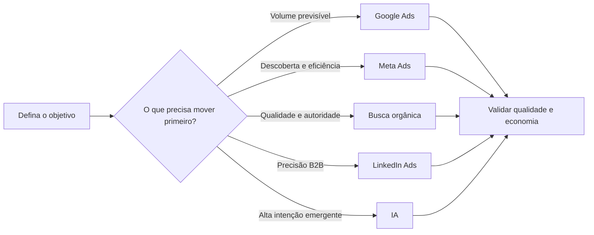
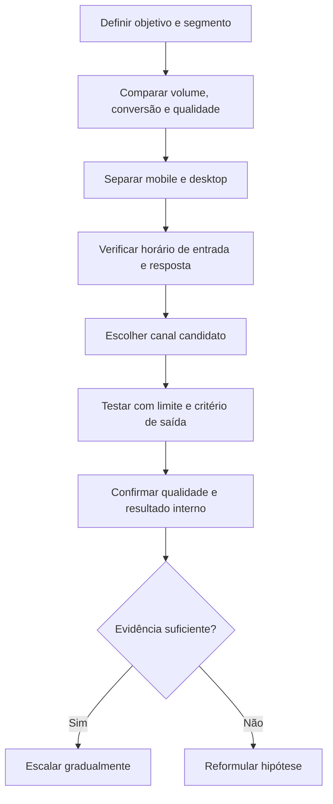

# Panorama PRO 2026: guia estratégico de canais e geração de leads

> Uso: Leitura estratégica do Sarden sobre o Panorama de Geração de Leads PRO 2026 (Leadster): posição e trajetória de cada canal (Google Ads, Meta Ads, LinkedIn Ads, busca orgânica, IA), dispositivo e horário, matriz de 17 segmentos, decisões de portfólio e plano de 30 dias. Fonte única declarada: o PDF do estudo, com página citada. Tabelas de benchmark em `00_susano/referencias/benchmarks/panorama_2026.md`.

> **Documento executivo e operacional | versão 1.0 | julho de 2026**
>
> **Público:** lideranças e equipes de Marketing, Growth, Mídia, Conteúdo, Revenue Operations e Vendas.
>
> **Fonte exclusiva:** *Panorama de Geração de Leads PRO 2026*, publicado pela Leadster. Todo dado, caso e opinião atribuída vêm desse PDF; nenhuma fonte externa foi incorporada.
>
> **Recorte temporal:** os dados foram coletados ao longo de 2025; “2026” é o ano da edição do estudo. (Panorama PRO 2026, p. 6)

> **Tese central**
>
> O estudo não revela um único “melhor canal”. Ele mostra um portfólio em que **Google Ads concentra escala**, **Meta Ads combina alcance e conversão**, **busca orgânica preserva qualidade enquanto perde volume**, **LinkedIn Ads oferece precisão B2B com baixa escala atribuída** e **IA estreia com conversão excepcional, mas participação mínima**. A decisão correta depende do objetivo: capturar demanda, criá-la, qualificar melhor, alcançar um decisor específico ou construir autoridade. (Panorama PRO 2026, pp. 26, 43, 58, 70, 87 e 101)

> **Regra de leitura**
>
> Benchmark não é meta automática. Os resultados descrevem uma população observada e ajudam a localizar uma operação no mercado. Antes de alterar orçamento, compare canal, segmento, dispositivo, volume, conversão e qualidade - e trate como hipótese qualquer explicação que o relatório não tenha testado causalmente.

## 1. Como usar este guia

Este documento converte o Panorama PRO em uma leitura humana, explicativa e orientada a decisão. A intenção não é reproduzir as 107 páginas do estudo nem transformar uma mediana em receita universal. O objetivo é responder cinco perguntas práticas:

1. **O que realmente mudou no mapa de canais em 2026?**
2. **Qual função cada canal desempenha melhor?**
3. **Como equilibrar volume, conversão e qualidade sem escolher uma métrica isolada?**
4. **Como dispositivo, horário e segmento alteram a decisão?**
5. **Quais ações podem ser iniciadas nos próximos 30 dias sem extrapolar o que a fonte permite concluir?**

### 1.1 Três níveis de leitura

**Leitura executiva:** comece pelas seções 2, 4 e 13. Elas sintetizam as mudanças, o tabuleiro competitivo e as decisões de portfólio.

**Leitura por canal:** vá diretamente às seções 6 a 10. Cada capítulo explica posição, trajetória, adequação, limites e perguntas de diagnóstico.

**Leitura operacional:** use as seções 11, 12 e 14 para revisar experiência por dispositivo, cobertura fora do expediente, diferenças entre os 17 segmentos e um plano de 30 dias.

### 1.2 Convenção de evidência

Para preservar o limite da fonte única, este guia adota quatro rótulos implícitos:

- **Dado publicado:** número ou afirmação apresentada no Panorama PRO, sempre acompanhada de página.
- **Opinião do especialista:** interpretação atribuída aos participantes do estudo; não é tratada como comprovação estatística.
- **Leitura operacional:** síntese construída a partir de dados publicados, apresentada como implicação e não como fato causal.
- **Pergunta de gestão:** questão que a empresa deve responder com os próprios dados antes de agir.

> **O que este guia não contém**
>
> O guia não adiciona automações nem benchmarks externos de CPC, CPL, CAC, receita ou LTV, pois essas métricas não são padronizadas na fonte utilizada.

## 2. Resumo executivo - o mapa mudou, mas não virou de cabeça para baixo

O Panorama PRO retrata uma transição, não uma substituição instantânea. Google Ads continua sendo a maior fonte de leads entre os canais analisados, com 26,85% do total. A busca orgânica continua sendo a maior porta de entrada, com 27,91% dos acessos, e a maior em qualidade, com 44,51% de leads qualificados. Meta Ads cresce em tráfego e em leads, converte 3,91% e transforma uma fatia de 9,48% dos acessos em 15,83% dos leads. A IA aparece com 7,80% de conversão, mas responde por apenas 0,10% do tráfego e 0,25% dos leads. LinkedIn Ads ocupa 0,10% dos acessos e 0,03% dos leads, numa posição de baixa escala atribuída. (Panorama PRO 2026, pp. 13, 17-19, 43, 58, 70, 87 e 101)

Isso produz uma conclusão importante: **o canal com a maior taxa de conversão não é o canal com a maior escala, e o canal com a maior escala não é o canal com a maior qualidade**. A decisão de investimento precisa começar pelo resultado que se deseja produzir.

### 2.1 Sete mensagens que uma liderança deve reter

1. **A conversão mediana voltou a subir, mas parte do movimento pode ser composição.** A taxa geral passou de 2,98% em 2025 para 3,07% em 2026. Meta, Google, LinkedIn e orgânico subiram, enquanto acesso direto caiu. O próprio relatório adverte que a perda de tráfego orgânico de baixa intenção pode elevar a taxa sem que cada empresa tenha melhorado sua capacidade de converter. (Panorama PRO 2026, pp. 11-12)
2. **O pódio depende da métrica.** IA lidera conversão; orgânico lidera qualidade; Google lidera volume de leads; Meta tem forte eficiência entre participação em acessos e participação em leads; LinkedIn se diferencia mais pela capacidade de segmentação do que pela escala observada. (Panorama PRO 2026, pp. 13, 19, 26, 43, 58, 70, 87 e 101)
3. **A busca orgânica encolhe de forma material, e a lente muda a conclusão.** Em participação, o tráfego caiu 14,79 pontos percentuais entre 2024 e 2026, enquanto os leads recuaram 8,09 pontos; nessa lente, a perda de share foi maior em tráfego. Em volume absoluto, os acessos caíram aproximadamente 23,00% e os leads, 35,09%; nessa lente, a perda foi maior em leads. A página 81 interpreta parte do desaparecimento como cauda longa de baixa intenção absorvida pela IA, mas essa é uma leitura editorial, não um efeito causal demonstrado. (Panorama PRO 2026, pp. 76, 79 e 81; percentuais calculados a partir dos volumes publicados)
4. **Meta ganha presença, mas o avanço de visitas superou o de leads.** O canal passou de 10,86 milhões de acessos em 2025 para 16,46 milhões em 2026, avanço descrito como 52%; os leads passaram de 511 mil para 537 mil, alta de 5%. A relação entre participação em leads e em tráfego, embora ainda favorável, diminuiu de aproximadamente 2 vezes para 1,67 vez. (Panorama PRO 2026, pp. 50, 53 e 55)
5. **O mobile é o ambiente padrão, com uma exceção relevante.** Meta, LinkedIn, Google e orgânico recebem a maioria dos acessos no celular. A IA destoa: 83,66% de seus acessos estão no desktop. Mesmo assim, o mobile representa 38,01% dos leads de IA com apenas 16,34% de seus acessos, sugerindo uma participação desproporcional na geração de leads dentro desse canal. (Panorama PRO 2026, pp. 21-22 e 100)
6. **O pipeline continua fora do relógio do time comercial.** O estudo classifica 43,8% dos leads como gerados entre 18h e 8h ou em fins de semana. IA, orgânico e acesso direto ficam próximos de 48%, acima do tráfego pago agregado. (Panorama PRO 2026, pp. 23 e 99)
7. **Segmento muda a resposta.** Google lidera o volume de leads em 15 dos 17 segmentos na matriz geral; Meta lidera conversão em nove; orgânico lidera conversão em um e se destaca em qualificação; acesso direto aparece como líder de conversão ou qualidade em casos específicos. O relatório torna inadequado transportar uma conclusão geral para todo mercado sem olhar o setor. (Panorama PRO 2026, p. 28)

### 2.2 O que mudou na prática

O portfólio deixou de ser bem descrito por uma oposição simples entre mídia paga e SEO. O próprio estudo separa funções:

- Google Ads captura procura existente e oferece previsibilidade de volume.
- Meta Ads alcança pessoas que ainda não estão buscando e opera descoberta em escala, quase toda mobile.
- Busca orgânica preserva autoridade e qualidade, mas já não entrega o mesmo volume histórico.
- LinkedIn Ads compra precisão sobre cargo, empresa e setor, com pouca escala diretamente atribuída.
- IA favorece presença por citação e autoridade, gerando poucos cliques e leads, porém com alta conversão entre os cliques identificados.

Esses papéis são a síntese apresentada nos scorecards de cada canal. (Panorama PRO 2026, pp. 43, 58, 70, 87 e 101)

> **Decisão executiva sugerida pela leitura do estudo**
>
> Em vez de perguntar “qual canal vence?”, declare primeiro o trabalho a executar: **volume previsível, descoberta, qualidade, precisão B2B ou autoridade**. Só depois compare o canal, sempre dentro do segmento e considerando dispositivo, horário e capacidade de atendimento.

## 3. Metodologia, escopo e limitações

### 3.1 Base analisada

O estudo foi construído a partir de dados coletados pelo chatbot de Marketing Conversacional da Leadster. A base abrange **2.425 sites**, **173 milhões de acessos** e **3,4 milhões de leads** gerados ao longo de 2025. Os dados são apresentados como anônimos. O relatório também informa que alguns números da edição “normal” reaparecem no PRO para sustentar uma narrativa mais aprofundada. (Panorama PRO 2026, pp. 2 e 6)

Isso significa que o Panorama PRO é uma análise da população observada na tecnologia do realizador, não um censo de todos os sites brasileiros. O tamanho da base é expressivo, mas não elimina possíveis diferenças de perfil entre empresas que usam e que não usam o mecanismo de coleta.

### 3.2 Três faixas de performance

Como o estudo não adota uma taxa universal de conversão, ele organiza resultados em três níveis:

- **Alta performance:** apresentada como norte para metas e objetivos.
- **Média performance:** utilizada como benchmark de mercado.
- **Baixa performance:** tratada como sinal para revisão da estratégia.

A lógica é especialmente útil porque mostra a dispersão dentro de cada canal. Em 2026, por exemplo, a IA varia de 5,54% na faixa baixa a 13,52% na alta; Meta de 0,94% a 13,70%; Google de 1,27% a 8,02%; LinkedIn de 0,15% a 18,30%; orgânico de 0,81% a 6,03%. A distância entre extremos é tão importante quanto a mediana. (Panorama PRO 2026, pp. 6, 9, 31, 45, 60, 72 e 89)

### 3.3 O que “conversão” e “qualidade” significam nesta leitura

O relatório apresenta a conversão por canal como mediana e a qualidade por uma distribuição de leadscore. Na visão geral, os leads classificados entre 4 e 5 são “qualificados”; de 2 a 3, “medianos”; de 0 a 1, “desqualificados”. A própria fonte ressalta que a régua é definida por cada empresa. Portanto, a comparação de qualidade reflete critérios locais que podem variar em amplitude e rigor. (Panorama PRO 2026, pp. 13-15)

Uma taxa maior de qualificados não equivale automaticamente a maior receita. O estudo não apresenta, de modo padronizado, passagem a oportunidade, venda, margem ou retenção. O leadscore é um indicador intermediário e deve ser tratado como tal.

### 3.4 Quatro cuidados antes de transformar o benchmark em meta

1. **Não confundir mediana com potencial.** A faixa alta mostra que há operações muito acima da mediana, mas não revela se essas operações são comparáveis em marca, oferta, orçamento ou ciclo de compra.
2. **Não confundir correlação com explicação.** Quando tráfego orgânico cai e a conversão geral sobe, o relatório propõe um efeito de composição como leitura plausível; não demonstra experimentalmente que esse seja o único mecanismo. (Panorama PRO 2026, pp. 11-12)
3. **Não comparar qualidade sem alinhar a régua.** Um ICP amplo pode classificar mais leads como adequados. Um ICP estrito pode reduzir a taxa de qualificados mesmo que gere mais valor comercial. Esse risco é explicitamente discutido pelos especialistas. (Panorama PRO 2026, pp. 14-15 e 62)
4. **Não avaliar canais assistidos apenas pelo último clique.** O capítulo de LinkedIn descreve um cenário em que acessos sobem enquanto leads atribuídos caem e sugere que o canal pode atuar antes da conversão final. Essa é uma interpretação de jornada, não uma medição causal de contribuição. (Panorama PRO 2026, pp. 67-68)

> **Limite decisório**
>
> O Panorama PRO permite formular prioridades e perguntas. Ele não fornece sozinho uma justificativa completa para cortar, escalar ou substituir um canal. Essa decisão exige que a organização conecte os benchmarks a custos, oportunidades, vendas e margem próprios.

---

## 4. Benchmarks que estruturam o panorama

### 4.1 Conversão mediana por canal em 2026

| Canal | Baixa performance | Mediana | Alta performance | Leitura principal |
|---|---|---|---|---|
| IA | 5,54% | **7,80%** | 13,52% | maior conversão, volume mínimo |
| Meta Ads | 0,94% | **3,91%** | 13,70% | maior mediana entre os canais pagos consolidados |
| Google Ads | 1,27% | **3,41%** | 8,02% | escala com conversão consistente |
| Geral | 1,02% | **3,07%** | 7,90% | referência agregada |
| LinkedIn Ads | 0,15% | **2,97%** | 18,30% | maior dispersão entre piso e topo |
| Busca orgânica | 0,81% | **2,39%** | 6,03% | conversão estável, com qualidade superior |
| Acesso direto | 0,57% | **1,74%** | 5,64% | menor mediana da comparação geral |

Fonte: Panorama PRO 2026, p. 9.

A tabela rejeita duas leituras apressadas. Primeiro, IA e LinkedIn apresentam topo muito alto, mas isso não basta para inferir escala reproduzível. Segundo, Meta e Google têm medianas próximas, mas papéis distintos: Meta opera descoberta e Google captura intenção. A escolha precisa considerar o objetivo antes de comparar apenas 3,91% contra 3,41%.

### 4.2 Evolução das medianas de 2024 a 2026

| Canal | 2024 | 2025 | 2026 | Movimento 2025-2026 |
|---|---|---|---|---|
| Meta Ads | 3,69% | 3,40% | 3,91% | recuperação |
| Google Ads | 3,22% | 3,28% | 3,41% | terceira alta anual |
| Geral | 3,15% | 2,98% | 3,07% | reação moderada |
| LinkedIn Ads | 2,32% | 1,88% | 2,97% | maior salto percentual |
| Busca orgânica | 2,37% | 2,32% | 2,39% | estabilidade |
| Acesso direto | 2,39% | 2,08% | 1,74% | queda contínua |

Fonte: Panorama PRO 2026, p. 11.

O relatório afirma que todos os canais listados, exceto acesso direto, melhoraram de 2025 para 2026. O dado deve ser lido com a ressalva de composição: a saída de visitas menos propensas a converter pode elevar a taxa, mesmo sem ganho equivalente em eficácia dentro de cada empresa. (Panorama PRO 2026, pp. 11-12)

### 4.3 Qualidade dos leads

| Canal | Desqualificados | Medianos | Qualificados |
|---|---|---|---|
| Busca orgânica | 28,8% | 26,7% | **44,5%** |
| Geral | 27,7% | 29,4% | **42,9%** |
| IA | 24,4% | 35,4% | **40,2%** |
| Google Ads | 33,1% | 26,8% | **40,1%** |
| Meta Ads | 27,0% | 33,3% | **39,7%** |
| Acesso direto | 28,3% | 34,0% | **37,7%** |
| LinkedIn Ads | 40,2% | 24,7% | **35,1%** |

Fonte: Panorama PRO 2026, p. 13. Valores exibidos com uma casa decimal conforme a visão geral.

O orgânico lidera a proporção de leads qualificados, enquanto a IA apresenta a menor taxa de desqualificados. LinkedIn fica por último em qualificação agregada, apesar da precisão de segmentação que caracteriza a plataforma. Os especialistas do relatório apontam que diferenças na definição de “qualificado” podem alterar o ranking, sobretudo quando empresas que usam determinado canal aplicam réguas mais exigentes. (Panorama PRO 2026, pp. 13-15 e 61-62)

### 4.4 Participação em acessos e leads

| Canal | Participação nos acessos | Participação nos leads | Relação observada |
|---|---|---|---|
| Busca orgânica | 27,91% | 16,11% | maior peso em acesso do que em lead |
| Google Ads | 23,40% | 26,85% | participação em leads supera a de acessos |
| Meta Ads | 9,48% | 15,83% | forte diferença favorável a leads |
| IA | 0,10% | 0,25% | fatia de leads 2,5 vezes a de acessos |
| LinkedIn Ads | 0,10% | 0,03% | participação em leads abaixo da de acessos |

Fonte: Panorama PRO 2026, p. 19.

Essa comparação é um indicador descritivo de eficiência de entrada, não uma medida de rentabilidade. Ela não considera custo por clique, custo por lead, qualificação posterior ou receita. Ainda assim, mostra por que um canal pode parecer pequeno em tráfego e relevante em geração de leads - ou o contrário.

---

## 5. O tabuleiro de três dimensões: volume, conversão e qualidade

A matriz central do Panorama cruza conversão no eixo horizontal, qualidade no vertical e volume de leads no tamanho da bolha. Google representa 27% do volume, orgânico 16%, Meta 16%, acesso direto 7% e IA 0,2%; a marcação de IA aparece como direcional. Visualmente, Google ocupa a maior escala, orgânico sobe em qualidade, Meta combina conversão e qualificação e IA aparece no extremo de conversão com uma bolha muito pequena. (Panorama PRO 2026, p. 26)

*Mapa decisório derivado dos papéis descritos nos scorecards dos canais. Fonte: Panorama PRO 2026, pp. 43, 58, 70, 87 e 101.*

### 5.1 Por que uma única métrica produz decisões ruins

**Se a empresa otimizar apenas conversão**, tenderá a supervalorizar IA, mesmo que o canal responda por somente 0,25% dos leads observados.

**Se otimizar apenas volume**, tenderá a concentrar Google, ignorando diferenças de qualidade, criação de demanda e influência de canais anteriores ao clique final.

**Se otimizar apenas qualidade**, poderá favorecer orgânico sem considerar a contração de tráfego e a necessidade de repor escala.

**Se otimizar apenas participação de tráfego**, poderá interpretar o orgânico como o principal motor de resultado, embora sua fatia de leads seja bem menor que a de acessos.

Essas quatro leituras decorrem diretamente da matriz e das participações publicadas. (Panorama PRO 2026, pp. 18-19 e 26)

### 5.2 Perguntas para uma decisão equilibrada

- O problema atual é falta de procura, falta de captura, baixa conversão ou baixa qualidade?
- A empresa precisa de resultado rápido e previsível ou pode construir autoridade no tempo?
- O decisor é amplo o suficiente para descoberta algorítmica ou exige segmentação corporativa precisa?
- A experiência mobile está pronta para o canal que se pretende escalar?
- Existe atendimento quando os leads realmente chegam?
- A régua de lead qualificado é consistente entre canais?
- O canal recebe crédito por último clique ou participa de uma jornada mais longa?

> **Princípio de portfólio**
>
> Um canal pode criar demanda, outro capturá-la, um terceiro educar e um quarto receber o crédito final. A matriz orienta onde cada canal parece mais forte; a empresa ainda precisa observar como esses papéis se conectam na própria jornada.

## 6. Google Ads - a base de volume e captura de intenção

### 6.1 Posição no panorama

| Indicador | Resultado 2026 | Posição no scorecard do estudo |
|---|---|---|
| Conversão mediana | 3,41% | 3º de 5; líder de conversão em 7 de 17 segmentos |
| Participação no tráfego | 23,40% | 2º de 5 |
| Participação nos leads | 26,85% | 1º de 5; líder de volume em 15 de 17 segmentos |
| Leads qualificados | 40,08% | 3º de 5; líder de qualidade em 6 de 17 segmentos |

Fonte: Panorama PRO 2026, p. 43.

O Google é descrito como a base segura da aquisição. Seu principal atributo não é vencer todas as métricas, mas combinar uma conversão acima da mediana geral com a maior participação de leads entre os canais analisados. A fatia de leads supera a de acessos, 26,85% contra 23,40%, o que indica que o canal gera resultado acima do próprio peso de entrada na amostra. (Panorama PRO 2026, pp. 19, 39 e 43)

### 6.2 Trajetória: conversão sobe, participação recua

A conversão mediana avançou em três anos consecutivos: 3,22% em 2024, 3,28% em 2025 e 3,41% em 2026. No mesmo período, a faixa de alta performance chegou a 8,02%, enquanto a baixa ficou em 1,27%. A dispersão mostra que operar Google Ads não garante um patamar: oferta, página, intenção e execução separam operações próximas de 1% das que superam 8%. (Panorama PRO 2026, p. 31)

Em tráfego, o movimento foi diferente. A participação passou de 25,20% em 2024 para 27,48% em 2025 e recuou a 23,40% em 2026. Os acessos foram 37,14 milhões, 45,93 milhões e 40,63 milhões, respectivamente. O canal continua como a segunda maior fonte de entrada, atrás do orgânico, mas terminou 2026 abaixo do pico do ano anterior. (Panorama PRO 2026, p. 35)

Em leads, o Google saiu de 884.677 em 2024 para 1.046.572 em 2025 e 911.386 em 2026. A participação seguiu o mesmo desenho: 25,40%, 28,15% e 26,85%. Portanto, o canal recuou em relação a 2025, mas preservou a liderança. Em 2026, a diferença favorável entre share de leads e share de acessos ficou em 3,45 pontos percentuais. (Panorama PRO 2026, pp. 37 e 39)

### 6.3 O segmento altera conversão e qualidade

A conversão do Google varia de 1,49% em Imóveis a 6,63% em Energia. O relatório associa resultados acima da média a alguns setores de ticket alto e jornada técnica, como Energia, Seguros e Jurídico, enquanto Imóveis e Software aparecem abaixo. Essa leitura é descritiva e setorial; não implica que ticket ou duração da jornada sejam, isoladamente, a causa do resultado. (Panorama PRO 2026, p. 33)

A qualificação vai de 19,53% em Seguros a 75,55% em Educacional, com 40,08% no agregado do canal. O contraste de Seguros é didático: o setor está entre os que mais convertem no Google, mas entre os que menos qualificam. Uma operação que observa só o formulário pode interpretar como sucesso o que o leadscore do próprio estudo descreve como inadequação. (Panorama PRO 2026, pp. 33-34)

Google é o maior gerador de leads em 15 dos 17 segmentos. As exceções são Educacional, liderado pelo orgânico, e Consultorias, liderado pelo Meta. Em Marketing, a participação de leads do Google chega a 48,18%; em Energia, a 43,85%. (Panorama PRO 2026, p. 38)

### 6.4 Dispositivo: o desktop vale mais do que seu tamanho

Em 2026, o mobile respondeu por 83,18% dos acessos de Google e 72,32% dos leads. O desktop teve apenas 16,82% dos acessos, mas 27,68% dos leads. A conversão ajuda a explicar a diferença: 4,30% no desktop contra 3,17% no mobile. A vantagem diminuiu em relação a 2025, quando as taxas eram 4,95% e 3,03%, mas continuou material. (Panorama PRO 2026, pp. 41-42)

**Leitura operacional:** mobile é o ambiente de escala; desktop ainda concentra uma propensão maior à conversão. A equipe deve avaliar a jornada de cada tela separadamente, sem usar a média do canal para esconder uma perda mobile.

### 6.5 Quando priorizar e quando questionar

O scorecard recomenda Google quando há demanda procurando o produto, é necessário volume previsível e o objetivo é fundo de funil. Sugere cautela para categorias novas sem busca, orçamentos curtos que dependem de CPC baixo e objetivos de criação de demanda. (Panorama PRO 2026, p. 43)

**Checklist de gestão para Google Ads**

- A categoria já tem procura observável ou a empresa tenta capturar uma demanda que ainda não existe?
- O ganho de volume preserva a proporção de leads qualificados?
- A página mobile explica a diferença para o desktop?
- Segmentos, termos e ofertas com maior conversão também produzem qualidade?
- O canal está sendo avaliado pelo volume que entrega ou pela receita que a empresa precisa confirmar internamente?

## 7. Meta Ads - descoberta e eficiência em ambiente mobile

### 7.1 Posição no panorama

| Indicador | Resultado 2026 | Posição no scorecard do estudo |
|---|---|---|
| Conversão mediana | 3,91% | 2º de 5; líder em 9 de 17 segmentos |
| Participação no tráfego | 9,48% | 3º de 5 |
| Participação nos leads | 15,83% | 3º de 5; líder de volume em 1 de 17 segmentos |
| Leads qualificados | 39,72% | 4º de 5; líder de qualidade em 6 de 17 segmentos |

Fonte: Panorama PRO 2026, p. 58.

Meta combina duas características: alcança quem ainda não está em busca ativa e converte uma parcela de visitas maior do que seu peso no tráfego sugeriria. Em 2026, 9,48% dos acessos produziram 15,83% dos leads. Isso não demonstra rentabilidade, pois o relatório não padroniza custo, mas confirma eficiência relativa na passagem observada de acesso a lead. (Panorama PRO 2026, pp. 19 e 53-55)

### 7.2 Recuperação da conversão e abertura do topo

A conversão mediana foi de 3,69% em 2024, 3,40% em 2025 e 3,91% em 2026. A faixa de alta performance saltou de 10,47% para 13,70% no último ano, enquanto a baixa permaneceu em 0,94%. A distância crescente entre operações fortes e fracas sinaliza que o benchmark central não resume a variedade de execução. (Panorama PRO 2026, p. 45)

O relatório atribui parte do amadurecimento do canal, em opinião de especialista, a dois movimentos: uso de APIs de conversão para devolver eventos do servidor e maior automação algorítmica de público, com o criativo assumindo papel mais central. Essa explicação é qualitativa; o Panorama não isola o efeito causal de CAPI, Advantage+ ou criativo sobre a alta de conversão. (Panorama PRO 2026, pp. 46-47)

### 7.3 Crescimento de tráfego maior que o de leads

Meta passou de 7,53 milhões de acessos em 2024 para 10,86 milhões em 2025 e 16,46 milhões em 2026. A participação subiu de 5,11% para 6,50% e 9,48%. O relatório ressalta que esse recorte inclui Meta Ads, mas não o alcance orgânico de Instagram e Facebook. (Panorama PRO 2026, p. 50)

Os leads cresceram de 365.650 em 2024 para 511.074 em 2025 e 537.455 em 2026. Entre 2025 e 2026, o tráfego aumentou 52% e os leads, 5%. A relação entre share de leads e de acessos permaneceu favorável, mas caiu de cerca de 2 vezes para 1,67 vez. Esse é o principal sinal de atenção: Meta ampliou sua superfície de entrada muito mais rapidamente do que o resultado em leads. (Panorama PRO 2026, pp. 53 e 55)

### 7.4 Força B2B em conversão, variação em qualidade

O Meta lidera conversão em parte relevante do B2B: Jurídico chega a 10,12%, Agência a 6,65%, Tecnologia a 5,71%, Indústria a 4,97% e Software a 4,27%. Na outra ponta, Consultoria fica em 1,23% e Imóveis em 1,60%. O relatório observa que, quando Meta supera Google em conversão, isso ocorre com frequência em segmentos B2B. (Panorama PRO 2026, p. 48)

A taxa de qualificados varia de 10% a 87,97%. O ponto cego está em setores nos quais a conversão é forte, mas a qualidade pode ser baixa, incluindo Software, Tecnologia, Agência e Marketing. Em contraste, Meta lidera qualidade em Energia, Imóveis, Saúde, Seguros, Venda de Produtos e Jurídico segundo o capítulo específico. (Panorama PRO 2026, p. 49)

Em volume, Consultorias é o único segmento em que Meta ocupa o primeiro lugar, com 56,39% dos leads. O canal também tem participação relevante em Venda de Serviços, 23,79%; Software, 21,78%; Financeiro, 19,94%; e Tecnologia, 18,48%. (Panorama PRO 2026, p. 54)

### 7.5 Canal quase integralmente mobile

Meta concentrou 91,84% dos acessos e 98,42% dos leads no mobile em 2026. A conversão de desktop caiu de 5,35% em 2024 para 4,07% em 2026; a mobile passou de 3,91% para 3,61% e voltou a 4,07%. Os dois dispositivos terminaram empatados, eliminando a vantagem que o desktop tinha. (Panorama PRO 2026, pp. 56-57)

O dado muda a prioridade de experiência: para Meta, mobile não é apenas o maior dispositivo, é praticamente todo o canal em geração de leads.

### 7.6 Quando priorizar e quando questionar

O estudo posiciona Meta para alcance de pessoas que ainda não buscam, alimentação de topo e meio de funil e operações com experiência mobile pronta. Recomenda cautela quando o decisor é muito nichado, a equipe não tem capacidade de produzir criativos ou o atendimento funciona apenas em horário comercial. (Panorama PRO 2026, p. 58)

**Checklist de gestão para Meta Ads**

- A expansão de tráfego está preservando a participação de leads qualificados?
- O time consegue produzir e renovar criativos no ritmo exigido pelo canal?
- A página, formulário e conversa funcionam sem atrito no celular?
- O evento devolvido à plataforma representa apenas lead ou também adequação?
- Segmentos com alta conversão apresentam qualidade suficiente para justificar escala?

## 8. LinkedIn Ads - precisão B2B com baixa escala atribuída

### 8.1 Posição no panorama

| Indicador | Resultado 2026 | Posição no scorecard do estudo |
|---|---|---|
| Conversão mediana | 2,97% | 4º de 5 |
| Participação no tráfego | 0,10% | 4º de 5 |
| Participação nos leads | 0,03% | 5º de 5 |
| Leads qualificados | 35,13% | 5º de 5 |

Fonte: Panorama PRO 2026, p. 70.

O LinkedIn é descrito como um canal de precisão cara para B2B. Ele não compete com Google em volume nem com Meta em escala, mas permite segmentar cargo, empresa e setor. O valor proposto está na exatidão do público, especialmente em produtos de ticket alto, ciclos longos e campanhas por conta. (Panorama PRO 2026, pp. 59 e 70)

### 8.2 Uma distribuição extremamente desigual

A mediana de conversão passou de 2,32% em 2024 para 1,88% em 2025 e 2,97% em 2026. O topo chegou a 18,30%, enquanto a base caiu para 0,15%. Nenhum outro canal do comparativo reúne um piso tão baixo e uma faixa alta tão elevada. O mesmo ambiente pode ser residual para uma empresa e muito eficiente para outra. (Panorama PRO 2026, p. 60)

Em qualidade, 35,13% dos leads são classificados como qualificados. O capítulo apresenta dados setoriais para apenas três segmentos: Financeiro, 65,35%; Venda de Serviços, 35,53%; e Software, 29,38%. O próprio relatório alerta, por meio de opiniões, que a régua de qualificação pode ser mais restrita entre empresas maduras que investem no canal. (Panorama PRO 2026, pp. 61-62)

### 8.3 Mais acessos, menos leads atribuídos

Os acessos cresceram de 107.747 em 2024 para 144.496 em 2025 e 181.936 em 2026. A participação foi de 0,07%, 0,09% e 0,10%. Mesmo nos setores de maior presença, o canal não chega a 1% do tráfego: Logística tem 0,52%, Financeiro 0,46%, Marketing 0,40% e Telefonia 0,31%. (Panorama PRO 2026, pp. 63-64)

Os leads atribuídos fizeram o movimento oposto: 6.194 em 2024, 1.717 em 2025 e 1.183 em 2026, reduzindo a participação de 0,18% para 0,03%. Software é o segmento com maior peso de leads de LinkedIn, ainda assim com apenas 0,17%. (Panorama PRO 2026, pp. 65-66)

O relatório interpreta a combinação como possível sinal de influência anterior ao clique final em jornadas B2B. Um especialista descreve relações digitais que podem durar 24 meses antes de uma conversão registrada em outro canal. Essa é uma explicação qualitativa sobre atribuição, não uma quantificação de impacto assistido. (Panorama PRO 2026, pp. 67-68)

### 8.4 Mobile passou a dominar também os leads

Em 2024, 61,82% dos acessos eram mobile, mas apenas 36% dos leads. Em 2026, o mobile alcançou 89,59% dos acessos e 64,58% dos leads. O consumo já era majoritariamente móvel; agora a conversão atribuída também se deslocou para o celular. (Panorama PRO 2026, p. 69)

### 8.5 Quando priorizar e quando questionar

LinkedIn é indicado no relatório para B2B de ticket alto, ciclo longo, segmentação precisa e ABM. O estudo sugere pensar duas vezes em produtos de ticket baixo, orçamento curto dependente de clique barato e operações cujo sucesso é medido somente por volume de leads. (Panorama PRO 2026, p. 70)

> **Cuidado com dois erros opostos**
>
> O primeiro é declarar que LinkedIn “não funciona” porque o último clique mostra poucos leads. O segundo é assumir que todo o valor ausente é influência assistida. O Panorama levanta a hipótese de jornada longa; a empresa precisa medi-la antes de justificar investimento.

## 9. Busca orgânica - menos tráfego, qualidade preservada

### 9.1 Posição no panorama

| Indicador | Resultado 2026 | Posição no scorecard do estudo |
|---|---|---|
| Conversão mediana | 2,39% | 5º de 5; líder em 1 de 17 segmentos |
| Participação no tráfego | 27,91% | 1º de 5; liderança setorial indicada em 3 de 17 no scorecard |
| Participação nos leads | 16,11% | 2º de 5; líder em 1 de 17 segmentos |
| Leads qualificados | 44,51% | 1º de 5; scorecard indica liderança em 4 de 17 |

Fonte: Panorama PRO 2026, p. 87. As divergências entre o scorecard e páginas internas são tratadas na seção 15.

O orgânico mantém um papel de autoridade e qualidade, mas deixou de ser a máquina de volume que já foi. A conversão permaneceu praticamente estável, enquanto tráfego e leads perderam participação. O estudo interpreta esse movimento como troca de volume por qualidade e como migração de parte da educação do cliente para ambientes de IA. (Panorama PRO 2026, pp. 71-72, 76, 79, 81 e 87)

### 9.2 Estabilidade de conversão

A mediana foi de 2,37% em 2024, 2,32% em 2025 e 2,39% em 2026. As faixas baixa e alta também mudaram pouco: 0,82% e 6,04% em 2024; 0,81% e 6,03% em 2026. Por segmento, a conversão vai de 0,65% em Consultoria a 3,64% em Agência. Marketing é o único setor em que o orgânico lidera conversão na matriz geral. (Panorama PRO 2026, pp. 72-73 e 28)

### 9.3 Liderança em qualidade

O orgânico registra 44,51% de leads qualificados, maior valor entre os canais. No capítulo setorial, lidera Software, 37,97%; Tecnologia, 48,80%; e Financeiro, 68,03%. A fonte atribui o resultado ao fato de o visitante chegar após pesquisar, comparar e resolver parte das dúvidas. Essa explicação é a narrativa do relatório e não um teste do mecanismo de educação. (Panorama PRO 2026, p. 74)

### 9.4 Duas lentes para a queda

Em participação, o tráfego orgânico passou de 42,70% em 2024 para 27,91% em 2026, queda de 14,79 pontos percentuais. Os leads passaram de 24,20% para 16,11%, queda de 8,09 pontos. Nessa lente de share, o orgânico perdeu mais espaço em tráfego do que em leads. (Panorama PRO 2026, pp. 76, 79 e 81)

Em volume absoluto, porém, os acessos caíram de 62.935.287 para 48.459.258, redução aproximada de 23,00%, enquanto os leads recuaram de 842.737 para 546.988, redução aproximada de 35,09%. Nessa lente, os leads caíram mais. As duas afirmações podem coexistir porque o total do mercado e o mix de canais também mudaram. O texto editorial da página 81 descreve a perda como saída de uma “cauda longa” de baixa intenção absorvida pela IA, mas isso deve ser tratado como interpretação da fonte, não fato causal demonstrado. (Panorama PRO 2026, pp. 76, 79 e 81; percentuais calculados a partir dos volumes publicados)

Educacional ainda recebe 55,70% do tráfego e 45,46% dos leads pelo orgânico. Consultoria tem 49,65% do tráfego orgânico e Saúde, 37,70%. Esses bolsões mostram que a contração agregada não elimina a liderança setorial. (Panorama PRO 2026, pp. 78 e 80)

### 9.5 Mobile e fora do expediente

Em 2026, 66,15% dos acessos orgânicos e 50,12% dos leads vieram do mobile. Pela primeira vez, a conversão mobile, 2,51%, superou a desktop, 2,42%. Além disso, 47,76% dos leads orgânicos foram gerados fora do expediente, quase quatro pontos acima da média geral. (Panorama PRO 2026, pp. 83, 85-86)

### 9.6 Quando priorizar e quando questionar

O estudo recomenda orgânico quando o setor ainda depende do canal, a empresa já investe em marca e conteúdo e aceita avaliar autoridade além do tráfego. Sugere cautela quando é necessário volume rápido e previsível, a estratégia depende apenas de conteúdo genérico de “como fazer” ou a categoria é nova e ainda não tem demanda estabelecida. (Panorama PRO 2026, p. 87)

**Checklist de gestão para busca orgânica**

- A queda está em consultas de marca, páginas comerciais ou conteúdo informacional?
- O share de tráfego e o volume absoluto contam a mesma história?
- A maior qualidade compensa a perda de leads em volume?
- A experiência mobile sustenta o novo equilíbrio do canal?
- O conteúdo produz informação citável e autoridade, ou repete respostas genéricas?

---

## 10. Inteligência artificial - alta conversão, escala mínima e atribuição incompleta

### 10.1 Posição no panorama

| Indicador | Resultado 2026 | Posição no scorecard do estudo |
|---|---|---|
| Conversão mediana | 7,80% | 1º de 5 |
| Participação no tráfego | 0,10% | 5º de 5 |
| Participação nos leads | 0,25% | 4º de 5 |
| Leads qualificados | 40,22% | 2º de 5; líder em 1 de 17 segmentos |

Fonte: Panorama PRO 2026, p. 101.

A IA estreia como o canal de maior contraste: converte mais que o dobro da mediana geral, mas representa apenas uma fração da aquisição. Sua faixa baixa é 5,54%, a mediana 7,80% e a alta 13,52%. A comparação deve permanecer proporcional: taxa excepcional sobre 170.486 acessos e 8.352 leads não substitui a escala de Google, Meta ou orgânico. (Panorama PRO 2026, pp. 89, 91 e 96)

### 10.2 Qualidade e concentração por segmento

A IA tem 24,4% de leads desqualificados, menor taxa entre os canais, e 40,22% de qualificados, atrás apenas do orgânico. Educacional chega a 60,42% de qualificados, Consultoria a 59,21%, Seguros a 53,57% e Venda de Serviços a 52,46%. O capítulo afirma que IA lidera a qualidade em Venda de Serviços. (Panorama PRO 2026, p. 90)

O tráfego de IA é mais presente em Energia, 0,30%; Agência, 0,28%; Software e Consultoria, 0,24% cada; e Tecnologia, 0,22%. Em leads, Energia chega a 0,70%, Consultoria a 0,48%, Indústria a 0,39% e Software e Tecnologia a 0,37% cada. Mesmo nos segmentos de maior presença, as participações continuam pequenas. (Panorama PRO 2026, pp. 95 e 97)

### 10.3 ChatGPT concentra o referral identificável

ChatGPT responde por 78,36% dos acessos vindos de ferramentas de IA. Em seguida aparecem Perplexity, 8,42%; Gemini, 5,87%; Copilot, 3,77%; [x.ai](http://x.ai), 1,62%; DeepSeek, 1,16%; Claude, 0,62%; Grok, 0,10%; Poe, 0,09%; e Heypi, 0,01%. O recorte mede tráfego que chegou ao site e foi identificado, não toda exposição a respostas de IA sem clique. (Panorama PRO 2026, pp. 92-93)

O estudo enfatiza justamente essa limitação: em opinião de especialista, a função principal da IA é responder dentro da conversa, e não enviar visita ao site. Por isso, o referral tende a subestimar a presença de uma marca nas respostas e a influência sem clique. (Panorama PRO 2026, p. 92)

### 10.4 Eficiência descritiva e comparação com LinkedIn

IA responde por 0,10% dos acessos e 0,25% dos leads. A fatia de leads é 2,5 vezes a de tráfego. Os 8.352 leads são quase sete vezes os 1.183 atribuídos ao LinkedIn Ads, embora ambos tenham 0,10% de participação no tráfego arredondado. Essa relação descreve a amostra; não compara custo, ticket ou receita. (Panorama PRO 2026, pp. 96 e 98)

### 10.5 Um canal desktop com lead mobile desproporcional

IA é a exceção ao domínio mobile: 83,66% de seus acessos ocorrem no desktop e 16,34% no mobile. Nos leads, a distribuição muda para 61,99% desktop e 38,01% mobile. Assim, o mobile entrega mais que o dobro de sua participação em acessos quando se observa participação em leads dentro do canal. (Panorama PRO 2026, p. 100)

Também é o canal com maior proporção fora do expediente, 47,98%, seguido de perto pelo orgânico, 47,76%, e acesso direto, 47,54%. (Panorama PRO 2026, p. 99)

### 10.6 Quando priorizar e quando questionar

O scorecard recomenda IA quando a organização quer construir citação e autoridade, busca leads de alta intenção e atua em venda técnica ou consultiva. Recomenda cautela quando a prioridade é volume rápido e previsível, a decisão depende de atribuição limpa ou o setor tem presença baixa no canal. (Panorama PRO 2026, p. 101)

O relatório também antecipa, como opinião, que mecanismos pagos podem se intensificar dentro das IAs e tornar o acesso futuro mais caro. Isso deve ser lido como cenário do especialista, não como fato estabelecido pelos dados do estudo. (Panorama PRO 2026, p. 94)

> **Leitura correta da IA em 2026**
>
> IA é um sinal estratégico de alta intenção e autoridade emergente, não uma máquina de volume. A prioridade é construir presença mensurável sem apresentar 7,80% como garantia de escala.

## 11. Dispositivo e horário - onde a jornada realmente acontece

Canal não é uma experiência única. O Panorama mostra que a origem pode ter comportamento radicalmente diferente entre mobile e desktop e que uma parcela relevante do pipeline surge quando a equipe não está trabalhando. Essas duas dimensões precisam entrar na decisão desde o diagnóstico.

### 11.1 Participação mobile em acessos e leads

| Canal | Acessos mobile | Leads mobile | O que chama atenção |
|---|---|---|---|
| Meta Ads | 91,84% | 98,42% | quase toda a geração de leads está no celular |
| LinkedIn Ads | 89,59% | 64,58% | acesso e lead tornaram-se majoritariamente mobile |
| Google Ads | 83,18% | 72,32% | desktop pesa mais em leads do que em acessos |
| Busca orgânica | 66,15% | 50,12% | mobile assume, pela primeira vez, a maioria dos leads |
| IA | 16,34% | 38,01% | único canal dominado pelo desktop, mas mobile gera leads acima de seu peso |

Fonte: Panorama PRO 2026, pp. 41, 56, 69, 85 e 100.

A tabela sugere três experiências diferentes. Meta é mobile de ponta a ponta. Google e orgânico têm escala mobile, mas o desktop continua desproporcional na geração de leads. IA começa no computador e termina com uma contribuição mobile maior do que a participação em acessos indicaria. Por isso, “otimizar para mobile” não significa aplicar o mesmo desenho a todos os canais; significa entender a função que a tela exerce em cada origem.

### 11.2 Conversão por dispositivo

No desktop, a IA lidera com 8,73%, seguida de Google com 4,30%, Meta com 4,07%, geral com 3,50%, orgânico com 2,42% e acesso direto com 1,63%. No mobile, Meta lidera com 4,07%, seguido da mediana geral de 3,37%, Google com 3,17%, orgânico com 2,51% e acesso direto com 2,31%. A página comparativa não exibe uma taxa mobile de IA. (Panorama PRO 2026, p. 22)

Dois cruzamentos merecem atenção. Google converte melhor no desktop, embora receba a maior parte do tráfego no celular. Orgânico inverteu sua relação histórica e passou a converter melhor no mobile em 2026. Meta chegou ao mesmo patamar de 4,07% nos dois dispositivos, mas a escala é quase integralmente móvel. (Panorama PRO 2026, pp. 42, 57 e 86)

### 11.3 Leads fora do expediente

| Origem | Leads fora do expediente | Leads dentro do expediente |
|---|---|---|
| IA | 47,98% | 52,02% |
| Busca orgânica | 47,76% | 52,24% |
| Acesso direto | 47,54% | 52,46% |
| Geral | 43,80% | 56,20% |
| Tráfego pago agregado | 42,69% | 57,31% |
| Referência | 42,59% | 57,41% |

O estudo define fora do expediente como o período entre 18h e 8h e os fins de semana. A tabela mostra quando os leads foram gerados; ela não informa se esses leads converteram em venda, qual foi o tempo efetivo de resposta ou quanto custaram. (Panorama PRO 2026, pp. 23 e 99)

> **Implicação operacional**
>
> Uma empresa que atende somente no horário comercial deixa parte substancial do fluxo aguardando. O Panorama sustenta a necessidade de revisar cobertura, roteamento e primeira resposta; a escolha entre plantão humano, automação ou outra solução depende da operação e não é resolvida pelo benchmark.

### 11.4 Auditoria em quatro perguntas

1. Qual canal apresenta a maior distância entre participação mobile e participação em leads?
2. As taxas de conversão por dispositivo preservam a mesma qualidade de lead?
3. Quantos leads chegam fora do expediente em número absoluto, e não apenas em percentual?
4. O processo registra horário de entrada, primeira resposta, qualificação e reunião para permitir uma análise própria?

---

## 12. Matriz dos 17 segmentos - três líderes, três respostas diferentes

A matriz geral identifica, para cada segmento, quem lidera volume de leads, conversão e qualidade. Ela é o antídoto mais direto contra uma recomendação universal de canal: em vários setores, três origens diferentes vencem as três métricas. (Panorama PRO 2026, p. 28)

### 12.1 Matriz publicada

| Segmento | Maior volume de leads | Maior conversão | Mais qualidade |
|---|---|---|---|
| Agências | Google 27,4% | Meta 6,7% | Google 40,1% |
| Consultorias | Meta 56,4% | Google 2,7% | Google 75,1% |
| Educacional | Orgânico 45,5% | Google 2,7% | Google 75,5% |
| Energia | Google 43,8% | Google 6,6% | Google 67,6% |
| Financeiro | Google 24,5% | Meta 6,4% | Orgânico 68,0% |
| Imóveis | Google 25,0% | Direto 2,2% | Meta 73,8% |
| Indústria e Fabricação | Google 34,3% | Meta 5,0% | Direto 44,7% |
| Jurídico | Google 39,1% | Meta 10,1% | Meta 41,8% |
| Logística e Transporte | Google 40,3% | Google 4,3% | Google 23,9% |
| Marketing e Publicidade | Google 48,2% | Orgânico 3,3% | Google 54,5% |
| Seguros | Google 28,6% | Direto 7,8% | Meta 55,2% |
| Serviços Médicos e Saúde | Google 34,1% | Google 4,8% | Meta 57,4% |
| Software | Google 34,5% | Meta 4,3% | Orgânico 38,0% |
| Tecnologia e TI | Google 32,1% | Meta 5,7% | Orgânico 48,8% |
| Telefonia e Internet | Google 30,9% | Google 2,8% | Google 67,4% |
| Venda de Produtos | Google 29,7% | Google 2,4% | Meta 45,4% |
| Venda de Serviços | Google 26,6% | Meta 4,5% | Meta 51,4% |

Fonte: Panorama PRO 2026, p. 28. Conflitos com páginas específicas dos canais são preservados e explicados na seção 15.

### 12.2 Quatro padrões de leitura

**Google domina volume, mas não todas as decisões.** Ele lidera a coluna de volume em 15 segmentos. As exceções são Consultorias, com Meta, e Educacional, com orgânico. Isso torna Google o ponto de partida natural para investigar escala, não uma resposta automática sobre eficiência ou qualidade. (Panorama PRO 2026, p. 28)

**Meta aparece como campeão de conversão em nove segmentos da matriz.** O padrão inclui Agências, Financeiro, Indústria, Jurídico, Software, Tecnologia e Venda de Serviços. Em alguns deles, o orgânico lidera qualidade, criando um desenho em que Meta converte e orgânico entrega adequação. (Panorama PRO 2026, p. 28)

**Acesso direto surge em momentos específicos.** Imóveis e Seguros lideram conversão por acesso direto, enquanto Indústria o apresenta como líder de qualidade. Como “direto” pode reunir diferentes caminhos de chegada, o resultado exige investigação interna de atribuição antes de virar uma recomendação de canal. A própria discussão geral do relatório ressalta essa dificuldade de rastreamento. (Panorama PRO 2026, pp. 15 e 28)

**Orgânico se destaca onde educação e autoridade permanecem fortes.** Lidera volume em Educacional, conversão em Marketing e qualidade em Financeiro, Software e Tecnologia na matriz geral. (Panorama PRO 2026, p. 28)

### 12.3 Como transformar a matriz em uma decisão local

Para cada segmento, comece com três hipóteses, uma por coluna:

1. **Hipótese de escala:** o líder de volume merece um diagnóstico de capacidade e saturação.
2. **Hipótese de eficiência:** o líder de conversão merece um teste de oferta e experiência.
3. **Hipótese de adequação:** o líder de qualidade merece uma análise até oportunidade ou venda.

Depois, compare essas hipóteses com a realidade da empresa. Se o negócio já supera o benchmark de conversão, mas falha em qualificação, a coluna de qualidade é mais útil que a de conversão. Se a qualidade é boa e o pipeline está vazio, o problema é escala. Se volume e conversão estão saudáveis, mas vendas não avançam, o Panorama não encerra o diagnóstico: é preciso olhar critérios e etapas internas.

> **A matriz é um mapa de perguntas, não um ranking definitivo.**
>
> Os valores ajudam a definir onde investigar primeiro. Custos, ticket, margem e receita não aparecem de forma comparável no estudo e precisam ser acrescentados pela empresa.

## 13. Decisões estratégicas para um portfólio de canais

Os scorecards do Panorama permitem organizar os canais por trabalho principal. A tabela abaixo é uma síntese operacional da fonte, não um modelo causal.

| Objetivo dominante | Canal candidato | Evidência no Panorama | Principal guardrail |
|---|---|---|---|
| Capturar demanda e gerar volume previsível | Google Ads | 26,85% dos leads; liderança de volume em 15 segmentos | confirmar qualidade e economia interna |
| Criar descoberta e alimentar topo/meio | Meta Ads | 15,83% dos leads com 9,48% dos acessos | controlar qualidade e capacidade criativa |
| Construir autoridade e colher qualidade | Busca orgânica | 44,51% qualificados; 27,91% do tráfego | não ignorar queda de volume e share |
| Alcançar decisor B2B específico | LinkedIn Ads | segmentação por cargo, empresa e setor; uso recomendado para ABM | não justificar tudo como influência assistida |
| Ser citado e receber demanda emergente | IA | 7,80% de conversão e 40,22% qualificados | escala mínima e atribuição incompleta |

Fonte: Panorama PRO 2026, pp. 43, 58, 70, 87 e 101.

### 13.1 Cinco decisões que o estudo habilita

**1. Separar criação de demanda de captura.** Google é mais adequado quando a busca já existe; Meta, quando a empresa precisa alcançar quem ainda não procura. Compará-los apenas por conversão mistura dois trabalhos distintos. (Panorama PRO 2026, pp. 43 e 58)

**2. Tratar orgânico como ativo de autoridade, não só tráfego.** A contração é real, mas a liderança em qualidade permanece. O plano deve observar quais páginas e consultas geram leads qualificados, em vez de perseguir apenas recuperação de visitas. (Panorama PRO 2026, pp. 74, 76, 79 e 87)

**3. Avaliar LinkedIn com uma janela compatível com B2B.** A queda de leads atribuídos exige cautela, mas a hipótese de assistência não pode ser assumida. A decisão é instrumentar a jornada e verificar se contas expostas avançam, sem prometer que o canal receberá crédito direto. (Panorama PRO 2026, pp. 67-70)

**4. Tratar IA como frente de autoridade experimental.** A conversão e a qualidade justificam monitoramento e presença; a participação mínima impede tratá-la como substituto imediato dos canais de escala. (Panorama PRO 2026, pp. 89-101)

**5. Fazer mobile e cobertura de horário parte da estratégia.** Um canal majoritariamente móvel com atendimento lento ou experiência ruim perde resultado depois da escolha de mídia. Dispositivo e horário são componentes da aquisição, não detalhes posteriores. (Panorama PRO 2026, pp. 21-24)

### 13.2 Sequência para uma decisão de orçamento

*Sequência de gestão derivada das dimensões analisadas no Panorama PRO 2026.*

## 14. Plano de 30 dias - do benchmark à decisão

Este plano não promete reproduzir a mediana. Ele usa as dimensões do estudo para organizar uma investigação local curta e reversível.

### Dias 1 a 5 - alinhar definições e construir a linha de base

- Escolher um segmento principal da matriz e registrar os líderes de volume, conversão e qualidade publicados.
- Definir internamente o que conta como acesso, lead e lead qualificado.
- Extrair, por canal, volume de acessos, leads e qualificados no mesmo período.
- Separar mobile e desktop.
- Marcar leads dentro e fora do expediente.
- Documentar a janela e o modelo de atribuição usados.

**Entrega:** uma tabela comparável ao Panorama, com definições explícitas e sem misturar períodos.

### Dias 6 a 10 - localizar o maior desvio

- Comparar a operação com a mediana do canal e com o segmento.
- Identificar se a maior lacuna está em escala, conversão ou qualidade.
- Verificar se o desvio está concentrado em um dispositivo.
- Verificar se o atendimento fora do expediente acumula demora.
- Escolher uma única pergunta de decisão, como “por que o mobile de Google perde conversão?” ou “por que Meta amplia tráfego sem ampliar qualificados?”.

**Entrega:** um diagnóstico escrito em uma frase, acompanhado de evidência e de uma limitação.

### Dias 11 a 20 - executar um teste focal

- Para Google: testar alinhamento entre intenção, oferta e página em um recorte controlado.
- Para Meta: testar criativo e experiência mobile sem ampliar indiscriminadamente o público.
- Para orgânico: priorizar páginas que combinam procura e qualidade, não apenas tráfego.
- Para LinkedIn: definir uma conta ou público de alto valor e medir avanço além do último clique.
- Para IA: criar ou melhorar uma fonte proprietária citável e monitorar referral identificável.

**Entrega:** um teste com hipótese, canal, público, duração, limite de exposição e métrica principal. Os tipos de teste decorrem dos papéis descritos nos scorecards, não de benchmarks externos. (Panorama PRO 2026, pp. 43, 58, 70, 87 e 101)

### Dias 21 a 25 - revisar qualidade e operação

- Comparar a taxa de leads qualificados antes e durante o teste.
- Auditar se a régua foi aplicada de forma igual entre canais.
- Separar resultados por dispositivo e horário.
- Registrar onde a atribuição é incompleta, especialmente LinkedIn, IA e acesso direto.
- Evitar escalar com base em taxa quando o volume é muito pequeno.

**Entrega:** leitura de resultado com os três eixos - volume, conversão e qualidade.

### Dias 26 a 30 - decidir e registrar

- **Escalar** se o ganho é consistente, operacionalmente suportável e preserva qualidade.
- **Manter** se o canal cumpre uma função de portfólio, mas ainda não há evidência para expansão.
- **Iterar** se o mecanismo parece correto e a execução apresenta uma falha localizável.
- **Interromper** se o teste não move a métrica escolhida ou degrada qualidade além do limite interno.

**Entrega:** decisão, justificativa, próxima revisão e aprendizado que deve permanecer documentado.

> **Resultado esperado ao fim de 30 dias**
>
> Não é “descobrir o canal campeão”. É sair de uma opinião genérica para uma decisão localizada: **qual canal, para qual trabalho, em qual segmento e dispositivo, com qual evidência e qual risco**.

---

## 15. FAQ, inconsistências e fonte única

### 15.1 Perguntas frequentes

**Qual é o melhor canal de 2026?**

Não existe um vencedor único. IA lidera conversão, Google volume de leads, orgânico qualidade e Meta combina descoberta com uma participação de leads acima da de tráfego. LinkedIn ocupa o papel de precisão B2B. A resposta depende do objetivo. (Panorama PRO 2026, pp. 26, 43, 58, 70, 87 e 101)

**O Google está deixando de funcionar?**

Não segundo o estudo. O canal perdeu participação e volume em relação a 2025, mas manteve a maior fatia de leads, 26,85%, e a conversão mediana subiu pelo terceiro ano. (Panorama PRO 2026, pp. 31, 35, 37 e 43)

**O Meta já substitui Google em escala?**

Não na amostra. Meta cresce e lidera Consultorias em volume, mas Google ainda lidera o volume de leads em 15 dos 17 segmentos e tem 26,85% dos leads, contra 15,83% do Meta. (Panorama PRO 2026, pp. 28, 38, 53-54)

**A queda do orgânico prova que a IA absorveu o tráfego?**

O declínio de tráfego orgânico é observado. A atribuição da queda à absorção de cauda longa pela IA é a interpretação editorial do relatório, não uma demonstração causal. Além disso, share e volume absoluto produzem leituras distintas sobre a velocidade da queda de tráfego e leads. (Panorama PRO 2026, pp. 76, 79 e 81)

**A conversão de 7,80% torna IA prioridade de orçamento?**

Torna IA uma frente relevante para aprendizado e autoridade, mas não prova escala. O canal representa 0,10% dos acessos e 0,25% dos leads observados. (Panorama PRO 2026, pp. 89, 91, 96 e 101)

**LinkedIn deve ser avaliado só pelos leads atribuídos?**

O estudo sugere que a jornada B2B pode gerar influência anterior ao clique final, mas não quantifica esse efeito. A empresa deve medir exposição e avanço de contas sem presumir que todo valor não atribuído veio do canal. (Panorama PRO 2026, pp. 67-70)

**43,8% fora do expediente significa que esses leads vendem mais?**

Não. O número descreve quando os leads foram gerados. O estudo não apresenta uma comparação padronizada de vendas ou receita por horário. (Panorama PRO 2026, p. 23)

### 15.2 Inconsistências internas preservadas

| Tema | O que a fonte apresenta | Tratamento neste guia |
|---|---|---|
| Tráfego orgânico em 2024 | p. 17 menciona 41,47%; gráficos das pp. 35, 50, 63 e 76 mostram 42,70% | usar 42,70% nas séries e registrar o conflito |
| Liderança de tráfego do Google | p. 36 diz 13 de 17; scorecard da p. 43 diz 14 de 17 | não escolher silenciosamente; citar a página usada |
| Liderança de qualidade do orgânico | p. 74 nomeia 3 segmentos; scorecard da p. 87 informa 4 de 17 | manter ambos e sinalizar a divergência |
| Meta como “maior conversão” | abertura da p. 44 usa essa formulação; p. 9 e capítulo de IA mostram 7,80% para IA e 3,91% para Meta | interpretar Meta como maior entre canais pagos consolidados, não no conjunto completo |
| Matriz geral omite IA | a legenda da p. 28 inclui Google, Meta, orgânico e direto, mas não IA | não tratar a matriz como comparação completa dos cinco canais |
| Qualidade em Venda de Serviços | p. 28 aponta Meta com 51,4%; p. 90 mostra IA com 52,46% e afirma liderança de IA | preservar o conflito e considerar que IA foi omitida da matriz geral |
| Qualidade em Energia | p. 28 aponta Google com 67,6%; p. 49 mostra Meta com 87,97% | registrar como conflito real sem eleger vencedor |
| Participação de “outros” nos leads de 2026 | p. 18 exibe 34,18%; pp. 37 e 79 exibem 33,91%, valor compatível com a soma das demais categorias | usar o número apenas com a página citada; não reconciliar silenciosamente |
| Total de acessos | metodologia arredonda para 173 milhões; p. 91 usa 173,6 milhões | tratar como arredondamento de apresentação |

Essas divergências não anulam o estudo, mas limitam a precisão de rankings muito próximos. Sempre que uma decisão depender de um desses pontos, retorne à página específica e confirme com dados internos.

### 15.3 Fonte única

**Leadster.*****Panorama de Geração de Leads 2026**

(vídeo do Notion não migrado: Panorama_de_Geracao_de_Leads_PRO_2026_｜_Workshop_completo.mp4)

---

## NOTAS DA MIGRAÇÃO (2026-11-01)

- Fonte única: Panorama de Geração de Leads PRO 2026 (Leadster). Toda citação de página se refere a esse PDF.
- Troca anual junto com `benchmarks/panorama_2026.md`.
