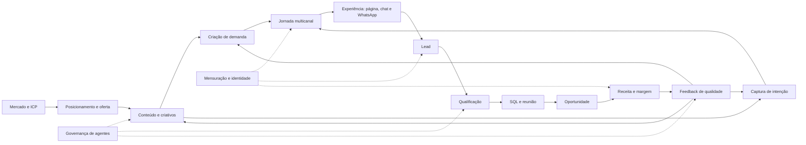
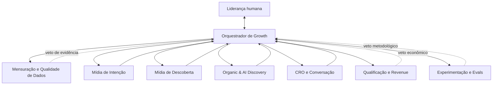

# Sistema operacional de geração de demanda e performance 2026

> Uso: Transforma o Panorama de Geração de Leads 2026 em decisões, rotinas, contratos de dados, experimentos, sistema multiagente e roadmap de 90 dias. Cada capítulo segue: o que mudou → evidência → impacto → decisão → execução → medição → experimento dos próximos 7 dias. Os números de mercado estão em `00_susano/referencias/benchmarks/panorama_2026.md`; a leitura estratégica por canal, em `00_susano/referencias/performance/panorama_2026_guia_estrategico.md`.

> **Documento operacional | versão 1.0 | 17 de julho de 2026**
>
> **Público:** liderança de Growth, Marketing, Revenue Operations, Produto, Comercial e agentes de IA de performance.
>
> **Escopo:** transformar o *Panorama de Geração de Leads 2026*, o *Panorama PRO 2026* e o workshop completo em decisões, rotinas, contratos de dados, experimentos e critérios de avaliação.
>
> **Período dos dados:** 2025. “2026” é a edição da publicação, não o ano em que os eventos foram coletados.

> **Tese central**
>
> Performance não é maximizar a taxa de conversão nem comprar o lead mais barato. É aumentar **receita incremental ajustada por qualidade, velocidade, margem e capacidade operacional**, com evidência suficiente para distinguir criação de demanda, captura de intenção e crédito de atribuição.

> **Como ler esta página**
>
> Cada capítulo responde à mesma sequência: **o que mudou → evidência → impacto → decisão → execução → medição → experimento dos próximos 7 dias**. Esse mecanismo de leitura e a camada final de consulta foram inspirados na organização didática de uma página de referência interna (Notion). A estrutura foi usada como referência; o conteúdo e as conclusões desta página foram desenvolvidos especificamente para geração de demanda.

---

## 1. Resumo executivo

O Panorama mostra um mercado em que a mediana geral voltou a crescer, mas as operações mais fortes se afastaram das mais fracas. Ao mesmo tempo, o mix de aquisição se reorganiza: busca orgânica perde participação, Google continua sendo a principal máquina de volume, Meta expande alcance e leads, LinkedIn parece ter valor que o último clique não captura, e referências de IA surgem pequenas, porém com alta intenção. Mobile se consolidou como ambiente dominante e 43,8% dos leads chegam fora do expediente.

Essas mudanças não pedem uma coleção de “melhores práticas” isoladas. Pedem um sistema operacional capaz de:

1. preservar definições e proveniência;
2. separar sinal real de efeito de composição;
3. escolher canal segundo objetivo e etapa da jornada;
4. medir qualidade depois do formulário;
5. coordenar mídia, conteúdo, CRO, atendimento e vendas;
6. executar experimentos com guardrails;
7. transformar cada resultado em memória reutilizável pelos agentes.

### 1.1 As sete decisões que o Panorama exige

| Decisão | Por que importa agora | Regra operacional |
| --- | --- | --- |
| Otimizar o funil completo | CVR e CPL podem melhorar enquanto qualidade e receita pioram | nenhuma escala sem CPQL, oportunidade, CAC e receita |
| Planejar canais por função | um canal pode criar demanda, outro capturar e um terceiro receber o crédito | declarar objetivo e horizonte antes de comparar canais |
| Tratar mobile como jornada principal | 74,39% dos acessos são mobile | todo diagnóstico começa por canal × dispositivo |
| Operar atendimento 24/7 | 43,8% dos leads chegam fora do expediente | responder, qualificar, rotear e agendar sem perder contexto |
| Devolver qualidade às plataformas | eventos rasos atraem mais eventos rasos | usar MQL, SQL, reunião e venda como sinais quando houver volume |
| Instrumentar descoberta por IA | o referral é mínimo, mas converte 7,80% | construir linha de base, conteúdo citável e rastreamento específico |
| Governar agentes com contratos | um modelo pode transformar correlação em certeza | toda saída declara fonte, confiança, hipótese, risco e critério de decisão |

### 1.2 O que não deve ser concluído

> Os dados não provam que adotar um canal causará o resultado da mediana; não comparam rentabilidade entre canais; não tornam 3,07% uma meta universal; não permitem substituir CRM e receita por leadscore; e não medem toda a influência de IA, dark social ou jornadas assistidas.

O benchmark serve para responder **“isso parece incomum?”** e para sugerir hipóteses. A causa só pode ser investigada com dados internos, decomposição do funil e, quando viável, experimento.

### 1.3 Decisão em uma frase

> Construir uma operação que compra, converte e atende demanda com eficiência é necessário; construir uma operação que sabe **qual demanda vale a pena, por que ela avançou e quando escalar** é o diferencial de 2026.

---

## 2. Contrato de evidência e método

### 2.1 Fontes e papéis

| Fonte | Natureza | Uso correto neste documento |
| --- | --- | --- |
| Panorama de Geração de Leads 2026, 194 páginas | benchmark quantitativo geral, B2B/B2C e 17 segmentos | taxas, recortes, exemplos e limitações, citados como **Panorama aberto, p. X** |
| Panorama PRO 2026, 107 páginas | aprofundamento dos cinco canais sobre a mesma população | tendência, share, dispositivo e scorecards, citados como **Panorama PRO, p. X** |
| Workshop PRO completo, 01:30:59 | interpretação qualitativa dos especialistas | mecanismos, ressalvas e recomendações, citados como **Workshop, HH:MM:SS–HH:MM:SS** |
| Dados internos da operação | verdade operacional primária | decisões de orçamento, metas, causalidade local e economia unitária |

> O Panorama PRO não é uma segunda amostra. Ele aprofunda a mesma base do Panorama aberto. Portanto, números coincidentes entre os dois PDFs não são validação independente.

### 2.2 Hierarquia de evidências

Os agentes devem usar a seguinte precedência:

1. receita, margem e vendas reconciliadas;
2. CRM, analytics, mídia e atendimento auditados;
3. experimentos controlados da própria operação;
4. coortes e análises internas observacionais;
5. benchmark do mesmo segmento, modelo, canal e dispositivo;
6. benchmark B2B/B2C por canal;
7. benchmark geral;
8. opinião de especialista e caso comercial.

Quando duas fontes divergem, o agente deve abrir uma investigação de definição, janela, atribuição, amostra, moeda e estágio do funil. Tirar uma média entre métricas incompatíveis é um erro de método.

### 2.3 Marcadores (os canônicos do método)

Toda análise material identifica a natureza de cada afirmação com os marcadores do método (`00_susano/nucleo.md`, Formato), sem taxonomia própria:

- **[DADO]**: medido na operação e reconciliado, ou publicado nos Panoramas (sempre com a página: "Panorama PRO, p. X" ou "Panorama aberto, p. X"; os números vivem em `00_susano/referencias/benchmarks/panorama_2026.md`);
- **[INFERÊNCIA]**: leitura plausível não declarada como fato pela fonte, interpretação do workshop ou cálculo derivado reproduzível a partir de dados citados (dizer qual dos três);
- **[VENDOR]**: resultado comercial apresentado pelo realizador do estudo ou por fornecedor de plataforma; direcional, com viés declarado;
- **[VERIFICAR]**: afirmação que precisa de confirmação antes de decidir; **[LACUNA]**: o dado não existe na base; **[CONTRADIÇÃO]**: fontes em conflito, com os dois caminhos.

Hipótese, recomendação e risco não são marcadores: hipótese vai na frase base com corte (`00_susano/dna/metodo/diagnostico_de_funil.md`), recomendação vira PA com ganho, dono e prazo, risco vai escrito como risco.

### 2.4 Escala de confiança

| Nota | Condição | Autorização do agente |
|---|---|---|
| 0, desconhecida | definição ausente, tracking quebrado ou conflito não resolvido | não recomendar mudança material |
| 1, fraca | amostra pequena, uma fonte ou alto não atribuído | investigação e teste exploratório |
| 2, direcional | dados coerentes, mas sem reconciliação completa | teste limitado com guardrails |
| 3, utilizável | CRM e mídia conciliados; definição estável | decisão tática reversível |
| 4, forte | múltiplas fontes internas e análise de coorte | escalar gradualmente |
| 5, causal local | experimento ou desenho quase experimental convincente | institucionalizar e monitorar |

### 2.5 Limitações que acompanham toda recomendação

- A amostra de 2.425 sites utiliza tecnologia do fornecedor e não é aleatória.
- “Conversão” é uma ação relevante ampla; não significa necessariamente MQL ou venda.
- O leadscore varia entre empresas e pode inflar qualidade quando o ICP é amplo.
- Não há base padronizada de CPC, CPL, CPQL, CAC, LTV ou margem por canal.
- “Acesso direto” e “outros” podem misturar marca, dark social e falha de atribuição.
- Segmentos com menos de 30 empresas são direcionais: Energia e Telefonia têm 10; Marketing, 15; Logística, 28; Consultoria, 29.
- A comparação anual pode sofrer mudança de composição da base.
- Referral de IA mede clique identificável, não todas as respostas ou menções sem clique.
- Estudos de caso do fornecedor indicam possibilidades, não efeitos reproduzíveis.

### 2.6 Inconsistências da fonte e tratamento

| Tema | Divergência observada | Regra nesta página |
| --- | --- | --- |
| Participação orgânica em 2024 | 41,47% no resumo histórico e 42,70% na ficha aprofundada | preservar ambos; usar 42,70% apenas ao reproduzir a série da ficha e evitar cálculo de alta precisão sem base bruta |
| “Maior conversão do estudo” | a ficha de Meta usa essa formulação, embora IA tenha 7,80% contra 3,91% | interpretar Meta como maior conversão entre pagos consolidados e escaláveis, não no ranking completo |
| Google em alta performance | o gráfico mostra 7,90% → 6,90% → 8,02%, mas a narrativa da mesma página descreve outro ponto inicial | preservar o gráfico e marcar o texto como inconsistente |
| Contagem de segmentos líderes | Google aparece líder de tráfego em 13 segmentos numa página e 14 no selo; orgânico é enumerado como líder de qualidade em três e aparece como quatro no selo | preferir tabelas por segmento; tratar selos como resumo editorial |
| Período e rótulo | metodologia informa coleta em 2025, enquanto séries chamam o corte de 2026 | usar 2025 como período observado e 2026 como edição/coorte publicada |
| Universo dos rankings | scorecards focam cinco canais; outros gráficos incluem geral e acesso direto; páginas de segmento podem exibir apenas parte das origens | só usar posição quando o universo comparado estiver declarado |

Fontes: Panorama PRO, pp. 6, 17, 31, 36, 43, 58, 74, 76, 87 e 89.

### 2.7 Checklist de admissibilidade do dado

- [ ] A definição do evento permaneceu estável?
- [ ] O período é comparável e contempla sazonalidade?
- [ ] As UTMs chegam ao CRM?
- [ ] Duplicatas, spam, suporte e candidatos foram removidos?
- [ ] Receita e estágio comercial estão conciliados?
- [ ] A parcela “outros/não atribuído” está abaixo do limite acordado?
- [ ] Há volume mínimo para o corte analisado?
- [ ] Custos incluem mídia, tecnologia e esforço humano quando a decisão exigir CAC?
- [ ] O benchmark pertence ao mesmo modelo, segmento e etapa?
- [ ] A conclusão diferencia fato, inferência e hipótese?

---

## 3. Mapa do sistema de demanda



### 3.1 Três funções que não devem ser confundidas

| Função | Pergunta | Exemplos de sinal | Erro comum |
| --- | --- | --- | --- |
| Criar demanda | quem colocou o problema ou a categoria no radar? | alcance qualificado, consumo de conteúdo, busca de marca, contas engajadas | cortar o canal porque não fechou no último clique |
| Capturar intenção | quem respondeu quando a necessidade ficou explícita? | busca, visita a página de decisão, demo, orçamento | atribuir toda a venda ao capturador |
| Receber crédito técnico | qual origem sobreviveu na taxonomia? | source/medium final, cookie, formulário | chamar o registro técnico de verdade causal |

### 3.2 Estado operacional do funil

```txt
mercado elegível
  → audiência alcançada
  → visita identificada
  → interação qualificada
  → lead válido
  → MQL aceito
  → SQL/reunião realizada
  → oportunidade
  → cliente
  → receita/margem/retensão
```

Cada transição precisa de definição, numerador, denominador, janela, responsável e evento de auditoria. Se um estágio não existe no dado, o agente não pode “preenchê-lo” por aproximação.

### 3.3 Objetivo por horizonte

| Horizonte | Objetivo dominante | Métricas de decisão |
| --- | --- | --- |
| 0–30 dias | corrigir vazamentos e capturar demanda existente | tracking, SLA, CVR, CPQL, show rate |
| 31–90 dias | realocar mix e melhorar aprendizagem | oportunidade, custo por oportunidade, receita por lead, testes incrementais |
| 3–12 meses | construir autoridade e disponibilidade mental | busca de marca, pipeline assistido, share de tráfego qualificado, citações |
| 12+ meses | aumentar eficiência estrutural e categoria | CAC blended, LTV:CAC, retenção, participação e margem |

---

## 4. Panorama 2026: o sistema mudou, não apenas a taxa

> Números do Panorama: `00_susano/referencias/benchmarks/panorama_2026.md`, por seção (régua oficial, série histórica, qualidade, participação, dispositivo, horário, scorecards, segmentos, cortes B2B/B2C e WhatsApp, inconsistências). Este capítulo é leitura e decisão; não repete tabela.

### 4.1 O que mudou

A conversão mediana geral subiu de 2,98% para 3,07%, enquanto a alta performance foi de 7,27% para 7,90% e a baixa caiu de 1,07% para 1,02%. A distância entre topo e base aumentou. Ao mesmo tempo, o orgânico perdeu participação, o mobile concentrou quase três quartos do tráfego e novas jornadas assistidas passaram a aparecer no referral de IA. **[DADO]** Panorama aberto, pp. 10, 21 e 23.

### 4.2 Evidência

| Sinal | Valor | Leitura segura |
|---|---|---|
| CVR mediana geral | 3,07% | referência ampla, não meta universal |
| Baixa performance | 1,02% | base do benchmark se deteriorou |
| Alta performance | 7,90% | topo ampliou capacidade de conversão |
| Tráfego mobile | 74,39% | ambiente dominante da jornada |
| Leads fora do expediente | 43,80% | aquisição e atendimento precisam ser desacoplados do horário humano |
| Tráfego orgânico | 27,91% | ainda é o maior entre os cinco canais do PRO, mas perde participação |
| Tráfego de IA | 0,10% | sinal pequeno e emergente |

O aumento de CVR pode ocorrer por melhora real, mas também porque tráfego orgânico de baixa intenção diminuiu. Se o denominador perde visitas menos propensas a converter, a taxa sobe mesmo sem crescimento do número de leads. **[DADO]** Panorama aberto, p. 12; Panorama PRO, p. 12.

### 4.3 Impacto operacional

O painel executivo não pode exibir CVR isoladamente. É necessário mostrar sessões, leads, qualidade, oportunidades e receita, além do mix de canais. Uma operação pode apresentar taxa melhor e mercado menor; outra pode aceitar queda de taxa ao ampliar alcance e ainda gerar mais margem.

### 4.4 Decisão

Adotar uma **árvore de valor** como unidade de gestão:

```txt
receita incremental
= audiência elegível
× taxa de passagem por estágio
× ticket/margem
× velocidade e capacidade de atendimento
× retenção
```

CVR de sessão para lead continua útil, mas passa a ser métrica de diagnóstico, não objetivo final.

### 4.5 Execução

1. congelar definições de sessão, lead, MQL, SQL, oportunidade e venda;
2. reconciliar os volumes entre analytics, CRM e financeiro;
3. construir coortes por mês de aquisição, canal e oferta;
4. apresentar volume e taxa lado a lado;
5. separar aquisição nova, retorno, marca e não atribuído;
6. criar alertas quando uma melhora de CVR vier com queda de leads, qualidade ou receita.

### 4.6 Medição

- CVR com intervalo de confiança;
- leads absolutos e taxa de qualificação;
- MQL→SQL, show rate, oportunidade e win rate;
- receita por sessão e por lead;
- CAC e payback por coorte;
- participação de canal no tráfego, lead, oportunidade e receita;
- taxa de não atribuído e match CRM.

### 4.7 Experimento dos próximos 7 dias

> **Reconciliação do denominador**
>
> Escolha as últimas oito semanas. Para cada semana, registre sessões, leads, MQLs, oportunidades e receita por canal. Recalcule CVR e participação de mix. Marque qualquer semana em que a CVR subiu, mas leads ou receita caíram. Resultado esperado: distinguir melhoria de eficiência de mudança de composição.

---

## 5. ICP, intenção, oferta e mensagem

### 5.1 O que mudou

O crescimento de canais de descoberta, a fragmentação da jornada e a expansão de respostas sem clique reduzem o valor de mensagens genéricas. O lead chega carregando um contexto específico: problema, urgência, conhecimento prévio, comparação e restrição. Um formulário único e uma promessa única perdem esse contexto.

### 5.2 Evidência

Os 17 segmentos variam de 1,32% de conversão mediana em Imóveis a 5,42% em Jurídico. O canal de maior conversão também muda: Meta lidera em nove segmentos do recorte PRO; Google é a principal origem de volume em 15 dos 17; orgânico lidera qualidade no agregado; e IA tem alta taxa com volume mínimo. **[DADO]** Panorama aberto, pp. 60–187; Panorama PRO, pp. 26 e 28.

O workshop aprofunda a distinção entre **fit** e **intenção**: aderência ao ICP não garante momento de compra, e um sinal de intenção sem fit pode apenas acelerar desqualificação. **[INFERÊNCIA]** Workshop, 00:14:20–00:16:48.

Esse contraste mostra que “público” não pode ser apenas uma configuração da plataforma. Deve ser um contrato de valor conectado ao funil.

### 5.3 Impacto

Sem uma definição operacional de ICP e intenção:

- mídia aprende a buscar o evento mais fácil;
- criativos ampliam o desejo sem declarar restrições;
- páginas convertem curiosos;
- vendas recebe volume sem contexto;
- o leadscore confirma um ICP excessivamente amplo;
- agentes recomendam escala porque observam CPL, não valor.

### 5.4 Decisão

Definir uma matriz **ICP × intenção × oferta × fricção admissível**.

| Dimensão | Pergunta | Exemplo de atributo |
| --- | --- | --- |
| Fit | esta conta/pessoa pode obter valor e comprar? | segmento, porte, localização, aplicação |
| Autoridade | participa da decisão? | cargo, papel, autonomia, comitê |
| Necessidade | há problema relevante? | caso de uso, severidade, frequência |
| Momento | por que agora? | prazo, evento disparador, contrato vencendo |
| Economia | a troca faz sentido? | faixa de orçamento, potencial, margem |
| Intenção | qual ação está tentando completar? | aprender, comparar, cotar, contratar, suporte |

### 5.5 Execução

1. entrevistar vendas sobre ganhos, perdas e “falsos positivos”;
2. analisar clientes por margem, retenção e esforço de implantação;
3. criar ICPs positivo, limítrofe e negativo;
4. mapear termos, páginas e criativos a estágios de intenção;
5. expor restrições importantes antes da conversão;
6. variar CTA: conteúdo, simulação, diagnóstico, demo, orçamento ou conversa;
7. registrar contexto de origem no CRM e no handoff humano.

### 5.6 Medição

- distribuição do leadscore por campanha;
- CPQL, CPSQL e custo por oportunidade;
- taxa de desqualificação por motivo;
- show rate e win rate por intenção;
- receita e margem por ICP;
- tempo de ciclo por oferta;
- divergência entre promessa do anúncio e motivo de perda.

### 5.7 Experimento dos próximos 7 dias

> **Filtro com transparência**
>
> Escolha uma campanha de alta conversão e baixa qualidade. Crie uma variante que declare um requisito real da oferta e faça uma pergunta de qualificação logo após o primeiro sinal de interesse. Compare lead bruto, qualificação e agendamento. Não interrompa o teste apenas porque a CVR cair; a decisão depende de CPQL e oportunidade.

---

## 6. Arquitetura de canais: função antes de ranking

### 6.1 O que mudou

Os cinco canais analisados no PRO ocupam posições diferentes quando o critério muda. IA lidera conversão, orgânico lidera qualidade, Google lidera leads, Meta combina descoberta e escala, e LinkedIn oferece precisão B2B com pouco crédito de último clique. Um ranking único destrói essa informação.

### 6.2 Evidência

| Canal | CVR mediana | Tráfego | Leads | Leads qualificados | Função predominante |
|---|---|---|---|---|---|
| IA generativa | 7,80% | 0,10% | 0,25% | 40,22% | recomendação e pesquisa assistida |
| Meta Ads | 3,91% | 9,48% | 15,83% | 39,72% | descoberta e escala social |
| Google Ads | 3,41% | 23,40% | 26,85% | 40,08% | captura de intenção previsível |
| LinkedIn Ads | 2,97% | 0,10% | 0,03% | 35,13% | alcance profissional e influência |
| Busca orgânica | 2,39% | 27,91% | 16,11% | 44,51% | autoridade, educação e recorrência |

**[DADO]** Panorama PRO, pp. 43, 58, 70, 87 e 101. Os rankings só comparam esses cinco canais. “Qualificados” segue a régua de leadscore da fonte, não uma definição universal.

### 6.3 Impacto

Comparar canais pela mesma régua produz decisões enviesadas:

- o canal de criação de demanda é penalizado por não fechar no clique;
- o canal de captura recebe crédito por uma intenção construída antes;
- o canal de autoridade parece ineficiente por ter muita visita informacional;
- o canal pequeno exibe taxa volátil e parece extraordinário;
- o canal de volume escala antes de provar qualidade e economia.

### 6.4 Decisão

Toda campanha deve declarar uma destas funções primárias:

1. **descoberta:** tornar problema, categoria ou marca reconhecível;
2. **consideração:** ajudar o público a formular critérios e comparar opções;
3. **captura:** responder a uma necessidade explícita;
4. **conversão:** reduzir fricção e coletar sinal comercial;
5. **aceleração:** retomar, qualificar, agendar e ajudar vendas;
6. **expansão:** aumentar valor e retenção após aquisição.

O canal pode cumprir mais de uma função, mas sua métrica primária precisa corresponder à função escolhida.

### 6.5 Playbook: Google Ads

**Mudança.** Google continua a principal origem de leads, embora sua participação em tráfego tenha recuado de 27,48% para 23,40% entre as edições 2025 e 2026. A conversão avançou para 3,41% e o canal liderou volume em 15 dos 17 segmentos. **[DADO]** Panorama PRO, pp. 31, 37–39 e 43. O workshop contextualiza o papel do canal a partir de 00:41:26.

**Impacto.** A captura segue robusta, mas misturar marca, problema, categoria, concorrente e conteúdo esconde a economia de cada intenção.

**Decisão.** Usar Google quando existe demanda ativa, necessidade de volume e uma oferta capaz de responder à consulta. Pensar duas vezes quando a categoria é nova, o orçamento é curto ou o objetivo é educar um mercado que ainda não busca.

**Execução.** Separar marca e não marca; agrupar termos por intenção; negativar suporte, emprego e baixa aderência; alinhar termo, anúncio, página e CTA; importar eventos offline; usar valor de conversão quando tickets variam; criar regras distintas por desktop e mobile.

**Medição.** Share de impressões elegíveis, termos úteis, CVR, CPQL, custo por reunião realizada, oportunidade, receita e margem por cluster de intenção.

**Experimento 7 dias.** Auditar os 50 termos com maior custo. Reclassificar em “decisão”, “exploração”, “suporte” e “incompatível”. Negativar incompatíveis e criar uma página específica para o cluster de decisão com maior gasto e menor CPQL.

### 6.6 Playbook: Meta Ads

**Mudança.** A participação de Meta cresceu de 5,11% para 9,48% do tráfego entre 2024 e 2026, e de 10,50% para 15,83% dos leads. Em 2026, a conversão chegou a 3,91%. Porém, o tráfego cresceu cerca de 52% na última comparação e os leads apenas cerca de 5%, comprimindo o proxy leads/share de tráfego. **[DADO]** Panorama PRO, pp. 45, 50, 53 e 55. A leitura dos especialistas sobre o canal começa por volta de **Workshop, 00:48:25**.

**Impacto.** A plataforma amplia descoberta, mas a escala torna o sinal de otimização e o suprimento criativo mais importantes. Em B2B, Meta converte 4,68%, mas apenas 26,8% dos leads aparecem qualificados. **[DADO]** Panorama aberto, pp. 34 e 36.

**Decisão.** Usar Meta para alcançar quem ainda não busca, alimentar topo e meio, testar problema e proposta e operar reengajamento. Pensar duas vezes quando o decisor é extremamente nichado, o time não consegue produzir criativos ou o atendimento só responde em horário comercial.

**Execução.** Organizar criativos por hipótese; declarar restrições reais; usar eventos mais profundos; devolver MQL, reunião e venda; excluir públicos irrelevantes; planejar cadência de renovação; testar oferta e mensagem antes de hipersegmentar.

**Medição.** Frequência, saturação criativa, taxa de qualificação, CPQL, custo por oportunidade, receita por mil impressões qualificadas e qualidade marginal a cada faixa de investimento.

**Experimento 7 dias.** Selecionar uma campanha de maior volume. Comparar o evento de lead com um evento de MQL ou reunião, mantendo público e criativo. Se não houver volume para otimização profunda, construir uma pontuação de valor intermediária e documentar sua correlação com vendas.

### 6.7 Playbook: LinkedIn Ads

**Mudança.** O tráfego de LinkedIn cresceu de 0,07% para 0,10%, enquanto a participação em leads caiu de 0,18% para 0,03%. A conversão mediana reagiu de 1,88% para 2,97%. O relatório sugere papel assistido, mas não fornece desenho causal. **[DADO]** Panorama PRO, pp. 60, 63, 65 e 67. O workshop introduz o canal em 00:57:26 e desenvolve o tripé **LinkedIn orgânico, Thought Leader Ads e prospecção** entre 01:03:10 e 01:05:06.

**Impacto.** Last-click tende a subestimar um canal usado para alcançar cargo, empresa e conta antes da busca. Ao mesmo tempo, “influência” não pode virar desculpa para campanha sem evidência.

**Decisão.** Usar em B2B de alto ticket, ciclo longo, ABM e audiência profissional valiosa. Pensar duas vezes em ticket baixo, orçamento curto ou quando a única definição de sucesso é volume de lead.

**Execução.** Construir listas de contas; separar expansão, aquisição e cobertura; registrar engajamento por conta; sincronizar conteúdo e abordagem comercial; usar grupos de controle geográficos ou de contas quando possível; observar mobile, que concentra 89,59% do tráfego do canal, mas 64,58% dos leads. **[DADO]** Panorama PRO, p. 69.

**Medição.** Contas alcançadas, cobertura de cargos, lift de busca de marca, reuniões em contas expostas, pipeline influenciado com regra explícita e teste incremental quando viável.

**Experimento 7 dias.** Escolher 30–100 contas prioritárias. Criar grupo exposto e grupo de comparação, registrar baseline de visitas, busca de marca e reuniões, e ativar conteúdo de problema em apenas um grupo. Sete dias podem não fechar vendas; o objetivo inicial é validar cobertura e instrumentação.

### 6.8 Playbook: busca orgânica

**Mudança.** Na série da ficha, o share orgânico caiu de 42,70% para 27,91% do tráfego, enquanto sua participação em leads foi de 24,20% para 16,11%. Em pontos de participação, o tráfego recuou mais; em volume absoluto, porém, acessos caíram de 62,9 milhões para 48,5 milhões (-23,00%) e leads de 842.737 para 546.988 (-35,09%). Portanto, a afirmação de que “audiência caiu mais que resultado” só vale para **share**, não para volume. A qualidade permaneceu a maior entre os canais, 44,51%. **[DADO]** Panorama PRO, pp. 72, 74, 76, 79, 81 e 87. O workshop discute a mudança do papel do orgânico entre 01:16:58 e 01:19:26.

**Impacto.** “Mais sessões orgânicas” deixa de ser objetivo suficiente. Conteúdo precisa ser gerido por função e influência: educação, comparação, decisão, navegação ou suporte.

**Decisão.** Usar orgânico para autoridade, demanda recorrente e horizonte longo. Pensar duas vezes quando a empresa precisa de volume imediato ou baseia a estratégia em conteúdo genérico sem ponto de vista, prova ou conexão com oferta.

**Execução.** Classificar URLs por intenção; atualizar páginas de decisão; adicionar CTAs contextuais; consolidar conteúdo redundante; publicar dados, critérios e exemplos verificáveis; conectar SEO a conteúdo citável em respostas de IA; medir conversões assistidas.

**Medição.** Tráfego não marca por cluster, entrada em páginas comerciais, microconversão, pipeline assistido, receita por landing page, menções/citações, qualidade e retenção por coorte.

**Experimento 7 dias.** Identificar dez URLs com alto tráfego e baixa passagem a conteúdo comercial. Em duas delas, inserir próximo passo contextual, comparação, prova e captura progressiva. Preservar uma URL semelhante como controle direcional.

### 6.9 Playbook: referências de IA

**Mudança.** A IA aparece com 7,80% de conversão, 0,10% do tráfego e 0,25% dos leads. Foram 170.486 visitas e 8.352 leads na base, com ChatGPT representando 78,36% do referral identificado. **[DADO]** Panorama PRO, pp. 89, 91, 93 e 96. O contraste entre alta conversão e baixo volume é contextualizado no **Workshop, 00:08:00–00:13:56** e retomado em **01:19:28–01:24:32**.

**Impacto.** O visitante que clica após pesquisar em um assistente pode chegar com maior clareza de problema e comparação. O referral, porém, captura apenas a parte clicável da influência; taxa alta com share pequeno não autoriza previsão de escala.

**Decisão.** Tratar IA como frente de autoridade e descoberta mensurável. Não tratá-la como substituta imediata de busca nem prometer atribuição limpa.

**Execução.** Padronizar channel grouping; registrar referenciador; mapear páginas de entrada; publicar definições, comparativos honestos, dados e critérios de escolha; manter identidade de produto consistente; monitorar erros factuais sobre a marca; oferecer páginas úteis para a próxima decisão. As ações de GEO são discutidas no **Workshop, 00:11:20–00:13:06**.

**Medição.** Sessões e leads por referenciador, qualidade, oportunidade, receita, páginas citadas, perguntas que originam visita, menções de marca e taxa de correção de informações incorretas.

**Experimento 7 dias.** Construir uma linha de base de referrals e pesquisar dez perguntas decisórias reais do ICP em três assistentes. Registrar se a marca aparece, com que contexto e quais fontes são citadas. Produzir ou atualizar uma página capaz de responder à lacuna mais recorrente.

### 6.10 Dispositivo como camada de canal

Meta concentra 91,84% dos acessos e 98,42% dos leads no mobile. IA é a exceção: 83,66% dos acessos são desktop, mas os 16,34% mobile geram 38,01% dos leads do canal. No orgânico, mobile converte 2,51% e desktop 2,42%. **[DADO]** Panorama PRO, pp. 56, 85–86 e 100.

> Não existe “performance do canal” sem o corte canal × dispositivo × página × estágio. A mesma mídia pode estar criando interesse no mobile e convertendo no desktop, ou o inverso.

### 6.11 Medição do portfólio

| Função | Métrica primária | Métrica de conexão | Guardrail |
| --- | --- | --- | --- |
| Descoberta | alcance qualificado incremental | busca de marca, visita de retorno | frequência e percepção |
| Consideração | consumo útil e contas engajadas | visita a decisão, reunião assistida | qualidade da audiência |
| Captura | oportunidade ou receita por intenção | CVR e CPQL | share perdido e CPC |
| Conversão | lead qualificado por sessão | show rate | fricção e abandono |
| Aceleração | tempo até avanço de estágio | receita por lead | spam, opt-out e capacidade |

---

## 7. Criativos, conteúdo e experimentação

### 7.1 O que mudou

Em plataformas cada vez mais automatizadas, a unidade de controle migra de microajustes de segmentação para qualidade do sinal, oferta, criativo e aprendizado. No orgânico e em IA, conteúdo genérico concorre com respostas prontas; o ativo que permanece útil é o que oferece prova, estrutura, comparação e decisão.

### 7.2 Evidência

Meta lidera conversão em vários segmentos, mas apresenta bolsões de baixa qualidade em Software, Tecnologia, Agência e Marketing. O PRO interpreta a evolução de automação da plataforma como mudança do trabalho do operador para o criativo; essa é **[INFERÊNCIA]**, não benchmark causal. **[DADO]** Panorama PRO, pp. 47–49.

No orgânico, a participação caiu enquanto a qualidade permaneceu líder. Isso favorece uma estratégia que diferencia tráfego útil de tráfego apenas volumoso. **[DADO]** Panorama PRO, pp. 74, 76 e 87.

### 7.3 Impacto

Uma operação sem taxonomia criativa não aprende por que algo funcionou. Ela sabe apenas qual anúncio venceu naquela janela. Uma operação sem mapa de conteúdo não distingue ativo de descoberta, consideração e decisão.

### 7.4 Decisão

Gerir cada peça como hipótese composta:

```yaml
creative_hypothesis:
  audience_problem: ""
  awareness_stage: ""
  promise: ""
  proof: ""
  mechanism: ""
  objection: ""
  format: ""
  call_to_action: ""
  disqualifier: ""
```

### 7.5 Execução

1. criar matriz de ângulos por problema, mecanismo, prova e objeção;
2. versionar cada peça com atributos, não apenas nome de arquivo;
3. manter uma biblioteca de claims aprovados e fontes;
4. combinar anúncio e página pela mesma hipótese;
5. separar testes de conceito, execução e audiência;
6. registrar condições de saturação e fadiga;
7. transformar comentários de vendas e motivos de perda em insumo criativo;
8. publicar conteúdo de decisão: comparação, custo total, critérios, limitações e implantação.

### 7.6 Medição

- hook rate, retenção e clique qualificado;
- CVR e qualificação por hipótese;
- frequência e queda marginal;
- CPQL e custo por oportunidade;
- receita por ângulo e oferta;
- tempo até saturação;
- contribuição de conteúdo a jornadas assistidas.

### 7.7 Sistema de experimentos

Todo teste deve ter problema, evidência, hipótese, controle, público, mudança, métrica primária, guardrails, amostra mínima, regra de decisão e registro de resultado. Um teste sem regra anterior ao resultado é apenas uma campanha acompanhada.

```yaml
experiment_contract:
  id: "EXP-AAAA-NNN"
  problem: ""
  internal_evidence: []
  external_benchmark: []
  hypothesis: ""
  change: ""
  control: ""
  audience: ""
  primary_metric: ""
  guardrails: []
  minimum_sample_or_window: ""
  stop_rule: ""
  scale_rule: ""
  owner: ""
  result: ""
  confidence: 0
  next_action: ""
```

### 7.8 Experimento dos próximos 7 dias

> **Teste de hipótese, não de peça**
>
> Escolha um problema prioritário do ICP. Produza três criativos que mantenham público, oferta e CTA, variando apenas o mecanismo ou prova. Registre a taxonomia antes de ativar. Compare sinal inicial e, assim que houver dados, qualidade. O aprendizado deve dizer “qual hipótese ganhou e em qual contexto”, não apenas “qual anúncio teve CTR maior”.

---

## 8. Conversão, atendimento e economia do funil

### 8.1 O que mudou

Mobile se aproximou do desktop em conversão geral e o lead passou a chegar continuamente. A diferença entre captar e atender se tornou uma fonte material de perda: quase metade do volume pode ocorrer quando a equipe não está disponível.

### 8.2 Evidência

- mobile: 74,39% dos acessos, CVR mediana de 3,37%;
- desktop: 25,61% dos acessos, CVR mediana de 3,50%;
- fora do expediente: 43,80% dos leads;
- IA, orgânico e direto: aproximadamente 48% fora do expediente;
- empresas com WhatsApp no geral: 3,20% de conversão, contra 2,66% sem; no B2B, 2,69% contra 2,12%; no B2C, a relação observada se inverte, 3,33% contra 3,60%.

**[DADO]** Panorama aberto, pp. 23, 25, 27, 29, 44 e 57. A comparação com/sem WhatsApp é observacional e não prova causalidade.

### 8.3 Impacto

No B2C, WhatsApp funciona como infraestrutura e sua simples presença não diferencia. No B2B, pode reduzir fricção, mas a utilidade depende de contexto, SLA e qualificação. Um botão que abandona origem, produto e respostas apenas desloca a fricção.

### 8.4 Decisão

Projetar uma jornada conversacional capaz de:

1. responder imediatamente;
2. confirmar consentimento e expectativa;
3. distinguir comercial, suporte, candidatura e cliente;
4. coletar o mínimo de contexto necessário;
5. oferecer agendamento ou próximo passo útil;
6. transferir para humano com histórico;
7. retomar de forma proporcional e com opt-out.

### 8.5 Execução

- auditar Core Web Vitals e tempo de carregamento nas principais páginas;
- testar a primeira tela sem depender de zoom ou rolagem;
- usar teclado, autofill e máscaras adequadas;
- preservar campos ao trocar de canal;
- transmitir UTM, página, oferta e respostas ao CRM;
- definir SLA por valor e urgência;
- criar fila de retomada do fora do expediente;
- limitar frequência de follow-up e registrar consentimento;
- medir passagem ao humano e abandono nessa transição.

### 8.6 Medição

| Camada | Métrica | Pergunta |
| --- | --- | --- |
| Experiência | tempo, erro e abandono | a interface impediu a ação? |
| Conversa | início→resposta→qualificação | o fluxo preservou intenção? |
| Velocidade | mediana e p90 de primeira resposta | o lead recebeu ajuda a tempo? |
| Comercial | show rate e oportunidade | a qualificação melhorou passagem? |
| Economia | CPQL, CPSQL, CAC e receita por lead | a eficiência chegou ao caixa? |
| Confiança | opt-out, reclamação e spam | a automação respeitou o usuário? |

### 8.7 Fórmulas mínimas

```txt
CPL = custo de mídia / leads válidos
CPQL = custo de mídia / leads qualificados
CPSQL = custo de mídia / SQLs aceitos
CAC = custo total de aquisição / novos clientes
ROAS = receita atribuída / custo de mídia
MER = receita total / investimento total de marketing
receita por lead = receita da coorte / leads válidos da coorte
```

### 8.8 Experimento dos próximos 7 dias

> **SLA fora do expediente**
>
> Crie uma fila para leads recebidos entre 18h e 8h e em fins de semana. Responda imediatamente com confirmação, duas perguntas de triagem e opção de agendamento. Compare com o período anterior: resposta, qualificação, agendamento, comparecimento e opt-out. Mantenha revisão humana de exceções.

---

## 9. Mensuração, atribuição e qualidade dos dados

### 9.1 O que mudou

A jornada atravessa canais, dispositivos e sessões, enquanto as plataformas observam apenas fragmentos. LinkedIn pode influenciar uma conta que depois busca no Google; conteúdo orgânico pode formar critérios usados em uma conversa de vendas; uma resposta de IA pode recomendar uma marca sem gerar clique. Last-click continua útil como registro técnico, mas é insuficiente como teoria causal.

### 9.2 Evidência

O PRO mostra tráfego crescente e queda de participação em leads last-click no LinkedIn, além de um referral de IA com share de leads 2,5 vezes maior que seu share de tráfego. Esses padrões são compatíveis com papéis diferentes, mas não provam influência. **[DADO]** Panorama PRO, pp. 63, 65, 67, 91, 96 e 98.

A atribuição de LinkedIn, a necessidade de conectar mídia ao CRM e os limites do último clique são desenvolvidos no **Workshop, 00:34:12–00:40:10**. A fala é evidência qualitativa e orienta o diagnóstico; não substitui teste incremental.

Em segmentos como Agência, “outros” chega a 48,17% dos leads. Quando uma categoria residual é material, a precisão aparente das demais categorias não autoriza redistribuição fina. **[DADO]** Panorama aberto, p. 66.

### 9.3 Impacto

Uma organização que usa apenas o relatório da plataforma tende a:

- duplicar crédito entre redes;
- cortar canais de criação de demanda;
- favorecer captura de marca;
- confundir usuário recorrente com origem direta;
- perder UTMs em redirecionamentos e mensagens;
- tomar decisão com janelas incompatíveis;
- treinar agentes em um histórico sem definições estáveis.

### 9.4 Decisão

Operar quatro camadas de leitura em paralelo:

1. **atribuição operacional:** registro reproduzível para rotina e integração;
2. **jornada observada:** sequência de toques identificados, sem alegar causalidade;
3. **incrementalidade:** efeito estimado por teste ou desenho quase experimental;
4. **economia blended:** resultado total do sistema contra investimento total.

Nenhuma camada substitui as outras. Atribuição operacional ajuda a executar; incrementalidade ajuda a decidir; blended protege contra falsa precisão.

### 9.5 Contrato semântico de métricas

| Campo | Definição obrigatória |
| --- | --- |
| `metric_name` | nome único e estável |
| `business_question` | pergunta que a métrica responde |
| `formula` | numerador, denominador e filtros |
| `grain` | unidade: sessão, pessoa, conta, oportunidade ou pedido |
| `window` | janela de evento e maturação |
| `source_of_truth` | sistema oficial |
| `owner` | responsável pela definição |
| `exclusions` | spam, teste, suporte, duplicata e outros |
| `version` | data e motivo da última mudança |
| `quality_status` | confiável, direcional ou bloqueada |

### 9.6 Taxonomia mínima de aquisição

```yaml
acquisition_event:
  occurred_at: "ISO-8601"
  anonymous_id: ""
  person_id: ""
  account_id: ""
  session_id: ""
  source: ""
  medium: ""
  campaign: ""
  content: ""
  term: ""
  referrer_domain: ""
  landing_page: ""
  device: "desktop|mobile|tablet|unknown"
  new_or_returning: ""
  consent_status: ""
  attribution_version: ""
```

### 9.7 Score de confiabilidade do corte

O agente de mensuração deve calcular uma nota antes da análise:

```txt
confiabilidade =
  25% completude de origem
  + 20% match com CRM
  + 20% estabilidade de definições
  + 15% reconciliação de volume
  + 10% maturação da janela
  + 10% tamanho da amostra
```

É um mecanismo de governança, não uma verdade estatística. Pesos devem ser ajustados à operação e versionados. Cortes abaixo do limite acordado não podem disparar escala automática.

### 9.8 Execução

1. documentar métricas e eventos;
2. estabelecer IDs entre sessão, pessoa, conta e oportunidade;
3. preservar first touch, last non-direct e sequência de toques;
4. registrar página e referenciador bruto antes do agrupamento;
5. devolver conversões offline com timestamp e valor;
6. reconciliar semanalmente mídia, analytics, CRM e financeiro;
7. monitorar “outros”, “direto” e “desconhecido” como métricas de qualidade;
8. construir coortes com janela suficiente para ciclos longos;
9. manter log de mudanças de tracking;
10. testar incrementalidade em decisões materiais.

### 9.9 Medição da própria mensuração

- cobertura de UTM;
- match sessão→lead e lead→CRM;
- duplicidade;
- diferença de volume entre sistemas;
- percentual de receita sem origem;
- atraso de atualização;
- taxa de eventos rejeitados;
- número de decisões bloqueadas por qualidade;
- tempo médio para resolver incidente de dados.

### 9.10 Experimento dos próximos 7 dias

> **Auditoria de 100 leads**
>
> Amostre 100 leads recentes e percorra o caminho inverso: CRM → evento de conversão → sessão → campanha → custo. Classifique origem completa, parcial, conflitante ou ausente. Quantifique os maiores pontos de perda e corrija primeiro o defeito que afeta mais decisões de orçamento.

---

## 10. Sistema multiagente de performance

### 10.1 Princípio de arquitetura

Um único agente tende a misturar diagnóstico, recomendação, execução e avaliação. O sistema proposto separa responsabilidades para criar contrapontos, rastreabilidade e direito de veto. A colaboração não elimina uma decisão humana; ela melhora a preparação da decisão.



### 10.2 Agente Orquestrador de Growth

**Missão:** traduzir uma pergunta de negócio em plano de investigação, acionar especialistas e consolidar uma recomendação executável.

**Entradas mínimas:** objetivo, período, modelo B2B/B2C, segmento, oferta, ticket, ciclo, capacidade, funil, custos e status dos dados.

**Saídas:** resumo executivo, nota de confiança, diagnóstico, até três hipóteses, decisão proposta, experimento, guardrails e pontos de aprovação humana.

**Não pode:** editar orçamento, pausar campanha ou publicar conteúdo apenas porque o benchmark parece favorável; preencher dados ausentes; suprimir uma reprovação dos agentes de dados, revenue ou experimento.

### 10.3 Agente de Mensuração e Qualidade de Dados

**Missão:** proteger a validade da evidência.

**Verifica:** definições, UTMs, duplicidade, match, origem residual, janelas, sazonalidade, mudança de tracking e reconciliação.

**Saída:** `confidence_score`, bloqueios, campos ausentes e consultas reproduzíveis.

**Direito de veto:** impede decisão material quando a origem ou o estágio analisado não é confiável.

### 10.4 Agente de Mídia de Intenção

**Missão:** capturar necessidade explícita com economia sustentável.

**Escopo:** busca paga, termos, intenção, feed quando aplicável, página e sinal offline.

**Analisa:** marca vs. não marca, query clusters, share elegível, dispositivo, CPQL, oportunidade e valor.

**Não pode:** defender escala com base apenas em ROAS atribuído pela plataforma ou CVR de lead.

### 10.5 Agente de Mídia de Descoberta

**Missão:** criar demanda e aprender sobre problema, mensagem e oferta sem sacrificar qualidade.

**Escopo:** Meta e demais canais sociais de alcance.

**Analisa:** taxonomia criativa, saturação, frequência, evento de otimização, qualidade marginal e efeito assistido.

**Não pode:** celebrar CPL baixo quando MQL, reunião ou opt-out se deterioram.

### 10.6 Agente Organic & AI Discovery

**Missão:** aumentar autoridade, descoberta qualificada e presença em mecanismos de busca e resposta.

**Escopo:** SEO, conteúdo, entidades, citações, referrals de LLMs e páginas de decisão.

**Analisa:** intenção da URL, pipeline assistido, qualidade, menções, consistência factual e lacunas de conteúdo.

**Não pode:** produzir conteúdo massivo sem fonte, propósito ou conexão com a jornada.

### 10.7 Agente de CRO e Conversação

**Missão:** aumentar passagem para lead qualificado reduzindo fricção legítima.

**Escopo:** landing page, formulário, chat, WhatsApp, mobile, acessibilidade, SLA e handoff.

**Analisa:** performance técnica, abandono, clareza, contexto, consentimento, transbordo e qualidade.

**Não pode:** usar padrão enganoso, ocultar restrição material ou aumentar conversão à custa de confiança.

### 10.8 Agente de Qualificação e Revenue

**Missão:** conectar aquisição a valor econômico e capacidade comercial.

**Escopo:** ICP, leadscore, MQL, SQL, show rate, oportunidade, win rate, CAC, ticket, margem e ciclo.

**Analisa:** qualidade por campanha, motivo de perda, SLA, aceitação de vendas e receita por coorte.

**Direito de veto:** bloqueia escala quando volume adicional ultrapassa capacidade ou degrada economia.

### 10.9 Agente de Experimentação e Evals

**Missão:** transformar hipóteses em testes e testar também a qualidade dos demais agentes.

**Escopo:** desenho, amostra, controle, guardrails, leitura de resultado, registro e conjuntos de avaliação.

**Direito de veto:** impede chamar uma variação observacional de experimento ou institucionalizar um resultado sem critério definido.

### 10.10 Protocolo de consenso

Uma recomendação de escala precisa de quatro pareceres:

| Parecer | Pergunta | Resultado permitido |
| --- | --- | --- |
| Dados | a evidência é utilizável? | aprova, limita ou bloqueia |
| Aquisição/CRO | existe eficiência e capacidade de execução? | aprova ou sugere correção |
| Revenue | o lead avança e produz valor? | aprova, limita ou bloqueia |
| Experimento | a conclusão é sustentada? | aprova como teste, rollout ou aprendizado inconclusivo |

Se houver bloqueio, o Orquestrador pode recomendar correção, análise ou teste reversível. Não pode converter discordância em média aritmética.

### 10.11 Objeto de decisão

```json
{
  "decision_id": "DEC-AAAA-NNN",
  "question": "",
  "business_objective": "",
  "evidence": [
    {"type": "internal|benchmark|qualitative", "source": "", "claim": ""}
  ],
  "data_confidence": 0,
  "diagnosis": "",
  "hypotheses": [],
  "recommendation": "maintain|reduce|fix|test_scale|scale",
  "expected_mechanism": "",
  "primary_metric": "",
  "guardrails": [],
  "stop_rule": "",
  "human_approval": "required|not_required",
  "dissent": [],
  "expires_at": "",
  "result": null
}
```

### 10.12 Experimento dos próximos 7 dias

> **Conselho de uma decisão real**
>
> Escolha uma pergunta concreta, como “escalar Meta em 15%?”. Faça cada agente emitir um parecer independente usando o mesmo pacote de dados. O Orquestrador deve consolidar concordâncias, dissensos e lacunas. Avalie se o processo revelou um risco que a análise individual não mostrava.

---

## 11. Contratos, memória, evals e guardrails

### 11.1 Contrato de entrada

```yaml
performance_request:
  question: ""
  decision_deadline: ""
  model: "B2B|B2C"
  segment: ""
  offer: ""
  ticket_or_ltv: ""
  sales_cycle_days: 0
  period: {start: "", end: ""}
  objective: "discovery|consideration|capture|conversion|acceleration"
  funnel_data: {}
  cost_data: {}
  cuts_available: []
  capacity_constraints: []
  data_quality_notes: []
  authorized_actions: []
```

Se faltarem campos que mudam materialmente a decisão, o agente deve pedir o dado ou reduzir o escopo. “Fazer o melhor possível” não autoriza inventar ticket, atribuição ou meta.

### 11.2 Contrato de saída

```yaml
performance_response:
  executive_summary: ""
  evidence_labels: []
  confidence_score: 0
  data_gaps: []
  funnel_diagnosis: ""
  benchmark_context: ""
  hypotheses:
    - statement: ""
      supporting_evidence: []
      opposing_evidence: []
      test: ""
  recommendation: ""
  experiment: {}
  primary_metric: ""
  guardrails: []
  risks: []
  dissent: []
  human_approval_points: []
  next_review_at: ""
```

### 11.3 Memória em quatro camadas

| Camada | Conteúdo | Retenção | Risco controlado |
| --- | --- | --- | --- |
| Conhecimento estável | definições, políticas, benchmarks e contratos | longa, versionada | deriva conceitual |
| Contexto da operação | oferta, ICP, metas, capacidade e sazonalidade | revisada mensalmente | recomendação genérica |
| Evidência episódica | campanha, análise, incidente e experimento | ligada a período e IDs | repetição de erro |
| Estado de execução | decisão ativa, owner, prazo e resultado | até encerramento | ação sem acompanhamento |

Memória deve guardar **o contexto do resultado**, não apenas o resultado. “Meta funcionou” é memória ruim. “Meta com criativo de prova, evento MQL, ICP X, investimento Y e capacidade Z aumentou oportunidades sem elevar CAC na janela W” é memória útil.

### 11.4 Política de atualização da memória

- não substituir definição sem versionar;
- expirar benchmarks externos por edição;
- registrar mudança de tracking como evento;
- marcar resultados inconclusivos;
- impedir que hipótese seja promovida a fato;
- associar cada aprendizado ao experimento e às condições;
- revisar memória quando oferta, ICP ou processo comercial mudar.

### 11.5 Evals de conhecimento

Testam se o agente:

1. cita a página correta;
2. sabe que os dados são de 2025;
3. distingue PRO de amostra independente;
4. escolhe benchmark específico;
5. reconhece segmentos com amostra pequena;
6. não transforma 7,80% de IA em previsão de escala;
7. não usa caso comercial como causalidade.

### 11.6 Evals de raciocínio

Casos mínimos:

- CVR sobe e receita cai;
- CPL cai e CPQL sobe;
- Meta cresce com qualidade menor;
- Google recebe crédito após exposição social;
- “direto” supera 30%;
- mobile domina tráfego, mas desktop fecha mais;
- canal novo tem três conversões e taxa extrema;
- vendas rejeita leads que o leadscore chama de qualificados.

O agente passa quando identifica ambiguidade, solicita dado relevante, formula hipóteses concorrentes e evita recomendação irreversível.

### 11.7 Evals de decisão

| Critério | Pergunta de avaliação | Falha grave |
| --- | --- | --- |
| Correção | números, fórmulas e fonte conferem? | inventar valor ou confundir período |
| Relevância | responde à decisão pedida? | entregar benchmark sem implicação |
| Completude | inclui qualidade, receita e risco? | otimizar lead bruto isolado |
| Calibração | confiança corresponde à evidência? | certeza com dado direcional |
| Ação | experimento tem métrica e regra? | recomendar “testar” sem desenho |
| Segurança | respeita autorização, privacidade e marca? | executar ação material sem aprovação |

### 11.8 Conjunto dourado de avaliação

Manter de 20 a 50 casos fictícios em contexto real (nunca com número real de cliente), com:

- pergunta original;
- pacote de dados;
- análise esperada;
- armadilhas conhecidas;
- decisão humana;
- resultado posterior;
- critérios de pontuação.

O conjunto deve incluir casos fáceis, limites, dados conflitantes e tentativas de induzir o agente a inventar. Atualizar quando um novo modo de falha surgir.

### 11.9 Guardrails de ação

> **Sempre exigir aprovação humana:** mudança relevante de orçamento, publicação pública, alteração de oferta/preço, contato massivo, edição de leadscore em produção, exclusão de dados, mudança de atribuição, promessa comparativa e qualquer ação regulada ou sensível.

**Ações normalmente reversíveis com escopo pré-autorizado:** gerar análise, preparar rascunho, abrir cartão de experimento, sugerir negativas, criar consulta, produzir QA e alertar anomalia.

### 11.10 Guardrails de negócio e experiência

- CPQL, oportunidade, CAC e margem acompanham CVR/CPL;
- opt-out, spam e reclamação acompanham automação;
- capacidade comercial limita escala;
- promessas devem ter fonte e aprovação;
- dados pessoais seguem finalidade, minimização e acesso;
- humanos recebem contexto e podem corrigir a classificação;
- nenhum agente deve discriminar por atributo protegido ou proxy indevido;
- um rollback precisa existir antes de qualquer rollout.

### 11.11 Experimento dos próximos 7 dias

> **Teste adversarial**
>
> Crie dez cenários em que o indicador superficial aponta para escala, mas o funil profundo não. Execute o Orquestrador e pontue: pedido de dados, uso de rótulos, calibração, guardrails e decisão. Transforme cada falha observada em caso permanente do conjunto dourado.

---

## 12. Rotinas operacionais

> Camada de liderança: estas rotinas são da liderança de growth e do sistema multiagente deste documento. A rotina do gestor de mídia (diário, semanal, periódico e gatilhos) está em `00_susano/referencias/performance/rotina_gestor_performance.md` e não se duplica aqui; quando as duas falam do mesmo passo, vale a rotina do gestor.

### 12.1 Diário: 15 minutos de saúde

- incidentes de tracking;
- gasto e pacing;
- anomalias de volume e qualidade;
- fila fora do SLA;
- erros de integração;
- campanhas com risco de marca;
- ações automáticas executadas e reversões.

Saída: uma página curta de exceções, não um relatório de todas as métricas.

### 12.2 Semanal: Growth Review

| Bloco | Tempo | Pergunta |
|---|---|---|
| Integridade | 10 min | podemos confiar no dado? |
| Resultado | 15 min | qual parte do funil moveu receita? |
| Diagnóstico | 15 min | quais drivers foram validados? |
| Experimentos | 15 min | escalar, manter, iterar ou encerrar? |
| Decisões | 5 min | quem fará o quê e até quando? |

O agente prepara o pre-read; responsáveis humanos confirmam decisões materiais.

### 12.3 Quinzenal: conselho de canais

Revisar função de cada canal, qualidade marginal, capacidade, aprendizado criativo, intenção e influência. O objetivo é evitar que cada especialista maximize seu próprio painel.

### 12.4 Mensal: revisão de economia e ICP

- receita e margem por coorte;
- CAC blended e por função;
- win rate e ciclo;
- qualidade por canal/campanha;
- motivos de perda;
- capacidade e SLA;
- mudanças de ICP, oferta ou mercado;
- memória a expirar ou corrigir.

### 12.5 Trimestral: estratégia e modelo de medição

Reavaliar portfólio, incrementabilidade, metas, contratos de dados, conjunto dourado de evals e direitos de ação. Um sistema de agentes que não é reavaliado acumula confiança indevida.

### 12.6 Registro de decisão

Cada decisão deve responder:

1. o que foi decidido;
2. qual evidência sustentou;
3. qual alternativa foi rejeitada;
4. quais riscos permaneceram;
5. qual métrica decide sucesso;
6. quando a decisão expira;
7. quem pode reverter;
8. qual foi o resultado.

### 12.7 Experimento dos próximos 7 dias

> **Primeiro Growth Review orientado a exceções**
>
> Faça o pre-read caber em uma página: integridade, três movimentos relevantes, três hipóteses, experimentos e decisões. Elimine métricas que não alteram nenhuma escolha. Ao final, registre tempo gasto e quantas ações ganharam owner, prazo e critério.

---

## 13. Roadmap de implantação em 90 dias

### 13.1 Resultado esperado

Ao final de 90 dias, a organização deve ter um funil reconciliado, decisões registradas, agentes com escopo e direitos definidos, um backlog priorizado, pelo menos um ciclo completo de experimentos e uma rotina executiva orientada a receita. O objetivo não é automatizar tudo; é tornar a decisão mais confiável, rápida e cumulativa.

### 13.2 Dias 1–15: fundação e verdade operacional

**Objetivo:** saber o que os números significam e onde não são confiáveis.

- nomear donos de negócio, dados e operação;
- congelar definições de lead, MQL, SQL, oportunidade, cliente e receita;
- inventariar analytics, mídia, CRM, atendimento e financeiro;
- medir não atribuído, duplicidade e match;
- documentar ICP, ofertas, capacidade e SLA;
- classificar canais por função;
- selecionar 20 casos para o primeiro conjunto de evals;
- criar registro de decisões e mudanças de tracking.

**Critério de saída:** funil mínimo reconciliado para um período e uma oferta prioritária; nota de confiança explícita; maiores lacunas com owner e prazo.

### 13.3 Dias 16–30: visibilidade e primeira coordenação

**Objetivo:** substituir painéis isolados por uma leitura de sistema.

- construir scorecard sessão→receita;
- habilitar cortes por canal, dispositivo, página, horário e ICP;
- criar coortes de maturação;
- implantar monitoramento de SLA fora do expediente;
- configurar o Orquestrador, Dados e Revenue em modo de recomendação;
- realizar o primeiro Growth Review;
- selecionar três hipóteses com impacto e reversibilidade altos;
- bloquear qualquer automação de orçamento ainda sem evals.

**Critério de saída:** reunião semanal usa o mesmo dicionário; decisões têm evidência, owner, métrica e validade.

### 13.4 Dias 31–45: sinais profundos e experiência

**Objetivo:** conectar aquisição à qualidade e reduzir vazamentos óbvios.

- importar MQL/SQL ou evento de qualidade para mídia;
- separar Google por clusters de intenção;
- criar taxonomia de criativos em Meta;
- mapear conteúdo orgânico por estágio;
- configurar referência de LLMs;
- auditar as principais jornadas mobile;
- testar resposta fora do expediente;
- revisar handoff para o time humano.

**Critério de saída:** pelo menos um canal recebe feedback de qualidade; primeiro teste de experiência tem controle e guardrails.

### 13.5 Dias 46–60: experimentação disciplinada

**Objetivo:** produzir aprendizado reproduzível.

- executar dois a quatro experimentos priorizados;
- registrar hipótese antes da ativação;
- calibrar tamanho de amostra e janela;
- avaliar qualidade marginal de escala;
- construir avaliação adversarial dos agentes;
- registrar resultados negativos e inconclusivos;
- revisar memória e proibir generalizações sem contexto.

**Critério de saída:** ao menos um experimento encerrado com regra aplicada; todos os resultados vinculados ao contrato original.

### 13.6 Dias 61–75: portfólio e incrementalidade

**Objetivo:** compreender interações entre canais e reduzir falsa precisão.

- comparar first touch, last non-direct e jornada observada;
- desenhar teste de incrementalidade para uma decisão material;
- medir busca de marca e retorno em campanhas de descoberta;
- revisar participação de investimento por função;
- analisar receita e margem por coorte;
- testar concentração de orçamento somente quando qualidade e capacidade sustentarem.

O workshop discute o tripé **volume, conversão e qualidade** em 01:24:40–01:25:24, a lógica de concentração de orçamento em 01:26:46–01:27:18 e o papel de marca em 01:27:20–01:28:34. Essas passagens orientam perguntas e decisões; a comprovação permanece interna.

**Critério de saída:** pelo menos uma decisão de mix considera função e evidência incremental ou blended, não somente last-click.

### 13.7 Dias 76–90: governança e escala controlada

**Objetivo:** transformar o piloto em sistema sustentável.

- promover para produção apenas agentes aprovados nos evals;
- delimitar ações reversíveis e aprovações humanas;
- ativar alertas e rollback;
- revisar privacidade, consentimento e claims;
- definir cadência de reavaliação;
- calcular valor gerado pelo sistema: tempo poupado, erros evitados, receita e margem;
- publicar changelog interno e backlog do próximo trimestre.

**Critério de saída:** cada agente possui contrato, owner, conjunto de evals, permissões, log e processo de desativação.

### 13.8 Matriz de prioridade

| Iniciativa | Impacto | Dependência | Risco | Fase sugerida |
| --- | --- | --- | --- | --- |
| Dicionário e reconciliação | muito alto | liderança de dados | baixo | dias 1–15 |
| SLA fora do expediente | alto | atendimento/CRM | médio | dias 16–45 |
| Eventos offline | muito alto | volume e integração | médio | dias 31–45 |
| Taxonomia criativa | alto | operação de mídia | baixo | dias 31–45 |
| Organic/AI discovery | médio–alto | conteúdo e mensuração | baixo | dias 31–60 |
| Agentes com ação automática | variável | evals e governança | alto | dias 76–90 |
| Teste incremental | alto | desenho e escala | médio | dias 61–75 |

### 13.9 Critérios de parar

Interromper ou reduzir o rollout se:

- taxa de qualidade cair além do guardrail;
- o time comercial ultrapassar capacidade;
- reclamação, opt-out ou spam crescer;
- fonte de verdade divergir sem explicação;
- agente executar ação fora do escopo;
- rollback não funcionar;
- resultado não maturar dentro da janela prevista;
- custo de operação superar o valor esperado.

### 13.10 Experimento dos próximos 7 dias

> **Sprint zero**
>
> Escolha uma oferta e um período. Complete dicionário, funil, nota de confiança, mapa de canais e três decisões recentes. Não tente implantar todos os agentes. O entregável da semana é um pacote de contexto suficientemente bom para que dois analistas independentes cheguem a conclusões comparáveis.

---

## 14. Camada de consulta rápida

### 14.1 Perguntas frequentes

**3,07% deve ser a nossa meta de conversão?**

Não. É a mediana geral de uma amostra específica. Escolha primeiro o benchmark de mesmo segmento, modelo, canal e dispositivo; depois confronte com economia, qualidade e capacidade internas. Uma operação pode racionalmente ficar abaixo de 3,07% ao expandir alcance rentável, ou acima disso capturando apenas uma demanda estreita.

**IA é o melhor canal porque converte 7,80%?**

Não. Ela tem a maior mediana entre os canais listados, mas apenas 0,10% do tráfego e 0,25% dos leads. O pequeno volume, a seleção de visitantes de alta intenção e o referral incompleto limitam qualquer previsão. Instrumente, desenvolva conteúdo citável e acompanhe qualidade e receita. **Fonte:** Panorama PRO, pp. 89, 91 e 96; Workshop, 00:08:00–00:13:56.

**Meta deve receber mais orçamento que Google?**

Não existe resposta geral. Meta costuma criar demanda e apresenta CVR de 3,91%; Google captura intenção e lidera volume de leads, com 26,85%. Compare função, CPQL, oportunidade, receita incremental, horizonte e qualidade marginal. Se a campanha de Meta estiver otimizando lead raso, corrigi-la pode preceder qualquer escala.

**Queda de tráfego orgânico significa fracasso de SEO?**

Não necessariamente. A participação orgânica caiu mais rapidamente que a de leads e o canal manteve a maior qualificação. A cauda informacional pode ter encolhido sem perda proporcional de demanda valiosa. Analise clusters de intenção, páginas comerciais, pipeline assistido e receita, não apenas sessões.

**Como tratar LinkedIn com poucos leads last-click?**

Defina sua função. Se a campanha é ABM ou cobertura de decisores, avalie alcance por conta, busca de marca, visitas de retorno, reuniões e teste incremental. Não alegue influência sem método; tampouco conclua inutilidade apenas pelo último clique. **Fonte qualitativa:** Workshop, 00:34:12–00:40:10 e 00:57:26–01:05:06.

**WhatsApp sempre aumenta conversão?**

Não. A comparação do Panorama é observacional e no B2C a taxa dos usuários de WhatsApp é menor que a dos não usuários. Trate o canal como infraestrutura: contexto, SLA, roteamento, follow-up e experiência determinam seu valor.

**Quando um agente pode recomendar escala?**

Quando dados são utilizáveis, o mecanismo é plausível, a qualidade e a economia permanecem dentro dos guardrails, a capacidade suporta o volume, existe rollback e os agentes de Dados, Revenue e Experimentação não vetam. Escala material ainda exige o nível de aprovação humana definido pela organização.

**O que fazer quando o benchmark e o dado interno divergem?**

Priorize o dado interno auditado e investigue diferenças de definição, amostra, estágio, mix, dispositivo, oferta, janela e atribuição. A divergência é informação: pode indicar vantagem real, problema local ou incomparabilidade. Não tire média entre eles.

**Como saber se CVR maior é melhoria real?**

Mostre volume de sessões e leads, mix de canais, qualidade, oportunidades e receita. Depois decomponha por página, dispositivo e ICP. Se o denominador perdeu tráfego de baixa intenção, a taxa pode subir por composição. Um teste controlado ou análise de coorte aumenta a confiança.

**Qual é a automação mais valiosa para começar?**

Normalmente, a que corrige um vazamento conhecido e reversível: instrumentação, resposta imediata, roteamento ou feedback de qualidade. A prioridade depende da árvore do funil. Automatizar compra de mídia antes de corrigir fonte e guardrails amplifica erro.

### 14.2 Glossário operacional

| Termo | Definição usada aqui |
| --- | --- |
| Atribuição | regra que distribui crédito observado; não equivale automaticamente a causalidade |
| Benchmark | referência externa para comparação e formulação de hipótese |
| Canal de captura | canal que responde a intenção já explícita |
| Canal de descoberta | canal que torna problema, categoria ou marca disponível |
| Confiança | força da evidência para autorizar uma classe de decisão |
| Conversão | passagem entre dois estados definidos; sempre declarar numerador e denominador |
| CPQL | custo de mídia dividido por leads qualificados |
| Dark social | visitas de compartilhamentos sem referenciador identificável |
| Evals | conjunto de testes que mede qualidade e segurança de um agente |
| Fit | aderência do lead/conta ao perfil capaz de obter valor e comprar |
| GEO | práticas para tornar informação encontrável, compreensível e citável por mecanismos generativos |
| Guardrail | métrica ou regra que impede ganho local com dano ao sistema |
| ICP | perfil de cliente ideal definido por valor, viabilidade e economia |
| Incrementalidade | efeito que não ocorreria sem a intervenção, estimado por desenho causal |
| Intenção | proximidade e tipo de ação que o usuário tenta realizar |
| Lead válido | contato que não é teste, spam, duplicata, suporte ou categoria excluída |
| Leadscore | pontuação de qualidade; precisa de versão e validação contra vendas |
| MQL | lead aceito pela regra de qualificação de marketing |
| SQL | lead aceito pela regra comercial para abordagem ou oportunidade |
| MER | receita total dividida pelo investimento total de marketing |
| Orquestrador | agente que coordena especialistas e consolida decisão, sem apagar dissenso |
| Qualidade marginal | qualidade do volume adicional após aumentar investimento |
| Receita incremental | receita causada pela intervenção, não apenas atribuída a ela |
| Rollback | mecanismo para reverter uma alteração com segurança |
| SLA | prazo e padrão acordados para atendimento ou processamento |
| Último clique | regra que credita a última interação elegível antes da conversão |

### 14.3 Dicionário de métricas

| Métrica | Fórmula | Grão | Guardrail de interpretação |
| --- | --- | --- | --- |
| CTR | cliques / impressões | anúncio | clique não prova interesse comercial |
| CVR sessão→lead | leads válidos / sessões | sessão | exibir volumes e mix |
| Qualificação | MQLs / leads válidos | pessoa/conta | régua precisa de versão |
| MQL→SQL | SQLs / MQLs | pessoa/conta | definir aceite e janela |
| Show rate | reuniões realizadas / marcadas | reunião | separar cancelamento e no-show |
| Oportunidade | oportunidades / SQLs | conta/oportunidade | critério comercial estável |
| Win rate | clientes / oportunidades maduras | oportunidade | usar coorte maturada |
| Receita por lead | receita da coorte / leads válidos | coorte | respeitar ciclo de vendas |
| CPL | mídia / leads válidos | campanha | não usar sem qualidade |
| CPQL | mídia / MQLs | campanha | incluir custo total quando necessário |
| CPSQL | mídia / SQLs | campanha | validar aceite comercial |
| CAC | custo total de aquisição / clientes | coorte | documentar itens de custo |
| ROAS | receita atribuída / mídia | canal/campanha | atribuído não é incremental |
| MER | receita total / marketing total | empresa/período | controlar sazonalidade |
| LTV:CAC | valor do cliente / CAC | coorte | mesma base de margem e horizonte |
| Payback | meses para recuperar CAC | coorte | considerar margem, não faturamento bruto |
| SLA p50/p90 | distribuição de tempo até resposta | lead | média esconde cauda |
| Match CRM | leads com ID reconciliado / leads | evento | monitorar por canal |
| Não atribuído | receita ou lead sem origem / total | evento | acima do limite bloqueia alocação fina |

### 14.4 Diagnóstico por sintoma

| Sintoma | Hipóteses concorrentes | Primeira verificação |
| --- | --- | --- |
| CVR alta, qualidade baixa | evento raso, promessa ampla, fraude ou leadscore frouxo | distribuição de motivos e MQL por campanha |
| Tráfego alto, poucos leads | intenção informacional, página, tracking ou oferta | URL × intenção × dispositivo |
| Leads altos, vendas baixas | ICP, SLA, capacidade, preço ou abordagem | MQL→SQL→venda por origem e tempo |
| Mobile alto, conversão baixa | velocidade, teclado, CTA ou quebra de contexto | sessão gravada e funil mobile |
| Direto muito alto | marca, retorno, app, mensagem ou UTM perdida | landing page e novo/recorrente |
| Outros >20% | taxonomia incompleta | referenciador bruto e integrações |
| Canal pequeno, taxa extrema | seleção e amostra pequena | intervalo de confiança e contagem |
| ROAS alto, MER estável | canibalização ou duplicidade de crédito | teste incremental e receita total |
| Orgânico cai, leads estáveis | perda da cauda de baixa intenção | clusters e páginas de decisão |
| SLA piora após escala | capacidade excedida | fila por hora e owner |

### 14.5 Consulta por segmento

Use a tabela para escolher perguntas, não para definir meta automática. Segmentos com `n < 30` são direcionais.

| Segmento | n | CVR mediana | Alta performance | Canal de maior CVR exibida | Qualificação geral | Primeira decisão a investigar |
|---|---|---|---|---|---|---|
| Agência | 97 | 2,56% | 7,99% | Meta 6,65% | 45,4% | corrigir “outros” e comparar CPQL Meta × Google |
| Consultoria | 29 | 1,71% | 3,73% | Google 2,72% | 67,4% | validar concentração da amostra e intenção consultiva |
| Educacional | 106 | 2,97% | 6,28% | Google 2,72% | 66,7% | preservar orgânico e personalizar por curso/momento |
| Energia | 10 | 5,33% | 7,90% | Google 6,63% | 68,1% | separar oferta e elegibilidade; benchmark direcional |
| Financeiro | 45 | 5,04% | 29,33% | Meta 6,39% | 49,0% | decompor Google por intenção e qualidade |
| Imóveis | 139 | 1,32% | 3,63% | Direto 2,23% | 46,3% | medir visita, proposta e retomada da jornada |
| Indústria | 140 | 3,85% | 7,36% | Meta 4,97% | 43,6% | filtrar aplicação/porte antes de escalar Meta |
| Jurídico | 146 | 5,42% | 15,19% | Meta 10,12% | 36,3% | combinar problema, localidade e aderência |
| Logística | 28 | 3,34% | 6,72% | Google 4,30% | 17,7% | corrigir qualificação por rota, carga e frequência |
| Marketing | 15 | 3,32% | 8,07% | Orgânico 3,30% | 27,5% | escolher canal por CPQL, não por CVR |
| Seguros | 32 | 5,10% | 19,29% | Direto 7,83% | 41,4% | auditar “direto” e conectar cotação a apólice |
| Saúde | 111 | 4,08% | 9,22% | Google 4,84% | 53,9% | medir agendamento realizado e receita por procedimento |
| Software | 311 | 1,83% | 4,70% | Meta 4,27% | 31,9% | separar PLG, demo e conteúdo; otimizar oportunidade |
| Tecnologia e TI | 78 | 2,07% | 5,37% | Meta 5,71% | 31,7% | cortar por subcategoria e preservar conteúdo técnico |
| Telefonia e Internet | 10 | 3,89% | 7,97% | Google 2,75% | 64,7% | separar aquisição, suporte e cobertura |
| Venda de Produtos | 247 | 3,01% | 6,75% | Google 2,40% | 36,1% | decidir por margem e valor do pedido/orçamento |
| Venda de Serviços | 444 | 3,74% | 8,00% | Meta 4,54% | 46,2% | subsegmentar oferta e testar eventos de qualidade |

**[DADO]** Panorama aberto, pp. 60–187. “Maior CVR exibida” compara os canais apresentados em cada página; em alguns casos, a taxa geral é superior. As amostras de Consultoria, Energia, Logística, Marketing e Telefonia exigem cautela adicional.

---

## 15. Biblioteca de prompts e contratos de trabalho

### 15.1 Prompt do Orquestrador

```txt
Você é o Orquestrador de Growth orientado a receita.

Objetivo: responder a uma decisão de performance coordenando evidência, mídia, experiência, revenue e experimentação.

Regras:
1. Priorize dados internos auditados; use benchmark como contexto.
2. Rotule [DADO], [DADO], [INFERÊNCIA], [INFERÊNCIA], Hipótese:, PA: e Risco:.
3. Não invente números. Use n/d e declare a consequência da ausência.
4. Não recomende escala apenas por CVR, CPL ou ROAS atribuído.
5. Separe criação de demanda, captura de intenção e crédito técnico.
6. Decomponha por canal, dispositivo, página, horário, ICP e oferta quando disponível.
7. Solicite parecer dos agentes de Dados, Revenue e Experimentação.
8. Preserve dissensos.
9. Limite a três hipóteses, cada uma com evidência a favor, contra e teste.
10. Defina métrica primária, guardrails, stop rule, rollback e aprovação humana.

Saída:
A. decisão em uma frase;
B. confiança e lacunas;
C. diagnóstico do funil;
D. contexto de benchmark;
E. hipóteses concorrentes;
F. recomendação e mecanismo;
G. experimento;
H. riscos, dissensos e aprovações.
```

### 15.2 Prompt de auditoria de dados

```txt
Audite o pacote de dados para a decisão {pergunta}.

Verifique definição, período, maturação, reconciliação, UTMs, match CRM, duplicidade, mudanças de tracking, não atribuído, amostra e sazonalidade.

Entregue:
- nota de confiança 0–5 e justificativa;
- testes executados;
- inconsistências;
- campos necessários;
- cortes seguros;
- cortes bloqueados;
- consulta ou procedimento reproduzível.

Não proponha orçamento. Seu direito de veto é metodológico.
```

### 15.3 Prompt de análise de canal

```txt
Analise {canal} para {modelo}, {segmento}, {oferta}, no período {janela}.

Declare a função do canal: descoberta, consideração, captura, conversão ou aceleração.
Compare sessões, leads, MQL, SQL, oportunidades, vendas, receita, custo, dispositivo, página e não atribuído.
Use o benchmark mais específico disponível sem tratá-lo como meta.

Responda:
1. qual mecanismo está operando;
2. onde o funil melhora ou piora;
3. qualidade marginal e capacidade;
4. três hipóteses;
5. manter, reduzir, corrigir, testar escala ou escalar;
6. experimento, guardrails e rollback.
```

### 15.4 Prompt de CRO mobile e conversação

```txt
Audite a jornada mobile de {página/campanha}.

Contexto externo: mobile representa 74,39% dos acessos no Panorama e 43,80% dos leads gerais chegam fora do expediente. Esses valores são benchmarks, não metas.

Avalie velocidade, primeira tela, correspondência mensagem-página, CTA, teclado, autofill, acessibilidade, prova, campos, chat, WhatsApp, persistência de contexto, consentimento, SLA, handoff e follow-up.

Proponha até três testes para lead qualificado. Para cada um, informe mecanismo, métrica, guardrails, amostra/janela e risco de piorar qualidade.
```

### 15.5 Prompt de Organic & AI Discovery

```txt
Mapeie como o ICP pesquisa, compara e decide sobre {categoria/oferta} em busca e assistentes.

Classifique as páginas por intenção e função. Identifique lacunas de definição, prova, comparação, restrição, preço/faixa, caso de uso e próximo passo.
Registre menções e referrals de IA sem confundir ausência de clique com ausência de influência.

Entregue:
- mapa de perguntas decisórias;
- páginas existentes e lacunas;
- afirmações que exigem fonte;
- plano de conteúdo citável;
- instrumentação;
- métricas de qualidade, oportunidade e receita;
- experimento de 7 dias.
```

### 15.6 Prompt de Revenue e qualidade

```txt
Audite se a operação está otimizando para cliente ou para evento raso.

Cruze leadscore, motivos de desqualificação, MQL→SQL→oportunidade→venda, SLA, show rate, ticket, margem e ciclo por canal/campanha.

Classifique:
A. escala saudável;
B. volume alto e qualidade baixa;
C. qualidade alta e volume limitado;
D. evidência insuficiente;
E. capacidade insuficiente.

Emita parecer de escala, limites, eventos a devolver à mídia e guardrails econômicos.
```

### 15.7 Prompt de crítica adversarial

```txt
Você é o revisor adversarial da recomendação abaixo.

Procure:
- benchmark tratado como causalidade;
- amostra pequena ignorada;
- efeito de composição;
- atribuição confundida com incrementalidade;
- qualidade ou receita ausente;
- dispositivo/ICP omitido;
- hipótese sem evidência contrária;
- experimento sem controle ou regra;
- ação fora da autorização;
- risco de privacidade, marca ou experiência.

Entregue falhas por severidade, evidência necessária e versão corrigida da decisão. Não crie objeções genéricas.
```

---

## 16. Matriz de fontes e rastreabilidade

### 16.1 Fontes quantitativas

| Tema | Fonte |
| --- | --- |
| Metodologia, amostra e definição | Panorama aberto, pp. 2 e 7 |
| Conversão geral e efeito de composição | Panorama aberto, pp. 10 e 12 |
| Conversão e qualidade por canal | Panorama aberto, pp. 15 e 18–19 |
| Participação de tráfego e leads | Panorama aberto, pp. 21–22; Panorama PRO, pp. 19 e 26 |
| Dispositivo e horário | Panorama aberto, pp. 23–27; Panorama PRO, pp. 21–23 |
| B2B | Panorama aberto, pp. 31–45 |
| B2C | Panorama aberto, pp. 46–59 |
| 17 segmentos | Panorama aberto, pp. 60–187; Panorama PRO, p. 28 |
| Google Ads | Panorama PRO, pp. 31–43 |
| Meta Ads | Panorama PRO, pp. 45–58 |
| LinkedIn Ads | Panorama PRO, pp. 60–70 |
| Busca orgânica | Panorama PRO, pp. 72–87 |
| IA generativa | Panorama PRO, pp. 89–101 |

### 16.2 Índice qualitativo do workshop

| Tema | Timestamp validado |
| --- | --- |
| IA: alta conversão e baixo volume | 00:08:00–00:13:56 |
| Ações de GEO | 00:11:20–00:13:06 |
| Qualidade, fit e intenção | 00:14:20–00:16:48 |
| Atribuição de LinkedIn e CRM | 00:34:12–00:40:10 |
| Google | a partir de 00:41:26 |
| Meta | por volta de 00:48:25 |
| LinkedIn | a partir de 00:57:26 |
| Tripé LinkedIn orgânico, Thought Leader Ads e prospecção | 01:03:10–01:05:06 |
| Orgânico | 01:16:58–01:19:26 |
| IA | 01:19:28–01:24:32 |
| Síntese volume, conversão e qualidade | 01:24:40–01:25:24 |
| Concentração de orçamento | 01:26:46–01:27:18 |
| Marca | 01:27:20–01:28:34 |

### 16.3 Referência estrutural

A arquitetura answer-first, os capítulos recorrentes e a camada de consulta usam como benchmark de forma, não como fonte dos dados, uma página de referência interna (Notion).

### 16.4 Regra de citação para agentes

Ao recuperar conhecimento desta página, o agente deve citar:

1. documento e página ou intervalo do PDF para números;
2. timestamp do workshop para interpretações verbais;
3. rótulo **[INFERÊNCIA]** para qualquer razão calculada;
4. rótulo **[VENDOR]** para estudos comerciais;
5. dado interno, consulta e período quando a conclusão for local.

### 16.5 Questões que o Panorama não resolve

- Qual é o CAC sustentável da empresa?
- Qual canal gera receita incremental?
- Quanto tempo cada coorte leva para maturar?
- Qual é a capacidade marginal de vendas?
- Que promessa melhora LTV, não apenas conversão?
- Qual investimento ótimo por canal?
- Que menções de IA não geraram referral?
- Qual parte de “direto” é marca, retorno ou tracking?
- Como a sazonalidade específica altera os benchmarks?

Essas perguntas precisam de dados e testes da própria operação.

---

## 17. Síntese para decisão

> **A regra que governa o sistema**
>
> Não escale porque um canal tem mais leads. Não corte porque ele tem pouco último clique. Não celebre porque a taxa subiu. Primeiro valide o dado; depois identifique a função, o estágio e o mecanismo; então confronte qualidade, capacidade, economia e risco; por fim, teste de forma reversível e transforme o resultado em memória versionada.

O Panorama 2026 fornece um mapa externo útil: Google domina volume; Meta expande descoberta e pode converter muito com qualidade desigual; orgânico continua relevante e qualificado apesar da queda de participação; LinkedIn exige leitura de influência e ICP; IA surge pequena e intencional; mobile domina; o atendimento precisa operar além do expediente.

O sistema operacional transforma esse mapa em disciplina. Seus agentes não existem para produzir mais análises. Existem para tornar **cada decisão de demanda mais explícita, cada experimento mais confiável e cada aprendizado mais reutilizável**, sempre sob responsabilidade humana e orientado a receita sustentável.

[Panorama PRO 2026 - Guia Estratégico de Canais e Geração de Leads](panorama_2026_guia_estrategico.md)

---

## NOTAS DA MIGRAÇÃO (2026-11-01)

- Dados do estudo coletados em 2025 e publicados na edição 2026 (Leadster); o próprio documento marca a hierarquia de evidência e as inconsistências da fonte.
- A referência interna de forma (uma página do Notion citada como benchmark de organização didática) virou menção sem link.
- Troca anual junto com `benchmarks/panorama_2026.md`: quando a edição 2027 for processada, revisar os capítulos de evidência.
