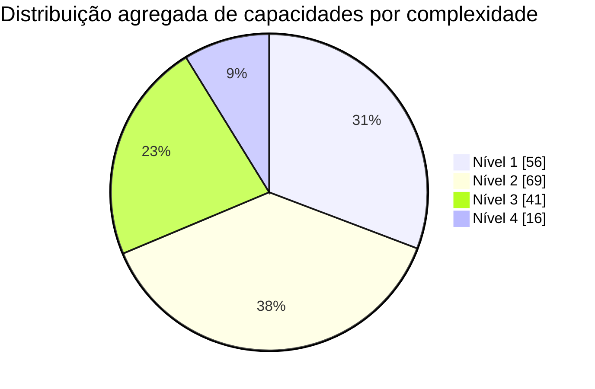

# HubSpot: Dossiê Mestre de Domínio do Produto

> **Propósito:** base de contexto profunda e única sobre o HubSpot para alimentar o Susano.
> **Consolidado a partir de 4 fontes:** dossiê operacional/RevOps (versão limpa), dossiê operacional/RevOps (versão "Guia Profundo"), scrape consolidado de 3 propriedades (Developers Reference EN, Produtos BR, Glossário/Site BR) e scrape completo da documentação de desenvolvedor + changelog.
> **Ângulo:** domínio operacional / RevOps. **Idioma:** pt-BR.
> **Captura das fontes:** 13/06/2026 (corpo) e 25/05/2026 (capítulo Brasil, §25). **Aviso:** preços, tiers, limites e créditos são sensíveis à data e estão marcados com `[VERIFICAR]`.
> **Escala:** documento mestre (referência completa). Não é um prompt; é knowledge base.

---

## 0. Como usar este documento e convenções

Este dossiê funde dois estudos operacionais independentes sobre o HubSpot mais os fatos extraídos da documentação oficial e do glossário. Quando os dois estudos divergem em números (especialmente preço e limites), os dois valores foram preservados e marcados como `[CONTRADIÇÃO]`, porque ambos vêm de leituras de fontes oficiais em momentos próximos e a divergência geralmente reflete promoção, localização, mudança de catálogo ou versão de termos.

**Marcadores de confiança (padrão Susano):**

- `[VERIFICAR]` valor sensível à data ou que deve ser confirmado no order form / pricing page vigente antes de uso comercial.
- `[INFERÊNCIA]` conclusão derivada da arquitetura oficial e de prática de implementação, não citação literal de doc.
- `[CONTRADIÇÃO]` dois valores ou afirmações divergentes entre as fontes; ambos preservados.
- `[LACUNA]` informação que nenhuma fonte trouxe com confiança suficiente ou ponto que merece pesquisa dedicada.

**Estrutura por Hub.** Cada Hub e camada funcional segue o mesmo gabarito de 8 blocos: o que é e para que serve, funcionalidades principais, casos de uso reais, como os profissionais usam de verdade, dicas e macetes, erros comuns e armadilhas, limitações e teto, notas de tier e preço.

---

## Índice

1. Sumário executivo
2. Mapa da plataforma
3. Modelo mental de operação (data model first)
4. CRM Core
5. Marketing Hub
6. Sales Hub
7. Service Hub
8. Content Hub
9. Operations Hub / Data Hub
10. Commerce Hub
11. Breeze e a camada de IA
12. Workflows e automação
13. Relatórios, dashboards e atribuição
14. Segmentação e ativos de execução
15. Permissões, times e governança de dados
16. Estrutura comercial, tiers e preço
17. Ecossistema, integrações e APIs
18. Plataforma de Desenvolvedor, APIs e MCP
19. Playbook RevOps transversal
20. Erros caros mais comuns (consolidado)
21. Tabela mestra de preços, seats, créditos e limites
22. Glossário
23. Contradições e pontos a verificar
24. Fontes
25. HubSpot no Brasil (capítulo compilado em 25/05/2026)

---

## 1. Sumário executivo

A HubSpot se apresenta hoje como uma plataforma de clientes composta por Smart CRM, Marketing Hub, Sales Hub, Service Hub, Content Hub, Data Hub (também chamado Operations Hub) e Commerce Hub, com o Breeze como camada transversal de IA. O ponto mais importante, operacionalmente, é que quase tudo compartilha a mesma base de dados do CRM, o mesmo mecanismo de propriedades e associações, e a mesma lógica de automação e relatórios. Diferente de plataformas construídas por aquisições fragmentadas, a arquitetura centraliza dados em um banco único e alimenta ferramentas especializadas que operam nativamente sobre o mesmo grafo de objetos. Em outras palavras: o HubSpot não funciona melhor quando cada time "usa sua parte"; funciona melhor quando o modelo de dados é desenhado uma vez, com governança, e depois exposto nos Hubs, workflows, relatórios e integrações.

Para equipes de RevOps, o modelo mental mais importante é compreender que o HubSpot não é um conjunto de aplicativos integrados, e sim uma única camada de dados estruturada onde registros fluem por automações transversais. O sucesso operacional exige domínio rigoroso de permissões, governança estrita de modelagem de dados, entendimento profundo dos limites de faturamento baseados em contatos, e uma arquitetura defensiva para evitar dívida técnica, falhas de sincronização e estouros de orçamento.

A plataforma atende especialmente bem operações que valorizam unificação entre marketing, vendas, atendimento, conteúdo e alguma camada de revenue operations. Costuma ser forte quando a empresa quer reduzir troca de contexto entre ferramentas, manter dados de cliente em um só lugar e fazer automação e reporting sobre a mesma base. Onde mais dói é em pricing progressivo, em diferenças relevantes entre tiers, e em limites que só aparecem quando a operação cresce: governança de permissões, custom object design, roteamento sofisticado, atribuição madura, quoting mais complexo e integrações fora do "nativo feliz".

---

## 2. Mapa da plataforma

A plataforma é estruturada com o Smart CRM no centro, circundado por módulos especializados (Hubs) que compartilham o mesmo banco de dados. Essa arquitetura elimina a necessidade de conectores complexos entre departamentos.

| Hub | Foco oficial | Usuário-alvo | Quando faz sentido |
|---|---|---|---|
| **Smart CRM / CRM Core** | CRM flexível com IA e base comum dos Hubs; banco de dados central e associações. | Toda a organização (RevOps, sales ops, marketing ops, CS ops). | Obrigatório. É a fundação. Sempre que a empresa quer um "source of truth" único para contatos, empresas, negócios e tickets. |
| **Marketing Hub** | Automação de marketing, campanhas, e-mail, ads, social, segmentação e atribuição. | Marketing, growth, demand gen. | Quando aquisição, nurture e medição de pipeline importam mais do que simples disparo de e-mail. |
| **Sales Hub** | Prospecção, pipeline, sequências, forecasting, calling e produtividade comercial. | SDR, BDR, AE, líderes de vendas. | Quando o CRM sozinho não basta e o time precisa de cadência, fila, previsão e coaching. |
| **Service Hub** | Help desk, tickets, portal, pesquisas, customer success e atendimento escalável. | Suporte, CS, onboarding, renovação. | Quando atendimento e retenção precisam operar sobre o mesmo histórico comercial e de marketing; gestão de SLA, portais, CSAT. |
| **Content Hub** | Criação e gestão de páginas, blog, podcasts, assets, membership e conteúdo com IA. | Conteúdo, web, SEO, desenvolvedores. | Quando o site e os ativos precisam conversar diretamente com CRM, segmentação e automação; páginas dinâmicas com personalização nativa. |
| **Data Hub / Operations Hub** | Sincronização, qualidade de dados, datasets, joins, custom code e operações de dados. | RevOps, ops, engenharia de dados, BI, TI. | Quando a dor é consolidar, limpar, harmonizar e ativar dados entre sistemas; processos que exigem Node.js, webhooks ou limpeza de dados. |
| **Commerce Hub** | CPQ, quotes, billing, invoices, subscriptions e cobrança integrada. | Revenue ops, finance ops, vendas B2B. | Quando o gargalo está entre proposta, aceite, cobrança e reconhecimento de receita; unificar propostas, links de pagamento e faturas no CRM. |
| **Breeze** | Assistentes, agentes, automações, enriquecimento e IA distribuída pela plataforma. | Todos os times front office e admins. | Quando a empresa já tem dados e processos minimamente organizados para a IA trabalhar com contexto útil. |

**Princípio de arquitetura:** quase todos os Hubs leem e escrevem nos mesmos objetos do CRM. Por isso, a decisão de modelagem de dados feita no CRM Core determina a qualidade de tudo que vem depois: campanha, pipeline, ticket, relatório, atribuição e integração.

---

## 3. Modelo mental de operação (data model first)

O modelo mental mais útil para operar o HubSpot bem é: **modelo de dados primeiro, processo segundo, interface depois.** Primeiro você decide quais objetos, propriedades, labels, estágios, owners e regras de associação representam a operação real. Depois desenha automações, handoffs e SLAs. Só então personaliza views, sidebars, páginas, filas e dashboards para cada equipe. Esse é exatamente o oposto da implementação "guiada pela tela", que costuma criar dívida de dados e retrabalho. `[INFERÊNCIA]` apoiada pela arquitetura oficial do CRM e por práticas de implementação de parceiros enterprise.

Na prática, um operador experiente normalmente começa pelo **data model workshop**: lista as entidades reais do negócio, mapeia campos obrigatórios, decide o identificador único por objeto, define qual associação é obrigatória e qual é opcional, e separa o que é derivado por sync ou calculated property do que é digitado pelo usuário. Só depois cria propriedades, ajusta sidebars, pipelines e views.

O segundo passo é desenhar o **mínimo conjunto de automações de higiene**: ownering, normalização, sync entre objetos associados, prevenção de duplicatas, defaults de lifecycle stage e alertas para dados faltantes. Esse backbone de higiene tende a entregar mais estabilidade do que começar pelas campanhas "brilhantes".

---

## 4. CRM Core

### 4.1 O que é e para que serve

O CRM da HubSpot é a camada de sistema de registro onde vivem objetos, registros, propriedades, associações, atividades, pipelines e grande parte da governança operacional. É o mecanismo de banco de dados relacional fundamental da plataforma: armazena, organiza e vincula todas as entidades, garantindo que cada interação de um cliente seja rastreada em uma linha do tempo unificada, servindo como a única fonte de verdade para todas as operações conectadas. A documentação descreve os objetos como a base para representar relacionamentos e processos de negócio, e o catálogo posiciona o Smart CRM como a fundação incluída nos produtos premium e também disponível separadamente.

### 4.2 Funcionalidades principais

**Objetos.** Os objetos padrão mais centrais continuam sendo contacts, companies, deals e tickets. Em materiais atuais também aparecem leads, products, quotes, invoices, subscriptions, orders e objetos ativados por admins, além dos custom objects. Em termos operacionais, quase toda decisão de implementação vira, no fim, uma decisão sobre em qual objeto um dado pertence, qual propriedade o representa e como esse registro se associa aos demais.

**Registros e propriedades.** Cada registro é um container de propriedades, histórico de alterações, associações e atividades. A HubSpot recomenda verificar se uma propriedade padrão atende à necessidade antes de criar custom properties. Contatos, empresas, negócios, leads, products e outros objetos têm bibliotecas próprias de default properties. Algumas propriedades padrão são populadas automaticamente, como parte de lifecycle stage, fontes analíticas ou dados enriquecidos.

**Objetos customizados.** Existem para representar entidades que não cabem bem nos objetos padrão: assinaturas, contratos, embarques, instalações, franquias, ativos, locais, alunos. Podem ser usados em visualização, workflows, relatórios e associações, e seus limites variam por produto/tier.

**Associações e association labels.** Associações são a forma como registros se relacionam (contato-empresa, negócio-contato, ticket-empresa, quote-deal). O schema suporta labels customizadas, inclusive pares do tipo empregador/empregado ou pai/filho. Isso é crítico quando o mesmo tipo de relação tem papéis diferentes. Em um negócio com múltiplos stakeholders, rotular um contato como "Tomador de decisão" e outro como "Avaliador técnico" permite que workflows enviem o contrato apenas para o tomador de decisão.

`[CONTRADIÇÃO]` **Limite de association labels.** O Product & Services Catalog fala em até 50 labels para cada par de objetos padrão, enquanto a documentação de association schema API fala em até 10 custom labels por pairing. Em projetos enterprise, tratar como item de validação prévia antes de modelagem avançada. Nota complementar do segundo dossiê: limites customizados de associação liberados via API pública só podem ser configurados para valores inferiores aos limites contratuais da assinatura.

**Activity timeline.** O layout de record page mostra timeline, overview de associações e propriedades importantes, além de custom tabs. A timeline pode ser filtrada por atividade e exibe histórico de mudanças. O registro vira tanto ficha de dados quanto diário operacional.

**Lifecycle stage, lead status e lead object.** Lifecycle stage indica em que momento o contato ou empresa está na jornada marketing-vendas; pode ser atualizado manualmente, por workflow, por chat e por automação padrão, e sincroniza entre objetos associados. Lead status é a lógica comercial de qualificação/disposição. O lead object é um objeto operacional separado do Sales Hub Pro/Enterprise, orientado à prospecção no sales workspace. Em resumo: lifecycle stage mede progressão macro do cliente; lead status mede qualificação comercial; o lead object mede trabalho de prospecção.

### 4.3 Casos de uso reais

Em B2B SaaS, o modelo mais comum é Company como conta, Contact como stakeholder, Deal como oportunidade, Ticket para suporte/onboarding/pós-venda, e eventualmente Custom Object para subscription, implementation project ou product seat. Isso permite reporting por conta, handoff entre marketing e vendas e gestão de expansão concentrada na empresa. Empresas B2B corporativas usam o CRM Core para modelar estruturas de contas complexas, associando múltiplos contatos a uma empresa matriz e a subsidiárias, estabelecendo hierarquias de decisão e mapas de influência para guiar vendas enterprise de ciclo longo.

Em B2C ou high-volume, o centro tende a ser o contact record, com companies menos importantes ou ausentes. Em educação, imobiliário, health e field services, custom objects costumam virar o verdadeiro diferenciador, porque processos, inventário, turmas, imóveis ou locais não cabem bem em deals puros. A própria HubSpot usa exemplos como subscriptions, locations, shipments e events.

### 4.4 Como os profissionais usam de verdade

Operadores de RevOps configuram o CRM desativando propriedades nativas desnecessárias e criando um dicionário de dados estrito. A transição de lifecycle stage é rigidamente controlada por automações em segundo plano: um contato transita para "Opportunity" exclusivamente quando um deal associado é criado no pipeline, prevenindo que representantes burlem as métricas de conversão atualizando campos manualmente.

O segundo passo é desenhar o mínimo de automações de higiene: ownering, normalização, sync entre objetos associados, prevenção de duplicatas, defaults de lifecycle stage e alertas para dados faltantes. A HubSpot oferece dedupe por e-mail, domínio, record ID e custom unique IDs; sync properties para copiar dados entre objetos associados; e automação de lifecycle stage entre contacts e companies.

### 4.5 Dicas e macetes

Use custom unique value properties cedo se a empresa tiver identificadores mestres fora da HubSpot (ID do ERP, ID do billing, matrícula, account ID, contract ID). Isso melhora imports, dedupe e reconciliação.

Use sync properties quando um dado precisa aparecer em outro objeto para a operação diária, mas a fonte da verdade não deve mudar de lugar. Exemplo clássico: telefone do contato visível no deal, ou segmento da empresa visível no ticket.

Use association labels como diferencial para arquiteturas complexas (decisor versus avaliador técnico) e configure os painéis de registro laterais condicionados por equipe, exibindo apenas as propriedades cruciais para aquele departamento.

Associe atividades automaticamente quando fizer sentido, configurando automatic associations conforme a origem da atividade, para evitar timelines quebradas e tarefas órfãs.

### 4.6 Erros comuns e armadilhas

O erro mais frequente é transformar properties em substituto de modelagem: usar "Produto comprado 1, 2, 3, 4" em vez de um objeto próprio, ou armazenar relacionamento entre múltiplos participantes em um campo texto. Isso reduz drasticamente a utilidade de relatórios, automações e associações.

Outro erro comum é confundir lifecycle stage com lead status e com deal stage. Cada um responde a uma pergunta diferente; misturar as três lógicas gera relatórios que parecem corretos, mas contam jornadas diferentes.

O erro mais destrutivo na importação é ignorar a lógica de deduplicação nativa, baseada primariamente em e-mail para contatos e domínio para empresas. Importar listas sem domínios válidos, ou permitir que integrações mal configuradas criem registros sem chaves de identificação, gera bancos repletos de duplicatas silenciosas, arruinando a confiabilidade dos relatórios e podendo disparar cobranças indevidas de contatos.

### 4.7 Limitações e teto

A criação e utilização de objetos personalizados exigem assinatura de nível Enterprise. Os limites de associação entre registros são rigorosos: embora limites customizados tenham sido liberados via API pública, eles só podem ser configurados para valores inferiores aos limites contratuais da assinatura. Field-level permissions, sandboxes e certas capacidades avançadas de governança ficam associadas a tiers mais altos. O catálogo legal traz add-ons de aumento de limites para workflows, reports, teams, users, calculated properties e custom objects, sinal claro de que operações maiores precisam desenhar escalabilidade desde cedo.

### 4.8 Notas de tier e preço

A estrutura basal do CRM é gratuita e atende necessidades elementares. O Smart CRM (camada premium) pode ser comprado separadamente e, no catálogo legal, aparece a partir de US$ 20/seat Starter, US$ 50/seat Professional e US$ 75/seat Enterprise `[VERIFICAR, 06/2026]`. Features de Smart CRM vêm incluídas quando se compra um produto premium, e seats "Core" herdam o nível mais alto entre os produtos comprados na conta. Objetos personalizados, layouts condicionais de registro, limites customizados de associação e governança de esquema de dados acompanham o tier Enterprise.


---

## 5. Marketing Hub

### 5.1 O que é e para que serve

Marketing Hub é a camada de aquisição, nurture e medição de marketing da HubSpot. É o motor de automação de marketing digital desenhado para capturar tráfego, qualificar leads e orquestrar campanhas em escala, sobre o mesmo banco do CRM. O objetivo principal é alinhar as métricas de marketing diretamente à receita gerada no CRM, abandonando métricas de vaidade em favor de análise de pipeline. Cobre campanhas, e-mail, formulários, landing pages, ads, social, segmentos e atribuição.

### 5.2 Funcionalidades principais

Campanhas agregam múltiplos assets e permitem orçamento, metas e reporting em torno de um esforço único. Formulários usam o novo editor e suportam lógica condicional. Páginas e landing pages podem ser geradas com Breeze. E-mail marketing cobre envio direto e automação. Smart content permite variações por dados de CRM e origem. Social composer publica em múltiplas redes. Ads conectam Google, Meta e LinkedIn, inclusive com eventos de conversão baseados em lifecycle stage e form submissions. O conjunto inclui ainda lead scoring, construtor de jornadas visuais, CTAs e ferramentas profundas de segmentação via listas ativas e estáticas.

### 5.3 Casos de uso reais

Em SMB B2B, o padrão é landing page mais form mais active segment mais nurture por e-mail mais handoff para sales owner. Em enterprise, o uso cresce para campanhas com orçamento, ads conversion events, smart content, atribuição multitoque e reporting por equipe e geografia. Em B2C, formulários, pages e e-mail tendem a importar mais do que account-based logic.

Empresas SaaS usam o Marketing Hub para nutrição de bases freemium: a integração de eventos personalizados de uso do software permite disparar sequências de e-mails baseadas em comportamento. Se o usuário utiliza um recurso específico no app, o HubSpot o insere em uma lista ativa e envia uma oferta de upgrade de plano altamente contextualizada.

### 5.4 Como os profissionais usam de verdade

O fluxo operacional bom costuma ser: criar subscription types, padronizar naming de campanhas, definir convenção de UTMs, construir formulários mapeados a propriedades úteis, gerar uma active segment por intenção, e só então ligar nurture e handoff. Depois, associar todos os assets relevantes à campanha para evitar atribuição incompleta.

Operadores maduros constroem políticas de "Sunset" para higienizar o banco. Criam um workflow que monitora engajamento de forma contínua: se um contato não abre e-mails, não visita o site e não clica em links por 180 dias, o sistema altera automaticamente o status de faturamento para "Non-Marketing Contact", prevenindo custos com leads inativos.

### 5.5 Dicas e macetes

Use active segments para públicos dinâmicos e static segments para populações congeladas (listas de exclusão, cohorts de análise, cargas de outbound). Use form shortening quando houver enrichment disponível, para reduzir fricção sem perder dados.

A melhor tática de redução de custo operacional é alterar a configuração global do portal para que todas as novas importações de planilhas e entradas via integração padronizem os contatos como "Non-Marketing". A mudança para o status cobrável "Marketing" deve ocorrer somente via gatilhos de alta intenção, como submissão de formulário de contato ou inscrição voluntária em newsletter.

### 5.6 Erros comuns e armadilhas

`[ARMADILHA FINANCEIRA CRÍTICA]` O modelo de faturamento de contatos é a maior armadilha do HubSpot. Importar uma base marcando a caixa "Set as Marketing Contacts" e ultrapassar o limite contratado em apenas um contato gera um upgrade imediato e automático de tier. Pior: a redução do custo não é automática. Mesmo deletando os contatos excedentes no dia seguinte, a organização continuará pagando o valor mais alto até o fim do período de renovação contratual.

Outros erros recorrentes: montar campanha sem taxonomia mínima de assets (destrói a utilidade dos relatórios de campanha); superlotar formulários sem estratégia de progressive capture ou shortening; e usar smart content cedo demais, antes de haver volume e qualidade suficientes nos dados de segmentação.

### 5.7 Limitações e teto

As listas de segmentação têm tetos de processamento por tier. `[VERIFICAR, 06/2026]` Portais Starter passaram por aumento recente para 50 listas ativas; Professional suporta até 1.200 listas ativas e 1.200 listas estáticas; Enterprise escala para 2.000 listas de cada tipo. Modelos de atribuição multi-touch complexos também encontram teto rapidamente fora do Enterprise. Social nativo é útil para publicação e alguma análise, mas não substitui suíte social enterprise. Ads nativos ajudam conversão, audiences e reporting, mas operações muito avançadas continuam dependendo do ad platform. Atribuição é poderosa, porém sensível à higiene de tracking, associação de assets e consistência de lifecycle/deals. Reviewers externos apontam pricing complexo e bugs como fricções recorrentes.

### 5.8 Notas de tier e preço

A cobrança escala em dois eixos paralelos: acesso às ferramentas (assentos base + assinatura do tier) e número de contatos de marketing. `[VERIFICAR, 06/2026]` Professional inicia em US$ 890/mês incluindo 3 assentos Core e 2.000 contatos de marketing; ultrapassar os 2.000 contatos adiciona pacotes de US$ 250/mês a cada 5.000 contatos extras; Enterprise inicia em US$ 3.600/mês com limites maiores.

`[LACUNA]` Na leitura da página oficial atual, o primeiro dossiê não conseguiu extrair com consistência todos os preços por tier de Marketing Hub. Campanhas e social publishing aparecem como Marketing Hub Professional/Enterprise; eventos de conversão com Meta e Google aparecem já em Starter/Professional/Enterprise; smart content em e-mail e páginas depende de tiers mais altos. Pricing específico do hub é altamente mutável; para contrato, usar o pricing page e o order form vigentes.


---

## 6. Sales Hub

### 6.1 O que é e para que serve

Sales Hub é o conjunto de ferramentas de prospecção, execução comercial, pipeline, coaching e previsão da HubSpot. Seu foco é transformar o CRM em um ambiente de trabalho para reps, não só em repositório de dados. Reduz a fricção administrativa do ciclo comercial, organiza o fluxo de trabalho diário de executivos de conta e dá visibilidade rigorosa de conversão e previsão de pipeline às lideranças.

### 6.2 Funcionalidades principais

Os blocos mais relevantes hoje: sales workspace com prospecting queue; leads object e lead pipelines; sequences e dynamic sequences; templates, snippets e document library; meetings scheduler; calling com gravação e transcrição; playbooks; forecasting; deal pipelines com automação; lead rotation; rastreamento nativo de aberturas de e-mail; e conversation intelligence mais profunda em tiers altos.

### 6.3 Casos de uso reais

Em startup B2B, a combinação típica é meetings mais templates mais snippets mais pipelines. Em mid-market, entram sequences, forecast, lead routing e coaching por call transcript. Em operação outbound mais intensa, o workspace e a fila de prospecção ficam centrais, mas vários times ainda complementam com dialers e engagement tools externos. Equipes de BDR dependem das sequences para cadências híbridas: o gestor define uma estrutura onde o BDR executa uma chamada exploratória no dia 1, seguida de e-mail automatizado no dia 2 e tarefa no LinkedIn no dia 4. A ferramenta interrompe a automação imediatamente se o lead responder ou agendar reunião, evitando comunicações duplicadas.

### 6.4 Como os profissionais usam de verdade

O fluxo maduro costuma ser: estruturar pipelines com critérios explícitos por stage; configurar lead pipelines e automações; padronizar templates, snippets e playbooks; ligar meetings scheduler ao calendário; usar fila diária para calls/emails/tasks; e fechar o mês pelo forecast, não por planilha lateral.

Gestores de RevOps blindam o funil impondo regras estritas de transição: configuram propriedades como campos obrigatórios para que um negócio avance de "Apresentação" para "Negociação", garantindo que a base exija valor do contrato ou motivo da perda antes de o representante atualizar o painel.

### 6.5 Dicas e macetes

Use playbooks como estrutura de captura de dados, não só como script de conversa. Use template/snippet analytics para eliminar peças que parecem boas mas convertem mal. Trate o leads object como fila operacional, não como sinônimo de lifecycle stage.

`[WORKAROUND]` No Sales Hub Professional, os Playbooks estão limitados a respostas em texto aberto e não conseguem atualizar propriedades estruturadas do CRM nativamente (isso é um unlock do Enterprise). Para contornar sem custo adicional, consultores configuram visualizações customizadas no painel central do registro do Deal, exibindo as propriedades exatas como um "formulário" incorporado, obrigando os reps a preencher os menus suspensos durante a ligação.

### 6.6 Erros comuns e armadilhas

O erro mais caro é implantar pipeline sem definição operacional de entrada e saída por stage. O segundo é colocar prospects em sequences sem governança de unsubscribe, ownership e critérios de stop. O terceiro é não separar claramente lead qualificado, deal aberto e conta em trabalho, o que causa forecast inflado e filas inúteis.

O acúmulo de tarefas vencidas e negócios estagnados é falha crítica de adoção. Vendedores criam propostas e não atualizam as datas de fechamento projetadas. Quando centenas de negócios ficam parados no passado, o módulo de Forecasting exibe gráficos corrompidos e inúteis para o conselho, gerando efeito dominó de desconfiança no CRM.

### 6.7 Limitações e teto

Para times SDR muito intensivos, análises independentes apontam gaps em visitor identification, power dialer nativo e profundidade de sales engagement versus plataformas especializadas. A HubSpot cobre muito bem CRM, cadência básica e alinhamento com marketing, mas nem sempre substitui todo o stack de prospecção em alta escala. Quando a operação precisa de estruturas de equipes regionais complexas, rotatividade condicional por territórios granulares ou playbooks capazes de atualizar registros de forma estruturada, o sistema exige o salto para Enterprise.

### 6.8 Notas de tier e preço

A cobrança é por assentos de vendas dedicados. `[CONTRADIÇÃO]` entre as fontes: o primeiro dossiê (guia de pricing no blog oficial, 01/2026) traz Starter a partir de US$ 9/seat anual ou US$ 15 mensal, Professional a partir de US$ 90-100/seat e Enterprise a partir de US$ 150/seat. O segundo dossiê traz Starter US$ 20/mês por assento, Professional US$ 100/mês por assento e Enterprise US$ 150/mês por assento. Os dois convergem em Enterprise (US$ 150) e divergem em Starter e Professional. `[VERIFICAR]` antes de qualquer proposta. Upgrade para Pro e Enterprise frequentemente exige taxas de onboarding obrigatórias que chegam a US$ 3.500. Sequences exigem seat de Sales ou Service e permissões próprias.


---

## 7. Service Hub

### 7.1 O que é e para que serve

Service Hub é a camada de atendimento, suporte, CS e retenção da HubSpot. Gira em torno de help desk, tickets, customer portal, knowledge base, feedback surveys e customer success workspace, sempre acoplados ao CRM. Estrutura tickets, mensura satisfação e reduz a carga operacional repetitiva de suporte, visando reduzir a taxa de cancelamento (churn).

### 7.2 Funcionalidades principais

Help desk centraliza canais e tickets; o pacote inclui pipelines de ticketing com roteamento e caixa de entrada omnichannel (chat, e-mail, formulários). O customer portal dá ao cliente uma área para acompanhar tickets. Knowledge base oferece autosserviço. Feedback surveys cobrem CSAT, NPS e CES, além de pesquisas customizadas. Customer success workspace adiciona health scores, views e métricas. SLAs condicionais, routing por skill e workspaces por time aparecem em camadas mais avançadas.

### 7.3 Casos de uso reais

Em suporte transacional, encaixa bem para consolidar e-mail, chat e WhatsApp em uma fila única com ticketing. Em CS B2B, o ganho aparece quando customer success workspace, health score, portal e ticket history ficam ligados ao histórico de marketing e vendas. Departamentos técnicos configuram o módulo de SLA para garantir que contas marcadas como "Key Accounts" recebam primeira resposta em até 30 minutos; se o prazo estiver em risco, o sistema notifica visualmente os supervisores no painel e via mensagem no Slack.

### 7.4 Como os profissionais usam de verdade

O desenho maduro costuma ser: criar ticket pipelines por tipo de operação; conectar canais; configurar regras de roteamento e SLA; ativar base de conhecimento para reduzir volume repetitivo; abrir portal para clientes-chave; e medir saúde e risco em customer success.

As operações refinam gatilhos baseados em inatividade: se um ticket fica estagnado em "Aguardando resposta do cliente" por 3 dias, um workflow envia e-mail de acompanhamento; se não houver retorno em 7 dias, o sistema encerra o ticket automaticamente e o rotula como "Resolvido por Inatividade", mantendo o pipeline focado nas emergências reais.

### 7.5 Dicas e macetes

Use propriedades de survey response em segmentação, workflow e reporting. Não trate o portal como mero anexo do suporte; ele funciona melhor quando o cliente vê histórico e consegue responder no próprio portal. Configure os cronogramas de SLA com base no horário de funcionamento de cada equipe regional e pause SLAs em finais de semana e feriados, para que o "Tempo Médio de Resolução" não exiba falsos gargalos causados por falta de configuração de calendário. Evite conectar caixas de e-mail pessoais ao inbox unificado. Se houver times especializados, workspaces por equipe em Service Hub Enterprise evitam uma operação única caótica.

### 7.6 Erros comuns e armadilhas

`[ARMADILHA WHATSAPP]` O maior erro de setup é delegar canais de WhatsApp ao Service Hub sem entender a política de templates da Meta. Quando o cliente cessa a interação, uma janela de 24 horas se fecha. Agentes que tentam responder dois dias depois encontram erros silenciosos de envio, porque o HubSpot não envia mensagens livres fora dessa janela sem um template pré-aprovado da Meta.

Outros erros: criar tickets sem taxonomia de categoria, prioridade, origem e owner; publicar knowledge base sem processo de manutenção; e achar que customer success workspace substitui estratégia de health model (a ferramenta ajuda, mas o score precisa de lógica de negócio).

### 7.7 Limitações e teto

No tier Professional, o portal do cliente tem autenticação e visualização básica, mas é insuficiente para organizações que precisam de dashboards ou painéis profundos de uso; nesses casos, desenvolvedores usam plataformas externas como Softr conectadas ao HubSpot. As pesquisas de feedback no Pro não permitem lógicas de ramificação avançadas. O customer portal ainda tem restrições relevantes, como suporte limitado a múltiplos idiomas em alguns cenários. Help desk e Service Hub avançado exigem seat para muitos recursos. Operações de suporte enterprise muito complexas podem continuar precisando de WFM, QA ou routing externo.

### 7.8 Notas de tier e preço

Licenciamento orientado a assentos de serviço, seguindo a matriz do Sales Hub. `[VERIFICAR, 06/2026]` Starter US$ 20/mês, Professional US$ 100/mês por assento (com controle de SLA e pesquisas), Enterprise US$ 150/mês por agente (habilita pesquisas ramificadas e painéis granulares). Help desk avançado, surveys, knowledge base e customer portal aparecem como Service Hub Professional/Enterprise, com certos recursos exigindo Service Seat. `[LACUNA]` o primeiro dossiê não extraiu uma tabela oficial completa de preços por tier do Service Hub com confiança suficiente.


---

## 8. Content Hub

### 8.1 O que é e para que serve

Content Hub é o produto de conteúdo e experiência web da HubSpot. Anteriormente conhecido como CMS Hub (rebatizado em abril de 2024), representa a evolução comercial do antigo CMS stack. Serve para criar, hospedar, adaptar e distribuir ativos digitais ancorados a funções generativas de IA e em profunda sinergia com o modelo de dados do CRM. Operacionalmente cobre website pages, landing pages, blog, embeds, private content, podcasts, dynamic pages com HubDB e remix de conteúdo com IA.

### 8.2 Funcionalidades principais

Páginas e landing pages podem ser criadas com editor e Breeze. Blog (com construtor drag-and-drop) e case studies ajudam SEO e prova social. Ferramentas unificadas de revisão de SEO. Geração generativa de imagens. Hospedagem de podcast com suporte a vozes de IA. Content remix gera novos formatos a partir de um asset. Memberships e private content (gated content) controlam acesso condicionado a listas segmentadas. HubDB e dynamic pages permitem catálogos, diretórios e estruturas data-driven. Embeddable content ajuda quem mantém o site principal em outro CMS.

### 8.3 Casos de uso reais

Para SMB, costuma começar como landing pages mais blog mais CTAs mais forms. Para mid-market, vira também centro de campanhas, centros de recursos e microsites. Para enterprise, o diferencial é quando HubDB, memberships, portals e CRM objects on page entram em jogo para construir experiências personalizadas, diretórios, áreas de parceiros e portais de clientes. Equipes corporativas produzem webinars longos e, via "Content Remixing", extraem instantaneamente o material original em dezenas de variantes secundárias: posts curtos para LinkedIn, rascunho formatado para blog e scripts de e-mail promocional, reduzindo semanas de redação a minutos.

### 8.4 Como os profissionais usam de verdade

A rotina madura separa três esteiras: conteúdo editorial, páginas de conversão e experiências privadas. Cada uma tem owner, templates, naming e objetivos próprios. Em paralelo, usa-se HubDB para catálogos e páginas dinâmicas, e content remix para escalar derivativos sem multiplicar retrabalho. Profissionais de inbound aplicam testes A/B governados por IA em landing pages críticas: em vez de monitorar análises manuais, a própria IA distribui o tráfego, analisa o desempenho simultâneo e consagra a página vencedora.

### 8.5 Dicas e macetes

Se o site institucional principal permanecer em WordPress ou outra stack, o Content Hub ainda funciona muito bem como motor de conversão via forms, CTAs, tracking code e content embeds. O verdadeiro poder reside na função "Brand Identity" / Brand Voice: a configuração nativa permite que a IA treine no tom de voz, estilo de redação e padrões visuais históricos do seu site, eliminando o ar robótico do material generativo e assegurando que rascunhos inéditos sejam estruturados na voz institucional legítima.

### 8.6 Erros comuns e armadilhas

`[ARMADILHA CSS]` Excluir estilos em cascata globais de páginas de marketing ativas sem rastrear as dependências previamente causa quebras catastróficas no design responsivo de centenas de peças ativas. Ignorar o painel de análise de SEO integrado antes da publicação penaliza o ranqueamento orgânico. Outros erros: usar Content Hub só como page builder, ignorando a vantagem de CRM-connected content; abusar de páginas e templates sem governança; e prometer "portal" sem antes entender memberships, access groups, domain setup e limitações de private content.

### 8.7 Limitações e teto

Dynamic pages dependem do stack CMS/Content Pro+. Private content traz requisitos específicos por tipo de conteúdo. Operações muito custom front-end podem preferir headless/híbrido. A HubSpot pode aplicar throttling em cenários de uso excessivo de bandwidth no conteúdo hospedado. O Content Hub tem teto claro em operações estritamente de e-commerce: não foi concebido para inventários maciços ou cestas complexas de transação, ambientes onde a integração nativa com Shopify torna-se mandatória.

### 8.8 Notas de tier e preço

`[VERIFICAR, 06/2026]` No catálogo legal, Content Hub aparece em Starter, Professional e Enterprise: US$ 20/seat Starter; US$ 500/mês Professional com 3 core seats; US$ 1.500/mês Enterprise com 5 core seats. Os dois dossiês convergem nesses valores. `[CONTRADIÇÃO]` aparente: a página de pricing em português mostrava, no mesmo período, composição promocional para Starter "a partir de US$ 7/mês/licença" em certos cenários, divergindo do catálogo. Para contrato e orçamento, tratar sempre a página comercial e o order form como fonte final.


---

## 9. Operations Hub / Data Hub

### 9.1 O que é e para que serve

Nos materiais oficiais atuais, o nome predominante é Data Hub, embora o mercado ainda use "Operations Hub" em muita conversa e documentação histórica. Aqui os dois são tratados como o mesmo eixo funcional: integração, qualidade, enriquecimento, datasets e operações de dados. É a infraestrutura técnica e de engenharia silenciosa da plataforma, focada em sanar problemas de má formação de banco de dados, enriquecer registros de forma autônoma e executar código que ultrapassa as limitações visuais do ecossistema.

### 9.2 Funcionalidades principais

Os blocos centrais são data sync one-way e two-way, custom field mappings, matching rules, data quality tools, dedupe, format data via workflow (conversão de capitalização, ajustes de fuso horário), custom events, datasets e data studio com data join, sync de custom objects com apps compatíveis, e integrações com data warehouse em tiers altos. As automações programáveis complexas usam webhooks e scripts Node.js (Custom Code Actions). O Data Agent adiciona pesquisa, categorização e enriquecimento com IA.

### 9.3 Casos de uso reais

Em RevOps, o caso clássico é sincronizar ERP, billing, CS e tooling com o HubSpot, padronizar dados e alimentar reporting confiável. Em enterprise, datasets e joins fazem a ponte entre CRM e analytics interno. Exemplo concreto de Custom Code: assim que um BDR adiciona um domínio a uma nova Company, um script Node.js aciona uma chamada de API via Custom Code para uma plataforma de enriquecimento (ex. Clearbit), recupera faturamento estimado, setor e número de funcionários, e mapeia de volta às propriedades HubSpot sem intervenção humana.

### 9.4 Como os profissionais usam de verdade

O operador maduro cria primeiro uma matriz de sistema mestre por campo. Depois define: qual app cria, qual app pode atualizar, qual app nunca manda overwrite, qual identificador faz matching, e quais campos serão sincronizados ou apenas exibidos. Só depois liga o sync. Engenheiros de RevOps programam ações interconectadas onde o HubSpot dita regras para o banco interno ou AWS. Para manter a segurança das chaves de API perante equipes juniores, usam a camada de "Secrets" encapsulada dentro das configurações de Custom Code, ocultando os tokens e operando chamadas com autenticação restrita.

### 9.5 Dicas e macetes

Data sync não substitui governança. Use custom unique IDs e match rules bem definidos. Use format data action para limpar input operacional antes que ele chegue aos relatórios; exemplo monótono e necessário: um workflow localiza a lacuna entre as strings e segmenta nomes completos digitados no campo "Nome", preenchendo adequadamente as propriedades de Nome e Sobrenome. Use datasets quando a pergunta de negócio exigir tabela intermediária e fórmula, em vez de forçar tudo no report builder padrão.

### 9.6 Erros comuns e armadilhas

O erro mais caro é ligar sync bidirecional sem política de precedência de campo. O segundo é criar mapping demais antes de provar valor. O terceiro é confundir data quality dashboard com data governance completo (a ferramenta ajuda, mas ownership de dados continua sendo processo humano). `[ARMADILHA CUSTOM CODE]` A omissão típica é negligenciar a aba "Data Outputs" após construir o JavaScript: qualquer variável processada no script que deva influenciar a etapa seguinte do workflow exige declaração e mapeamento estrito de tipo. Sem essa vinculação, os dados se perdem e os fluxos falham sem gerar alertas.

### 9.7 Limitações e teto

Nem todo app suporta o mesmo nível de data sync. Datasets e joins têm limites próprios e dependem de tier. Data warehouse integrations e parte do stack avançado ficam em camadas mais altas. `[VERIFICAR]` Scripts Node.js em Custom Code Actions têm limites severos de consumo de memória e tempo máximo de execução (tolerância usual abaixo de 20 segundos por chamada), tornando inviável o processamento em lotes de alto estresse. A engine nativa do Data Sync padroniza as chaves de API para plataformas populares, limitando a criação customizada de modelo frente a ferramentas iPaaS independentes. Em cenários enterprise, eventualmente ainda será necessário um iPaaS ou data platform externo para orquestração mais sofisticada.

### 9.8 Notas de tier e preço

A arquitetura fundamental de Data Sync é gratuita. `[VERIFICAR, 06/2026]` Os dois dossiês convergem: Data Hub Starter US$ 20/seat; Professional a partir de US$ 800/mês com 1 core seat (marco obrigatório para Custom Code e Data Formatting); Enterprise a partir de US$ 2.000/mês com 1 core seat (justificado por Data Studio e Datasets). Clientes novos depois de 05/03/2024 passam a ver pricing por seat em Starter e base price em Pro/Enterprise, sem afetar de imediato clientes antigos no modelo anterior.


---

## 10. Commerce Hub

### 10.1 O que é e para que serve

Commerce Hub é o stack de CPQ, quotes, billing e pagamento da HubSpot. O objetivo é encurtar o caminho entre proposta, aceite e recebimento, deixando o quote-to-cash mais visível dentro do CRM e aproximando as operações financeiras dos representantes de vendas. Opera majoritariamente faturamento B2B: gestão de propostas faturáveis, fechamento de cotações e transações diretas no sistema.

### 10.2 Funcionalidades principais

O núcleo hoje inclui o CPQ com quotes, templates de quote, line items com pricing flat/tiered/ramp, click-to-accept ou e-signature, invoices, payment links, subscriptions, payment records, payouts/fees/refunds, relatórios de commerce analytics, e opção de processar via HubSpot Payments ou Stripe. Cotações assináveis nativamente, faturamento de subscrições recorrentes e sincronização direta com o gateway HubSpot Payments e processadores opcionais.

### 10.3 Casos de uso reais

Em B2B SaaS e serviços, funciona melhor quando há proposta formal, renegociação, assinatura e recorrência leve ou moderada. Em empresas com billing/ERP robusto, pode operar como camada de front-office e integrar back-office depois. Em vendas transacionais simples, payment links e invoices já resolvem muito sem CPQ completo. Exemplo: empresas SaaS anexam links de pagamento em workflows pós-demonstração; ao aprovar eletronicamente a proposta, o cliente tem as taxas iniciais cobradas via cartão e ciclos mensais configurados via débito automático.

### 10.4 Como os profissionais usam de verdade

O fluxo maduro é: organizar product library e pricing model; criar quote templates por motion comercial; padronizar acceptance options; definir quando quote vira invoice; ligar reporting de sent versus accepted versus paid; e automatizar follow-up pós-aceite e pós-pagamento. Os times configuram os "Checkout Settings" permitindo o repasse das taxas processuais aos compradores (surcharge) em faturas de alto risco, preservando margem.

### 10.5 Dicas e macetes

Separe claramente quote (negociação e aceite) de invoice (cobrança). Use templates por motion, não um template universal. Valide cedo implicações fiscais e jurisdicionais de invoice e e-signature com jurídico e financeiro. `[VERIFICAR]` No cenário dos EUA e para grandes transações, prefira compensação via ACH local: enquanto transações de cartão custam 2,9% do volume, as transferências ACH no Commerce Hub têm teto de proteção, cobrando um máximo consolidado de US$ 10 por operação e preservando somas vastas.

### 10.6 Erros comuns e armadilhas

O erro mais comum é tentar substituir imediatamente toda a stack de billing/ERP por Commerce Hub. Outro é negligenciar product library e line items, fazendo o quoting perder padronização no início. Há risco de confusão entre legacy quotes e o novo quoting. `[ARMADILHA CAMBIAL]` `[VERIFICAR]` Omitir os mecanismos cambiais em conexões internacionais: o HubSpot adiciona silenciosamente taxas de conversão de moeda que flutuam entre 1% e 2% (EUA, Reino Unido, Canadá) nas compensações cross-border no modelo nativo, destruindo lucros projetados sem cálculo prévio.

### 10.7 Limitações e teto

Commerce Hub é forte para front-office de receita, mas não é automaticamente ERP, tax engine ou revenue recognition de nível enterprise. Não foi projetado para operar como e-commerce independente com controle complexo de inventário e carrinho tradicional de varejo. Digital wallets como Apple Pay desativam automaticamente quando submetidos através de checkouts embarcados em módulos do seu site. Alguns recursos dependem de connected payments account; HubSpot Payments tem disponibilidade e regra própria por jurisdição (frequentemente restrita na América Latina).

### 10.8 Notas de tier e preço

`[CONTRADIÇÃO]` entre as fontes sobre a disponibilidade por tier: o primeiro dossiê diz que Commerce Hub está em Professional e Enterprise, não em Starter, com features específicas como e-signature limit increase. O segundo dossiê diz que a adoção é transversalmente garantida até no módulo Starter. Provável reflexo da diferença entre as ferramentas básicas de pagamento (amplamente disponíveis) e o CPQ/Commerce premium (Pro/Ent). `[VERIFICAR]` Taxas subjacentes: operar com a fundação legada do Stripe via HubSpot cobra 0,75% sem teto sobre a quantia; o HubSpot Payments nacional aplica platform fee mais baixa, em torno de 0,5%. `[LACUNA]` os preços correntes por seat do Commerce Hub não foram extraídos com confiança equivalente à do catálogo; checar no pricing atual.


---

## 11. Breeze e a camada de IA

### 11.1 O que é e para que serve

Breeze é o conjunto de ferramentas de IA da HubSpot, distribuído pela plataforma. A documentação atual o divide em assistants, agents, studio, tools, knowledge vaults e reporting. Consolida interfaces interativas e agentes autônomos criados para delegar, extrair e concluir fluxos, poupando humanos de logística de dados primários no CRM. Parte das capacidades usa HubSpot Credits.

### 11.2 Funcionalidades principais

No que está documentado: geração e edição de conteúdo; content remix; brand voice; prospecting agent; customer agent; data agent; enriquecimento de dados; intelligence tab em company/contact; buyer intent; ações de workflow para análise, pesquisa e smart properties; e Breeze Studio para customizar assistentes e agentes. A suíte inclui o Breeze Assistant (copiloto conversacional nas telas operacionais), o Customer Agent (triagem primária autônoma nos inboxes), o Prospecting Agent (enriquecimento de base para vendas), o Content Agent e as Knowledge Vaults, que isolam os vetores de contexto institucional.

### 11.3 Casos de uso reais

Breeze funciona melhor quando já existem dados, conteúdo e processos minimamente organizados. Customer Agent depende de base de conhecimento e conteúdo confiável. Prospecting Agent depende de selling profile, sinais de compra e critérios de enrolment. Data Agent depende de dados limpos. Sem isso, a IA tende a acelerar ruído. Equipes de atendimento Tier-1 acoplam o Customer Agent diretamente aos artigos da Base de Conhecimento e blogs hospedados; quando o cliente pede ajuda no chat, a IA vasculha exclusivamente o que está publicado e orienta resoluções instantâneas, escalando para humano caso falhe.

### 11.4 Como os profissionais usam de verdade

Times maduros ativam primeiro brand voice, content assist, meeting/post-call summaries e form shortening/enrichment, porque dão ganho rápido com baixo risco. Só depois escalam agents autônomos, quando já existe governança de créditos, permissões e conteúdo-fonte. Apesar da retórica plug-and-play, especialistas investem semanas delineando a taxonomia exata das Knowledge Vaults; auditam o relatório "Unanswered Questions" (perguntas não respondidas) e reescrevem arquivos em loop constante para aplacar falhas de compreensão da IA.

### 11.5 Dicas e macetes

Trate IA como camada de execução contextual, não como substituto de arquitetura. Ative AI settings de forma explícita, definindo quais dados podem ser compartilhados. Monitore créditos mensalmente. Teste agents em escopo estreito antes de liberar uso espalhado. O Breeze é refém estrito dos conteúdos a que for alimentado: ao alimentar a Knowledge Vault, abandone integrações com bases públicas desestruturadas e transforme wikis confusos em PDFs e arquivos de síntese polidos, isolando o escopo para barrar alucinações em conversas ativas.

### 11.6 Erros comuns e armadilhas

O maior erro é comprar a promessa de marketing antes de ler o artigo "Understand Breeze" e os artigos de setup específicos. A promessa de "configurar seu AI Agent em 15 minutos" mascara dívida técnica: o agente opera mal se tentar acoplar URLs da intranet sem revisão de formato. `[VERIFICAR]` O Assistant está sujeito a tetos invisíveis de utilização, limitados em torno de 30 disparos por minuto ou 1.000 iterações diárias. Outro erro recente é não entender o modelo de consumo por crédito e, no caso de alguns agentes, a mudança para pricing orientado a outcome anunciada em abril de 2026.

### 11.7 Limitações e teto

Alguns agents consomem credits; recursos bulk e automated podem acelerar muito o consumo; e o uso depende de permissões e AI settings. O ecossistema favorece fontes do próprio sistema (páginas HubSpot e Knowledge Base nativa). Operações que hospedam suporte documental em terceiros como Zendesk ou Notion perdem o crawling fluido e são forçadas ao método de atualização via upload manual ou conexões iPaaS. Boa parte do que parece mágico depende de contexto já existente no CRM. O que é real hoje: geração assistida, enrichment, insights, agents específicos e automation-oriented AI. O que ainda exige cuidado: autonomia ampla sem revisão.

### 11.8 Notas de tier e preço

`[VERIFICAR, 06/2026]` HubSpot Credits incluídos variam de 500, 3.000 e 5.000 em Starter/Professional/Enterprise para Smart CRM, Marketing, Sales, Service e Content, e chegam a 500, 5.000 e 10.000 para Data Hub ou Customer Platform. Créditos adicionais custam US$ 0,010 por crédito (1.000 créditos por aproximadamente US$ 10). Há disparidade nas documentações quanto ao custo por ação de agente: algumas referências citam resolução orientada a texto via Customer Agent em torno de 50 créditos e iteração de prospecção em torno de 100 créditos. Operações densas podem onerar a conta na casa dos milhares de créditos por mês.


---

## 12. Workflows e automação

### 12.1 O que é e para que serve

Workflows são a espinha dorsal da automação da HubSpot, o sistema nervoso autônomo da operação. A base de conhecimento os posiciona como o mecanismo principal para automatizar processos, além de automações menores em e-mail, forms, pipelines e sequences. É o painel drag-and-drop estruturado para desenhar condicionantes que ativam, processam e reativam ações lógicas sem intervenção humana.

### 12.2 Funcionalidades principais

Os workflows suportam Enrollment Triggers vinculados a propriedades do CRM, ramificações If/Then (branches), delays baseados em relógio ou datas relativas, sync/update de propriedades, formatação de dados, webhooks, extensões, enrollment multiobjeto, lead rotation (roteamento equitativo ou fixo) e ações com Breeze para análise e smart properties. O catálogo legal mostra add-ons de aumento de volume de workflows.

### 12.3 Casos de uso reais

As receitas mais comuns: lead routing, owner assignment, MQL-to-SQL handoff, task creation por stage, follow-up pós-form, pós-meeting e pós-pagamento, normalização de campo, alertas de renovação, escalonamento de SLA e envelopamento de integrações externas via webhook. O clássico B2B Handoff: quando um deal atravessa as fases e é rotulado "Fechado Ganho", a automação gera tarefas mandatórias ao financeiro, envia resumos contextuais para canais no Slack e atualiza o Lifecycle Stage de Empresa e Contato para "Customer".

### 12.4 Como os profissionais usam de verdade

O operador experiente evita workflow monstro e prefere backbone por domínio: uma automação para ownership, outra para lifecycle, outra para hygiene, outra para notifications, outra para sales handoff. Isso facilita troubleshooting e reduz efeito colateral. Quando enfrentam volumes que exigem qualificar entidades por estados e cidades distintas, arquitetos elaboram ramificações aninhadas (nested branches) com soluções de contingência (fallbacks).

### 12.5 Dicas e macetes

`[TRUQUE]` Ao construir um fluxo engatilhado por propriedades manuais criadas por representantes, injete um Delay estático inicial de um minuto entre a ativação do gatilho e as execuções. Essa barreira dá respiro para que a base sincronize as demais funções de forma assíncrona e os dados recém-criados se unifiquem antes das validações. Use workflows para data formatting cedo. Use lead pipeline automation nativa quando o processo estiver centrado no lead object. Ao montar integração, avalie primeiro data sync nativo; só depois parta para webhook/custom app.

### 12.6 Erros comuns e armadilhas

O erro mais caro é automação sem convenção de nomenclatura, owner e lógica de exclusão. O segundo é update excessivo do mesmo campo a partir de várias automações. O terceiro é automatizar processo ruim e multiplicar erro rapidamente. Configurações desleixadas em re-enrollment: permitir recadastramento em gatilhos baseados puramente na "Última Visita ao Website" submete os usuários a fluxos retroalimentados disparados diariamente. Abuso da lógica OR versus AND nos filtros do gatilho inicial confunde avaliações hierárquicas.

### 12.7 Limitações e teto

`[VERIFICAR]` Os fluxos mantêm barreiras baseadas em volume de filtragem: pode-se associar até um teto de cerca de 250 filtros específicos aos gatilhos da árvore base. As inscrições globais e as entradas ativas processadas não mantêm limite artificial. Volume de workflows é limitado por tier e pode exigir add-on. Integrações muito sofisticadas ou transacionais às vezes pedem orchestration fora da HubSpot.

### 12.8 Notas de tier e preço

A automação de fluxos cross-módulo pertence integralmente aos níveis Professional e Enterprise. Starter lida apenas com arquitetura básica vinda de formações de anúncios e cadências lineares. `[VERIFICAR, 06/2026]` O catálogo legal informa Workflow Limit Increase de US$ 200/mês por 100 workflows, até capacidade máxima de 10.000 workflows por conta, disponível para edições Professional ou Enterprise de vários hubs.


---

## 13. Relatórios, dashboards e atribuição

### 13.1 O que é e para que serve

Reporting na HubSpot combina dashboards, biblioteca de relatórios, custom report builder, suítes analíticas por função e modelos de atribuição. É a suíte de BI imbricada nativamente ao ecossistema, transformando atividades microscópicas do banco em gráficos centralizados para decisão executiva, sem depender fundamentalmente de extração SQL externa. O objetivo é permitir leitura operacional e executiva sobre objetos, atividades, tráfego, campanhas, forms, journeys e receita.

### 13.2 Funcionalidades principais

Dashboards podem ser criados, clonados e compartilhados. O custom report builder permite combinar múltiplas fontes. Journey analytics cobre contatos, deals ou tickets em tiers específicos. Attribution reports cobrem contact create, deal create e revenue attribution. Existem suítes analíticas de sales, service, commerce e traffic analytics. A atribuição é baseada em ponderação de toques unificados (multi-touch attribution).

### 13.3 Casos de uso reais

Liderança normalmente quer poucas saídas: pipeline por etapa, origem de pipeline e receita, velocidade/funnel, produtividade comercial, backlog/tempo de resolução e saúde de dados. O operador profundo quer reports de conversão por cohort, journey por etapa, ad conversion event, sequence effectiveness, form conversion e impacto por asset. Diretores implementam Painéis de Atribuição de Receita: quando um deal é encerrado, o gestor isola as etapas para confirmar quais canais lideraram os toques iniciais, justificando orçamentos frente ao financeiro.

### 13.4 Como os profissionais usam de verdade

Primeiro definem o dicionário de campos e estágios; depois montam dashboards executivos mínimos; só então entram nos relatórios analíticos mais sofisticados. Sem taxonomia consistente, atribuição e journey report viram ciência de aparência. RevOps experientes evitam métricas de atividade infladas e preferem visões atreladas a sucesso, usando modelos multi-touch como U-shaped, que destina 40% do peso ao primeiro engajamento e 40% ao último, distribuindo os 20% restantes entre os toques intermediários.

### 13.5 Dicas e macetes

Use o report builder para responder perguntas específicas e dashboards para leitura contínua. Em atribuição, já entre sabendo qual modelo responde qual pergunta, porque a HubSpot permite múltiplos modelos, não um certo absoluto. Modelos complexos de atribuição exigem adesão rigorosa ao preenchimento de campos: o cálculo pressupõe que a equipe registre estritamente "Quantia" (Amount), data de criação, data de fechamento em ganho, e que o rastreio de conversões esteja centralizado na visualização conjunta de Empresa e Contato no Deal base. Se omitir chaves de relação, o retorno da interação desaparece dos relatórios faturados.

### 13.6 Erros comuns e armadilhas

`[ARMADILHA: MULTIPLICADOR FANTASMA DE PIPELINE]` No cross-object reporting do Custom Report, o HubSpot conta de forma isolada os contatos correlacionados a ações sobre as vendas. Se uma oportunidade de US$ 100.000 está associada a um grupo onde existem 5 contatos tomadores de decisão, o relatório pode projetar a soma errônea de US$ 500.000, multiplicando o montante a cada registro interligado passivamente. Inúmeras reuniões com lideranças C-level quebram pela inflação artificial desse campo relacional transversal. Outros erros: pedir um "dashboard 360" antes de fechar o data model; e usar revenue attribution sem disciplina de deal association, campaign association e tracking.

### 13.7 Limitações e teto

Limites de custom reports, dashboards, journey analytics e event volumes variam por tier. `[VERIFICAR]` Os patamares estáticos das licenças Professional limitam a operação a cerca de 100 relatórios construídos isoladamente. `[VERIFICAR]` O back-end sofre teto de sampling: para não sobrecarregar o processamento, o limite é travado em torno de 100.000 registros processados nas distribuições. Construtores nativos perdem versatilidade ao tentar manipular fórmulas e campos calculáveis complexos dentro das abas nativas; datasets e data studio podem ser o passo intermediário antes de exportar para um warehouse externo.

### 13.8 Notas de tier e preço

`[VERIFICAR, 06/2026]` O catálogo legal informa Reporting Limit Increase de US$ 200/mês, adicionando 300 dashboards e 3.000 custom reports para equipes em Professional/Enterprise de vários hubs (consistente com o limite base de cerca de 100 relatórios no Pro citado acima). Journey analytics tem disponibilidade por hub/tier específicos: contacts em Marketing/Service Enterprise, deals em Sales Enterprise e tickets em Service Enterprise. Revenue Attribution Reports e Contact Attribution Reports mais profundos são monopólio do pacote de Marketing Enterprise, frequentemente inacessíveis a bases menores.


---

## 14. Segmentação e ativos de execução

### 14.1 O que é e para que serve

Este bloco reúne as ferramentas táticas que amarram a operação diária: active/static segments, forms, CTAs, marketing email, subscription types, meeting links, templates, snippets, sequences e playbooks.

### 14.2 Funcionalidades principais

Segments podem ser ativos ou estáticos. Forms usam propriedades do CRM e suportam lógica condicional. CTAs podem ser embutidos em páginas externas com tracking code. Marketing emails obedecem subscription types. Meetings criam páginas one-to-one ou team. Templates e snippets padronizam comunicação. Sequences automatizam follow-up. Playbooks padronizam execução e captura.

### 14.3 Casos de uso reais

Marketing usa segment mais form mais CTA mais email. Vendas usa meetings mais templates mais snippets mais sequences mais playbooks. Service usa snippets, meetings e playbooks menos como outbound e mais como consistência operacional. A vantagem real aparece quando tudo isso alimenta o mesmo histórico do contato, empresa e deal.

### 14.4 Como os profissionais usam de verdade

Bons operadores não criam assets isolados; criam bibliotecas: taxonomia de forms, política de naming para segments, template library por caso de uso, snippet governance por time, meeting link por motion, sequence com critérios claros de entrada e saída.

### 14.5 Dicas e macetes

Use active segments para automação e static segments para controle manual ou exclusão. Em snippets, respeite os limites e tokens de personalização corretos. Em meeting pages, configure booking form e confirmações desde o começo, sem deixar o default cru.

### 14.6 Erros comuns e armadilhas

O maior erro é asset sprawl: excesso de forms, templates e segments sem governança. O segundo é esquecer subscription governance e cair em problema de preferência de comunicação. O terceiro é achar que meetings links resolvem processo sem agenda, ownering e critérios de roteamento.

### 14.7 Limitações e teto

Limites de templates, snippets, playbooks, meeting links e segments variam por tier. Se o uso cresce sem padronização, a dor não costuma ser limite técnico primeiro; costuma ser encontrar o asset certo, confiar nele e mantê-lo.

### 14.8 Notas de tier e preço

`[VERIFICAR]` Sequences exigem seat de Sales ou Service e permissões próprias. Team scheduling pages exigem seats atribuídos. Segment access, forms e marketing email têm unlocks distintos por tier. Confirmar limites exatos do mix de hubs no catálogo legal.


---

## 15. Permissões, times e governança de dados

### 15.1 O que é e para que serve

Governança em HubSpot envolve users, seats, teams, permission sets, acesso a registros, acesso a propriedades, limites de acesso a assets e, em alguns cenários, Brands. É o que separa uma conta "todo mundo mexe em tudo" de uma operação escalável. Constitui a hierarquia e o bloqueio de infraestrutura que define os direitos sobre dados: da visibilidade dos painéis até os processos em lote de deleção ou exportação.

### 15.2 Funcionalidades principais

Super Admin controla permissões. Teams organizam usuários e ajudam em visibilidade e reporting. Permission sets aceleram padronização. Asset access limita quem vê e edita. Record access restringe view/edit/delete por owner ou time (modos como "View Owned Only" e "View Team Only"). Property-level access restringe campos sensíveis. Brands organiza multi-brand em conta única. Presets dão defaults administrativos em tiers altos. A arquitetura inclui herança de Times Pais/Filhos.

### 15.3 Casos de uso reais

Em enterprise, é comum separar times por região, BU, marca ou motion comercial, e usar permission sets para papéis como SDR, AE, CSM, Support Agent, Marketing Manager, Admin. Redes bancárias B2B estruturam distribuições seguras por filiais: o BDR designado opera condicionado a "View Owned Only", bloqueado nas fronteiras das empresas de sua responsabilidade, enquanto a liderança de sub-região opera "View Team Only", centralizando análises agrupadas e inviabilizando visualizações cruzadas.

### 15.4 Como os profissionais usam de verdade

A melhor prática é mínimo privilégio desde o início. Primeiro define-se a matriz de papéis; depois permission sets; depois teams; depois record/property access; e só no fim acessos finos a assets. A arquitetura é ancorada em Permission Sets (conjuntos moldáveis de condições). Os diretores revogam em lote credenciais sensíveis, travando dois elementos perante administradores novatos: o "Bulk Delete" e o "Export", impedindo exportações e deleções massivas sem log de autorização.

### 15.5 Dicas e macetes

Restrinja propriedades sensíveis cedo. Use teams não só para reporting, mas para controle de visibilidade e roteamento. Documente quais campos são administrados por workflow, integração ou usuário, porque isso facilita o debugging de property history. `[CONTROLE ANTI-BILLING]` Um vazamento orçamentário comum é a permissão irrestrita de conversão de contatos. Em Configurações > Usuários e Equipes, abra os acessos de conta e revogue a permissão "Marketing contacts access" da equipe comercial adjacente. Isso barra que agentes atrelem o faturamento de milhares de contatos e forcem saltos de tier com dois cliques equivocados.

### 15.6 Erros comuns e armadilhas

O erro mais caro é adiar governança até crescer. O segundo é confiar em team ownership sem checar access real a records. O terceiro é usar Brands esperando segregação completa sem desenhar também permissions e domains. `[ARMADILHA SUPER ADMIN]` Entregar o perfil "Super Admin" indiscriminadamente à equipe fundadora ou a desenvolvedores no momento zero: administradores globais retêm poderes silenciosos sobre o Data Model, e rupturas irreparáveis ocorrem quando associações são alteradas "de boa fé", colapsando fórmulas atreladas a automações sem pontos de revisão ou back-up.

### 15.7 Limitações e teto

Teams, field-level permissions, brands e outras capacidades avançadas dependem de tiers e add-ons. Tentar aplicar particionamentos rigorosos a mídias de campanha ou visões finamente divididas dentro do Sales Pro gera conflitos. Segregação de estrutura com múltiplos sites integrados em relatório unificado com divisão regional exige Enterprise. Em contas grandes, governance design vira projeto próprio.

### 15.8 Notas de tier e preço

`[VERIFICAR, 06/2026]` Teams aparecem em Professional/Enterprise em vários produtos, e o catálogo legal traz add-on de Teams Limit Increase por US$ 200/mês para mais 100 teams. Brands é add-on sobre Marketing Hub Enterprise. Hierarquias rigorosas de times (sub-times pai/filho e particionamento absoluto da base) estão acopladas a planos de subscrição superior (Enterprise).


---

## 16. Estrutura comercial, tiers e preço

### 16.1 O que é e para que serve

Comercialmente, a HubSpot combina tiers de produto, seats diferentes, créditos de IA e add-ons de limite. Isso é tão importante quanto a feature list, porque a arquitetura que faz sentido em Starter quase nunca é a mesma que justifica Professional ou Enterprise. É a infraestrutura de modelo faturável que licencia os softwares, escalonada primariamente pela contagem progressiva de seats e consumo.

### 16.2 Funcionalidades principais

O catálogo legal diz que produtos são disponibilizados especialmente via HubSpot Seats. Se a conta mistura produtos de níveis diferentes, os Core Seats herdam o nível mais alto entre os produtos comprados. O modelo separa Core Seats, credits incluídos e add-ons de aumento de capacidade. O paradigma atual foca no Seat Model base (Core Seats, Sales Seats restritos ao CRM operante, ou módulos focados em Service e Commerce) cruzado com subscrições de créditos dos agentes Breeze. Existem ainda View-Only Seats gratuitos para acesso a relatórios e painéis.

### 16.3 Casos de uso reais

Starter faz sentido quando a empresa quer CRM operacional com automações leves e menos governança. Professional é o ponto de inflexão para automação séria, reporting melhor, campanhas, sequences e help desk. Enterprise justifica-se quando entram governance, custom objects, hierarquia de times, sandboxes, field-level permissions e escala. Uma equipe em transição corporativa unifica a operação via subscrição Customer Platform: analistas e TI retêm Core Seats, e a liderança acessa painéis via View-Only Seats isentos de despesas.

### 16.4 Como os profissionais usam de verdade

Quem compra bem normalmente não escolhe pelo nome do Hub, e sim pelas duas ou três limitações operacionais que estão bloqueando o negócio. O upgrade certo quase sempre é aquele que destrava o gargalo sistêmico, não o maior número de features.

### 16.5 Dicas e macetes

Em negociação, sempre valide: tipos de seat incluídos, seats adicionais, onboarding obrigatório, add-ons de limite, credits incluídos, e quais recursos dependem não só do hub, mas também de seat pago atribuído.

### 16.6 Erros comuns e armadilhas

O erro comercial clássico é começar barato sem prever o salto para Professional quando workflow, campaigns, sequences ou service tools virarem mandatórios. Reviews independentes e o próprio ecossistema observam pricing complexo como dor recorrente.

### 16.7 Limitações e teto

`[LACUNA]` para uma matriz oficial completa e atualizada com todos os preços exatos de todos os Hubs e tiers na mesma granularidade. O que ficou de alta confiança foi a estrutura de seat/credit/add-on e alguns preços de catálogo de Smart CRM, Content e Data Hub. Para contratos reais, order form e pricing page vigente continuam sendo a fonte final.

### 16.8 Notas de tier e preço

Resumo de alta confiança `[VERIFICAR, 06/2026]`: Smart CRM Starter/Pro/Ent em US$ 20/50/75 por seat; Content Hub em US$ 20/seat Starter, US$ 500 Pro, US$ 1.500 Ent; Data Hub em US$ 20/seat Starter, US$ 800 Pro, US$ 2.000 Ent; Marketing Hub Professional a partir de US$ 890/mês (3 core seats, 2.000 contatos), Enterprise a partir de US$ 3.600/mês; Sales e Service Hub por assento (ver seção própria e `[CONTRADIÇÃO]` de Sales); créditos adicionais a US$ 0,010 por crédito; vários add-ons de limite (workflows, reports, teams, custom objects) a US$ 200/mês cada. Ver a tabela consolidada na seção 21.

---

## 17. Ecossistema, integrações e APIs

### 17.1 O que é e para que serve

O ecossistema combina Marketplace, integrações nativas, data sync, apps públicos/privados, APIs, webhooks, extensões de UI e CRM cards. É a forma de conectar a plataforma ao resto da stack sem perder usabilidade dentro do HubSpot.

### 17.2 Funcionalidades principais

O Marketplace lista milhares de apps e Breeze agents. Data sync pode ser one-way ou two-way. Há integrações documentadas para Salesforce, Slack, Google Ads, Meta/WhatsApp, Gmail, Outlook, Microsoft Teams, Shopify e outras. No lado dev, a plataforma oferece APIs de CRM, events, marketing events, webhooks, CRM cards e UI extensions.

### 17.3 Casos de uso reais

Salesforce é o caso clássico de coexistência ou transição. Slack e Teams ajudam operações diárias. Ads e WhatsApp conectam aquisição e atendimento. Stripe e QuickBooks conectam revenue ops. Snowflake e warehouse entram mais em camadas avançadas.

### 17.4 Como os profissionais usam de verdade

A regra de ouro: use nativo quando o nativo cobrir o processo e preservar dados úteis no CRM; integre custom quando o processo for realmente diferencial ou quando o nativo for superficial demais. Para experiência in-app, CRM cards e UI extensions costumam ser mais valiosos do que mandar o usuário para fora do HubSpot.

### 17.5 Dicas e macetes

Antes de instalar qualquer app, olhe o que ele faz com records, mappings, workflows e chamadas de API. A página Connected Apps hoje já mostra activity log, record insights, workflow usage e API usage por app, útil para auditoria e cleanup.

### 17.6 Erros comuns e armadilhas

O erro mais comum é integrar cedo demais, antes de estabilizar data model e ownership dos campos. O segundo é duplicar automações entre app e HubSpot. O terceiro é usar integração por moda, não por processo.

### 17.7 Limitações e teto

Data sync nativo é excelente para muitos casos, mas não cobre toda sofisticação de iPaaS, data platform ou ERP-grade orchestration. Apps variam muito de qualidade. Algumas integrações nativas têm escopo mais limitado em instalação user-level versus admin-level, como no caso de Microsoft Teams.

### 17.8 Notas de tier e preço

`[VERIFICAR]` O Marketplace é acessível em todos os planos, mas a utilidade real da integração depende do hub/tier e do seat do usuário no recurso de destino. A data sync está disponível em todos os produtos e planos, mas custom field mappings e certas capacidades avançadas exigem Data Hub ou tiers superiores.


---

## 18. Plataforma de Desenvolvedor, APIs e MCP

Seção construída a partir do scrape da Developers Reference e da documentação de desenvolvedor. É a camada que mais interessa para integração via API e para agentes de IA que precisam ler/escrever no HubSpot.

### 18.1 Os dois servidores MCP

A HubSpot oferece dois servidores MCP (Model Context Protocol) distintos. MCP é a forma padronizada de um agente baseado em LLM solicitar e receber contexto de sistemas externos como o HubSpot de modo seguro, e até executar ações na conta.

**HubSpot MCP Server (Remoto).** Endpoint: `mcp.hubspot.com`. Dá a qualquer ferramenta ou agente compatível com MCP acesso seguro de leitura e escrita aos dados do CRM. Requisitos e funcionamento:
- Exige estar na nova HubSpot Developer Platform.
- Cria-se uma user-level application com read scopes para os objetos de CRM desejados; as credenciais OAuth são usadas para conectar ao endpoint via qualquer cliente MCP compatível.
- O admin da conta precisa conectar primeiro, para então liberar a conexão dos demais usuários.
- Autenticação: suporta OAuth 2.0 hoje, com alinhamento futuro à especificação MCP para OAuth 2.1, incluindo PKCE (Proof Key for Code Exchange) e refresh token rotation (refresh tokens de uso único que mudam a cada renovação de access token). Projetar a implementação para lidar com refresh tokens rotativos.
- Apps construídos com o MCP server seguem os mesmos distribution limits dos demais apps HubSpot.

Escopos de dados do MCP remoto:
- **Leitura e escrita:** objetos de CRM (contacts, companies, deals, tickets, carts, products, orders, line items, invoices, quotes, subscriptions e segments/listas) e engagements (calls, emails, meetings, notes e tasks).
- **Somente leitura:** contexto organizacional (users, teams, reporting structures, owners, roles e seats) e marketing/conteúdo (campaigns e campaign metrics, landing pages, website pages e blog posts).
- **Restrição importante:** o MCP server não dá acesso a custom Sensitive Data Properties, incluindo Personal Health Information e outras formas de Highly Sensitive Data. Você controla o acesso do agente pelos scopes do User-level App.

**Developer MCP Server (Local).** CLI-based. Permite que ferramentas agênticas de desenvolvimento interajam com a HubSpot Developer Platform via CLI (scaffold e gestão de projetos, UI Extensions, consulta à documentação de dev). Funcionamento:
- Setup: ter a última versão do HubSpot CLI e rodar o comando `hs mcp setup`, selecionando as ferramentas agênticas suportadas.
- Requer Developer Platform v2025.2.
- Opera totalmente local; a autenticação é tratada pelo CLI.
- Funciona com editores de IA como Claude Code e Cursor.

Exemplos de prompts cobertos: pelo MCP remoto, "Pegue a última atualização da Acme Inc. na minha conta", "Resuma os deals no estágio X com valor maior que US$ 1.000", "Quantos contatos eu tenho"; pelo Developer MCP, "Crie um projeto de UI Extension", "Qual o componente para exibir uma tabela em UI Extensions", "Faça deploy dessa mudança na minha conta".

### 18.2 APIs de CRM e padrões de uso

A API de CRM expõe objects, properties, associations, owners, pipelines, engagements, imports, exports e schemas. Padrões recorrentes na documentação:
- CRUD por objeto com endpoints REST; criação, leitura, atualização e arquivamento de registros.
- Atualização de propriedades via método PATCH no registro do objeto.
- Paginação de resultados com cursor ("Get the next page of results").
- API de Search para filtrar registros por propriedade com operadores.
- Webhooks para reagir a eventos do CRM (criação, mudança de propriedade, associação).
- CRM Cards e UI Extensions para estender a interface dentro do registro.
- Há coleção oficial no Postman para a API.

### 18.3 Custom Code Actions (secrets, inputs, outputs)

Custom Code Actions rodam dentro de workflows e aceitam JavaScript (Node.js) ou Python. Conceitos operacionais:
- **Secrets:** camada para armazenar e referenciar chaves de API e tokens sem expô-los no código, protegendo credenciais de equipes juniores.
- **Inputs:** propriedades do registro inscrito passadas como variáveis para o script.
- **Outputs (aba Data Outputs):** variáveis processadas no script precisam ser declaradas e mapeadas com tipo de dado explícito para influenciar a etapa seguinte do workflow; sem isso, os dados se perdem silenciosamente.
- **Sample event payload:** a documentação fornece um payload de exemplo do evento para desenvolvimento e teste.
- **Limites, bibliotecas e retry** (tabela do capítulo Brasil):

| Tema | Estado atual | Leitura prática |
| --- | --- | --- |
| Disponibilidade | **Data Hub Professional ou Enterprise** | é um dos principais motivos para vender Data Hub Pro/Ent |
| Linguagens | JavaScript em runtime Node.js; Python em beta/runtime Python | suficiente para automação operacional relevante sem infra própria |
| Limites de execução | **20 segundos** e **128 MB** | desenhar ações curtas, idempotentes e sem dependência pesada |
| Secrets | segredos ficam disponíveis como variáveis de ambiente | soma dos valores de secrets limitada a **1.000 caracteres** |
| Outputs | outputs estruturados reutilizáveis no workflow | string output até **65.000 caracteres** |
| Rate limiting interno | há controle por ação no editor | afeta a ação e as etapas subsequentes do workflow |
| Retry de falha externa | 429/5xx podem ser reprocessados por até **3 dias** | necessário **throw/raise** correto para acionar retry |
| Bibliotecas Node.js disponíveis | `@hubspot/api-client`, `axios`, `lodash`, `redis`, `mysql`, `googleapis` etc. | cobre a maioria dos cenários RevOps |
| Bibliotecas Python disponíveis | `requests`, `google-api-python-client`, `mysql-connector-python`, `redis`, `nltk` etc. | ainda menos ampla que um runtime livre, mas suficiente para integrações táticas |

Fonte: documentação de desenvolvedores da HubSpot (usage guidelines, webhooks guide, request validation, custom code actions; referências [2], [3], [7], [8] e [9] em §24.5), acesso em 25/05/2026. Valores sensíveis à data: [VERIFICAR] antes de dimensionar integração.

### 18.4 Agent Tools para Breeze

Agent Tools permitem que um app tenha papel direto em como a IA da HubSpot (Breeze Agents) ajuda os clientes. As capacidades do produto viram tools acessíveis dentro dos workflows dos agentes; as tools são definidas uma vez e reutilizadas em múltiplos agentes. Exemplos: enviar contrato para e-signature, registrar alguém em um evento, sincronizar notas de cliente no HubSpot. É a forma de dar aos agentes um conjunto mais rico de ações em nome do cliente.

### 18.5 Dados sensíveis e compliance

Sensitive Data no CRM para desenvolvedores permite armazenar tipos específicos de dado sensível com proteções de privacidade e segurança que apoiam conformidade com HIPAA. Pontos-chave:
- **Disponibilidade:** apenas Enterprise (Marketing Hub, Sales Hub, Service Hub, Content Hub e Operations Hub, todos na edição Enterprise).
- Apps públicos e privados interagem com Sensitive Data via APIs específicas; novos scopes de Sensitive Data foram introduzidos para limitar o acesso programático.
- Private App developers podem adicionar os novos scopes imediatamente em "Settings > Privacy & Consent". Public Apps passam por processo multi-etapas.
- **Não inclui** números governamentais usados para acessar informação altamente sensível (ex. Social Security Numbers ou tax identifiers), nem números completos de conta, nem números completos de cartão e CSCs.

### 18.6 Rate limits e webhooks

| Cenário | Limite | Leitura prática |
| --- | --- | --- |
| App público distribuído com OAuth via marketplace | **110 requests / 10s / conta instalada** | bom para apps SaaS distribuídos; não conta CRM Search |
| App privado / distribuição privada Free ou Starter | **100 requests / 10s / app** e **250.000 / dia / conta** | suficiente para integrações pequenas e médias, insuficiente para cargas pesadas sem desenho |
| App privado / distribuição privada Professional | **190 requests / 10s / app** e **625.000 / dia / conta** | faixas mais confortáveis para RevOps mid-market |
| App privado / distribuição privada Enterprise | **190 requests / 10s / app** e **1.000.000 / dia / conta** | onde integrações intensivas ficam mais viáveis |
| API limit increase | **250 requests / 10s / app** e **+1.000.000 / dia por add-on**, até 2 add-ons | relevante para integrações batchadas ou alta volumetria |
| APIs com limites mais restritos/específicos | Associations, CRM Search, GraphQL | sempre ler o guia da família antes de projetar throughput |

**Webhooks**

| Tema | Estado atual | Detalhe operacional útil |
| --- | --- | --- |
| Escopo de eventos | CRM objects e conversations | contatos, empresas, deals, tickets, products, line items e eventos de conversations |
| Configuração do endpoint | URL HTTPS obrigatória | configuração pode ficar em cache por até 5 minutos |
| Concorrência padrão | HubSpot tenta até **10 requests em voo** por conta instalada | cada request pode carregar até **100 eventos** |
| Throttling configurável | `maxConcurrentRequests` > 5 | configurável via settings do app |
| Ordem / duplicidade | **não há garantia de ordem** e pode haver duplicidade rara | usar `occurredAt`, `subscriptionId`, `eventId` e idempotência própria |
| Timeout de resposta | **5 segundos** | acima disso, entra política de retry |
| Retry policy | até **10 tentativas** distribuídas nas próximas **24 horas** | retry em connection failure, timeout e qualquer 4xx/5xx |
| Limite de subscriptions | **1.000 por app** | projetos multi-evento precisam governança de subscriptions |
| Segurança | assinatura via headers HubSpot; versão atual recomendada é **V3** | validar timestamp de até 5 minutos e HMAC SHA-256/base64 |

**Estrutura típica de payload de webhook**

```json
[
  {
    "objectId": 1246965,
    "propertyName": "lifecyclestage",
    "propertyValue": "subscriber",
    "changeSource": "IMPORT",
    "eventId": 3816279340,
    "subscriptionId": 25,
    "portalId": 33,
    "appId": 1160452,
    "occurredAt": 1462216307945,
    "eventType": "contact.propertyChange",
    "attemptNumber": 0
  }
]
```

A estrutura acima representa o formato essencial publicado pela HubSpot: IDs do evento, app e portal, timestamp do evento (`occurredAt`), tipo de subscription, tentativa atual (`attemptNumber`) e, quando aplicável, a propriedade alterada. Em eventos de conversations entram campos como `messageId` e `messageType`; em associationChange entram `fromObjectId`, `toObjectId`, `associationType`, `associationRemoved` e `isPrimaryAssociation`.

Fonte: documentação de desenvolvedores da HubSpot (usage guidelines, webhooks guide, request validation, custom code actions; referências [2], [3], [7], [8] e [9] em §24.5), acesso em 25/05/2026. Valores sensíveis à data: [VERIFICAR] antes de dimensionar integração.

Nota: a versão anterior desta seção trazia faixas observadas em scrape (100 a 150 requests por 10 s; 250 mil a 500 mil por dia) sem separar tipo de app e tier; a tabela acima substitui essa leitura.

### 18.7 HubL, HubDB e conteúdo para desenvolvedores

- **HubL:** linguagem de template da HubSpot (estilo Jinjava), com if-statements, loops, filtros e variáveis, usada em páginas, e-mails e módulos do Content Hub.
- **HubDB:** banco tabular interno usado para conteúdo orientado a dados e dynamic pages (catálogos, diretórios, estruturas data-driven).
- **robots.txt e SEO técnico:** padrões de controle de indexação documentados para o conteúdo hospedado.
- A Developers Reference cobre apps (públicos e privados), UI Extensions, serverless functions, CMS dev, design manager, e a CLI (`hs`).


---

## 19. Playbook RevOps transversal

O playbook mais sólido para fazer os Hubs virarem um só engine é: defina lifecycle stage no nível de contact/company, defina lead logic no nível da fila comercial, defina pipeline stages no nível do processo de venda/atendimento, e amarre tudo com owners, associations e automações curtas. Em seguida, padronize naming, acessos e métricas de liderança. Isso reduz conflitos entre marketing, vendas e service antes mesmo de escalar automação.

Na espinha dorsal de automação, priorize cinco automações antes de qualquer outra:
1. **Ownering:** atribuição de owner por regra clara (round-robin, território, conta).
2. **Hygiene/formatting:** normalização de campos (capitalização, telefone, nome/sobrenome) antes que o dado chegue aos relatórios.
3. **Stage progression:** transições de lifecycle e deal stage controladas por automação, não por digitação manual que burla métrica.
4. **Notifications de handoff:** alertas de passagem entre marketing, vendas e CS, com contexto.
5. **Reconciliação de dados** entre objetos associados (sync properties, matching).

Só depois entre em nurture, SLA, CS e revenue workflows. Essa ordem entrega mais estabilidade do que começar por campanhas brilhantes.

No reporting, a liderança raramente precisa de dezenas de dashboards. O set executivo útil costuma ser: pipeline por estágio, conversão por etapa, origem de pipeline/receita, produtividade comercial, backlog e resolução de tickets, saúde de dados e, se aplicável, billed versus collected. O restante é dashboard operacional por função.

---

## 20. Erros caros mais comuns (consolidado)

Lista única, fundindo os dois dossiês. Cada item traz a correção.

1. **Modelar tudo em properties e nada em objetos/associações.** Correção: volte ao desenho de entidades e use custom object quando a relação ou processo justificar.

2. **Misturar lifecycle stage, lead status, lead object e deal stage.** Correção: defina explicitamente qual pergunta cada camada responde.

3. **Ligar integrações bidirecionais sem precedência de campo.** Correção: documente system of record, matching rule e overwrite policy por campo.

4. **Comprar Hub pelo nome, não pelo gargalo.** Correção: mapeie primeiro qual unlock operacional falta, depois o tier.

5. **Automatizar processo mal definido.** Correção: desenhe critérios de stage e handoff antes do workflow.

6. **Ignorar governança de permissões até a conta crescer.** Correção: permission sets, teams e property restrictions desde cedo.

7. **Criar conteúdo sem taxonomia de campanha e sem tracking disciplinado.** Correção: convenção de naming, UTMs, associação de assets e ownership editorial.

8. **Prometer IA autônoma sem base de conteúdo e dados.** Correção: primeiro limpe os dados, depois ligue a IA.

9. **`[ARMADILHA FINANCEIRA]` Importar marcando "Set as Marketing Contacts" e estourar o limite por um contato.** Gera upgrade automático e imediato de tier, e o custo não cai mesmo deletando os excedentes, até a renovação. Correção: portal default Non-Marketing; promoção a Marketing só via gatilho de alta intenção; revogar "Marketing contacts access" da equipe.

10. **`[MULTIPLICADOR FANTASMA]` Confiar em cross-object custom report sem entender a multiplicação.** Um deal de US$ 100k associado a 5 contatos pode aparecer como US$ 500k. Correção: usar relatórios single-object para somar receita; validar a granularidade antes de levar número a C-level.

11. **`[WHATSAPP]` Delegar WhatsApp ao Service Hub sem entender a janela de 24h da Meta.** Mensagens livres fora da janela falham silenciosamente. Correção: usar templates pré-aprovados da Meta para reabrir conversa.

12. **`[CSS GLOBAL]` Excluir estilos em cascata globais de páginas ativas sem rastrear dependências.** Quebra responsiva em massa. Correção: mapear dependências antes de remover CSS.

13. **`[CUSTOM CODE]` Esquecer de declarar/mapear a aba Data Outputs.** Variáveis se perdem e o fluxo falha sem alerta. Correção: declarar outputs com tipo explícito.

14. **`[SUPER ADMIN]` Distribuir Super Admin no dia zero.** Alterações "de boa fé" no Data Model colapsam automações sem back-up. Correção: mínimo privilégio e revisão.

15. **`[CAMBIAL]` Vender cross-border presumindo taxa padrão.** O HubSpot adiciona 1% a 2% de conversão silenciosamente. Correção: precificar com o spread cambial e preferir ACH (teto US$ 10) quando aplicável.


---

## 21. Tabela mestra de preços, seats, créditos e limites

Síntese de todos os números espalhados pelo dossiê em um só lugar. Todos os valores são `[VERIFICAR, 06/2026]` e sujeitos a promoção, localização e mudança de catálogo. Para contrato, vale o order form/pricing page vigente.

### 21.1 Preço por Hub e tier

| Produto | Starter | Professional | Enterprise | Observação |
|---|---|---|---|---|
| **Smart CRM (camada premium)** | US$ 20/seat | US$ 50/seat | US$ 75/seat | CRM básico é gratuito; Smart CRM vem incluso em produtos premium. |
| **Marketing Hub** | `[LACUNA]` (por seat, novo modelo) | US$ 890/mês (3 core seats + 2.000 contatos) | US$ 3.600/mês | +US$ 250/mês por 5.000 contatos extras acima do limite. |
| **Sales Hub** | `[CONTRADIÇÃO]` US$ 9-15/seat vs US$ 20/seat | `[CONTRADIÇÃO]` US$ 90-100/seat vs US$ 100/seat | US$ 150/seat | Onboarding até US$ 3.500 em Pro/Ent. |
| **Service Hub** | US$ 20/seat | US$ 100/seat | US$ 150/seat | Mesma matriz de assentos do Sales. |
| **Content Hub** | US$ 20/seat (promo BR citada US$ 7/mês `[CONTRADIÇÃO]`) | US$ 500/mês (3 core seats) | US$ 1.500/mês (5 core seats) | Rebatizado de CMS Hub em abr/2024. |
| **Data Hub / Operations Hub** | US$ 20/seat | US$ 800/mês (1 core seat) | US$ 2.000/mês (1 core seat) | Pro é o marco para Custom Code e Data Formatting. |
| **Commerce Hub** | `[CONTRADIÇÃO]` disponível no Starter vs só Pro/Ent | `[LACUNA]` | `[LACUNA]` | Cobra taxas de transação (ver 21.5). |

### 21.2 Créditos de IA (Breeze) incluídos por tier

| Pacote de produto | Starter | Professional | Enterprise |
|---|---|---|---|
| Smart CRM, Marketing, Sales, Service, Content | 500 | 3.000 | 5.000 |
| Data Hub ou Customer Platform | 500 | 5.000 | 10.000 |
| **Crédito adicional** | US$ 0,010 por crédito (1.000 créditos por aprox. US$ 10) | | |

Consumo estimado por ação `[VERIFICAR]`: Customer Agent (resolução por texto) em torno de 50 créditos; iteração de prospecção em torno de 100 créditos.

### 21.3 Add-ons de aumento de limite

| Add-on | Preço | O que adiciona |
|---|---|---|
| Workflow Limit Increase | US$ 200/mês | +100 workflows (máx. 10.000 por conta) |
| Reporting Limit Increase | US$ 200/mês | +300 dashboards e +3.000 custom reports |
| Teams Limit Increase | US$ 200/mês | +100 teams |
| Brands | add-on | sobre Marketing Hub Enterprise |
| Outros (users, calculated properties, custom objects) | variável | aumento de limites por catálogo |

### 21.4 Limites operacionais relevantes

| Limite | Valor | Confiança |
|---|---|---|
| Listas ativas (Starter) | 50 | `[VERIFICAR]` |
| Listas ativas + estáticas (Professional) | 1.200 + 1.200 | `[VERIFICAR]` |
| Listas ativas + estáticas (Enterprise) | 2.000 + 2.000 | `[VERIFICAR]` |
| Custom reports (Professional, base) | aprox. 100 | `[VERIFICAR]` |
| Sampling de relatórios (teto de processamento) | aprox. 100.000 registros | `[VERIFICAR]` |
| Filtros por gatilho de workflow | aprox. 250 | `[VERIFICAR]` |
| Custom Code Action (tempo de execução) | abaixo de 20 segundos por chamada | `[VERIFICAR]` |
| Breeze Assistant (rate) | aprox. 30/min ou 1.000/dia | `[VERIFICAR]` |
| Association labels por par de objetos | `[CONTRADIÇÃO]` 50 (catálogo) vs 10 (API schema) | `[VERIFICAR]` |
| Custom objects | somente Enterprise | alta |
| API (apps) | aprox. 100-150 req/10s; 250k/dia (Pro), 500k/dia (Ent) | `[VERIFICAR]` |

### 21.5 Taxas de transação (Commerce Hub) `[VERIFICAR]`

| Item | Valor |
|---|---|
| Cartão de crédito | 2,9% do volume |
| ACH (EUA) | teto de US$ 10 por transação |
| Conversão cambial cross-border (EUA, Reino Unido, Canadá) | 1% a 2% |
| Platform fee via Stripe legado | 0,75% (sem teto) |
| Platform fee via HubSpot Payments | aprox. 0,5% |


---

## 22. Glossário

### 22.1 Termos nativos do HubSpot

- **Smart CRM:** camada base do CRM da HubSpot, comum aos Hubs premium.
- **Objeto:** tipo de entidade de negócio no CRM (contact, company, deal, ticket, custom object).
- **Registro:** instância individual de um objeto.
- **Propriedade:** campo de dados de um objeto, padrão ou customizado.
- **Associação:** relação entre dois registros.
- **Association label:** rótulo que qualifica o papel da associação entre registros (ex. decisor, avaliador técnico).
- **Lifecycle stage:** estágio macro da jornada de contato ou empresa (de subscriber a customer).
- **Lead status:** estado de qualificação e disposição comercial do lead.
- **Lead object:** objeto operacional do Sales Hub para prospecção e trabalho de leads no sales workspace.
- **Pipeline:** sequência de estágios de um processo (deal pipeline, ticket pipeline, lead pipeline).
- **Workflow:** motor de automação multiobjeto da HubSpot.
- **Sequence:** cadência de follow-up comercial (e-mails e tarefas), pausável por resposta ou reunião.
- **Active segment (lista ativa):** segmento dinâmico que entra e sai automaticamente por critério.
- **Static segment (lista estática):** segmento estático que não se atualiza após salvo.
- **HubSpot Credits:** unidade de consumo usada por parte das capacidades de IA e automação.
- **Core Seat:** seat base cujo nível acompanha a assinatura premium mais alta da conta.
- **Sales Seat / Service Seat:** seat atribuído para recursos avançados de vendas ou atendimento.
- **View-Only Seat:** seat gratuito de acesso a relatórios e painéis.
- **Breeze:** camada de IA da HubSpot (assistants, agents, studio, tools, knowledge vaults).
- **Breeze Studio:** ambiente para configurar assistants e agents.
- **Knowledge Vault:** repositório de contexto institucional que alimenta os agentes de IA.
- **Data Sync:** sincronização nativa de dados entre HubSpot e apps de terceiros (one-way ou two-way).
- **Custom Code Action:** ação de workflow que roda Node.js ou Python, com secrets, inputs e outputs.
- **HubDB:** banco tabular interno para conteúdo orientado a dados e dynamic pages.
- **HubL:** linguagem de template da HubSpot para páginas, e-mails e módulos do Content Hub.
- **CRM Card / UI Extension:** componentes para estender a interface dentro do registro do CRM.
- **MCP Server:** servidor Model Context Protocol que conecta agentes de IA ao HubSpot (remoto, no CRM; local, na Developer Platform).

### 22.2 Termos de negócio (RevOps, marketing e vendas)

Definições de uma linha, condensadas do glossário BR da HubSpot e do vocabulário padrão de RevOps.

- **ADR (Account Development Representative):** rep de vendas focado em expandir relacionamentos em contas existentes (upsell e cross-sell).
- **AE (Account Executive):** rep que gere o relacionamento com o prospect e fecha o negócio.
- **BDR (Business Development Representative):** rep focado em gerar novas oportunidades e parcerias, geralmente outbound.
- **SDR (Sales Development Representative):** rep focado em qualificar leads inbound e prospectar no topo do funil.
- **Inside Sales Rep:** rep que conduz vendas remotamente por canais digitais.
- **Relatórios ad-hoc:** relatórios pontuais criados sob demanda para responder a uma pergunta específica.
- **ACV (Annual Contract Value):** valor anual de um contrato.
- **ARR (Annual Recurring Revenue):** receita recorrente anualizada.
- **MRR (Monthly Recurring Revenue):** receita recorrente mensal.
- **CAC (Customer Acquisition Cost):** custo total para adquirir um novo cliente.
- **LTV / CLV (Lifetime Value):** receita total esperada de um cliente ao longo do relacionamento.
- **ROI (Return on Investment):** retorno sobre o investimento, ganho relativo ao custo.
- **ROAS (Return on Ad Spend):** receita gerada por unidade gasta em anúncios.
- **NPS (Net Promoter Score):** índice de lealdade medido pela probabilidade de recomendação.
- **CSAT:** índice de satisfação do cliente com um atendimento ou interação.
- **CES (Customer Effort Score):** mede o esforço que o cliente teve para resolver algo.
- **CPQ (Configure, Price, Quote):** processo e ferramenta de configurar, precificar e cotar propostas.
- **KPI (Key Performance Indicator):** indicador-chave de desempenho.
- **BI (Business Intelligence):** análise de dados para decisão de negócio.
- **ERP (Enterprise Resource Planning):** sistema de gestão integrada de recursos da empresa.
- **B2B / B2C:** modelos de venda business-to-business e business-to-consumer.
- **BOFU (Bottom of Funnel):** fundo do funil, estágio próximo da decisão de compra.
- **MQL / SQL:** lead qualificado por marketing / lead qualificado por vendas.
- **Churn:** taxa de cancelamento ou perda de clientes.
- **Upsell / Cross-sell:** vender upgrade de plano / vender produto adicional complementar.
- **Buyer behavior (comportamento do comprador):** padrões de decisão e ação do comprador ao longo da jornada.
- **Campaign management (gestão de campanhas):** planejamento, execução e medição de campanhas de marketing.
- **Close rate (taxa de fechamento):** percentual de oportunidades que viram venda.
- **Cloud-based CRM:** CRM hospedado na nuvem, acessível via navegador.
- **Cold calling:** ligação fria de prospecção para contatos sem relacionamento prévio.
- **Contract management (gestão de contratos):** ciclo de criação, aprovação, assinatura e renovação de contratos.
- **CRM analytics (análise de CRM):** relatórios e métricas sobre os dados do CRM.
- **Distribution channel (canal de distribuição):** via pela qual produto/serviço chega ao cliente.
- **Drip marketing:** envio automatizado e cadenciado de mensagens ao longo do tempo.
- **E-commerce:** venda de produtos ou serviços pela internet.
- **Email automation (automação de e-mail):** envio de e-mails disparado por gatilhos e regras.
- **Lead enrichment (enriquecimento de leads):** complementar dados de um lead com fontes externas.
- **Market segmentation (segmentação de mercado):** dividir o mercado em grupos por características comuns.
- **Audience segmentation (segmentação de audiência):** subdividir a base de contatos por critérios para personalizar comunicação.
- **Marketing analytics:** medição de desempenho e ROI das ações de marketing.
- **Marketing collateral (material de marketing):** peças de apoio à venda (one-pagers, cases, decks).
- **Marketing funnel (funil de marketing):** etapas do interesse à conversão.
- **Marketing mix:** combinação de variáveis de marketing (produto, preço, praça, promoção).
- **Personalized marketing:** comunicação adaptada a dados e comportamento de cada contato.
- **Performance analytics:** análise de desempenho de pessoas, campanhas ou processos.
- **Profit margin (margem de lucro):** percentual de lucro sobre a receita.
- **Sales commission (comissão de vendas):** remuneração variável paga sobre vendas fechadas.
- **Sales conversion rate (taxa de conversão de vendas):** percentual de leads que viram clientes.
- **Sales cycle (ciclo de vendas):** tempo médio do primeiro contato ao fechamento.
- **Sales lead (lead de vendas):** contato com potencial de virar oportunidade comercial.
- **Sales performance management:** gestão de metas, métricas e produtividade do time de vendas.
- **Sales pipeline coverage (cobertura de pipeline):** razão entre pipeline aberto e meta do período.
- **SLA (Service Level Agreement):** acordo de nível de serviço com prazos e padrões de atendimento.
- **Value chain (cadeia de valor):** conjunto de atividades que agregam valor do insumo ao cliente final.
- **BIMI (indicadores de marca para identificação de mensagens):** padrão que exibe o logo da marca em e-mails autenticados.


---

## 23. Contradições e pontos a verificar

Lista consolidada do que merece validação direta antes de uso comercial ou em projeto.

### 23.1 Contradições entre as fontes (`[CONTRADIÇÃO]`) e o tratamento de cada uma

- **Pricing Sales Hub Starter/Pro:** dossiê 1 (blog oficial, 01/2026) traz Starter US$ 9/seat anual ou US$ 15/mês e Pro US$ 90 a 100/seat; dossiê 2 traz Starter US$ 20/seat e Pro US$ 100/seat; convergem em Enterprise (US$ 150). Tratamento: [CONTRADIÇÃO] mantida; preço é sensível à data e a promoção, e a fonte final é o order form vigente ([VERIFICAR] em toda proposta).
- **Association labels por par de objetos:** catálogo fala em até 50; documentação de API schema fala em até 10 custom labels. Tratamento: [CONTRADIÇÃO] mantida; [INFERÊNCIA] os dois números podem medir coisas diferentes (labels por par contra labels custom por objeto); conferir na documentação de associations antes de desenhar modelo de dados.
- **Content Hub Starter:** catálogo US$ 20/seat; página BR citava promoção "a partir de US$ 7/mês/licença". Tratamento: resolvida como preço de lista contra preço promocional regional; usar o catálogo e [VERIFICAR] a promoção vigente.
- **Commerce Hub por tier:** dossiê 1 diz Pro/Ent apenas; dossiê 2 diz disponível até no Starter. Tratamento: resolvida como [INFERÊNCIA]: ferramentas básicas de pagamento e cotação existem em tiers menores, CPQ e Commerce premium exigem Pro/Ent; no Brasil, pagamentos nativos não operam (§25), o que torna a diferença menos relevante.
- **Nomenclatura Operations Hub vs Data Hub:** materiais oficiais atuais privilegiam "Data Hub"; o mercado ainda usa "Operations Hub". Tratamento: resolvida: o nome oficial é Data Hub; este dossiê usa os dois na primeira menção e Data Hub no resto.

### 23.2 Valores sensíveis à data (`[VERIFICAR]`)

- Todos os preços por Hub e tier, créditos incluídos e add-ons (mudam por promoção, localização e versão de catálogo).
- Limites de listas (50 / 1.200+1.200 / 2.000).
- Limite base de custom reports no Pro (cerca de 100) e teto de sampling (cerca de 100.000 registros).
- Limite de filtros por gatilho de workflow (cerca de 250).
- Tempo de execução de Custom Code Action (abaixo de 20s).
- Rate limits do Breeze Assistant (cerca de 30/min ou 1.000/dia) e das APIs (100-150 req/10s; 250k-500k/dia).
- Taxas de transação do Commerce Hub (2,9% cartão, US$ 10 ACH, 1-2% cambial, 0,75% Stripe, 0,5% HubSpot Payments).
- Custo por ação de agente Breeze (cerca de 50 e 100 créditos).
- Migração de OAuth 2.0 para 2.1 no MCP remoto (timeline e exigências de PKCE e refresh token rotation).
- Versão exigida da Developer Platform (v2025.2 para o Developer MCP).

### 23.3 Dados ausentes (`[LACUNA]`)

- Matriz oficial completa de pricing de todos os Hubs e tiers na mesma granularidade.
- Preços por seat correntes do Commerce Hub.
- Preços por tier de Marketing Hub Starter no novo modelo por seat.

---

## 24. Fontes

Este dossiê foi consolidado a partir de quatro arquivos de origem, capturados em 13/06/2026:

1. **Dossiê de Domínio do Produto (versão limpa), ângulo RevOps.** Estudo operacional com marcadores de confiança e grounding em busca web (catálogo de produtos e serviços, pricing de Content Hub e Sales Hub, documentação de CRM, Marketing, Sales, Service, Content, Operations/Data, Commerce, Breeze, governança e integrações; reviews de mercado em TrustRadius e Capterra).

2. **Dossiê de Domínio do Produto (versão "Guia Profundo"), ângulo RevOps.** Segundo estudo operacional independente, com números e táticas específicas (billing de Marketing Contacts, Sunset workflows, workaround de Playbooks, multiplicador fantasma de pipeline, janela de 24h do WhatsApp, taxas do Commerce, controles de governança anti-billing).

3. **Scrape consolidado de três propriedades HubSpot:** Developers Reference (EN), páginas de Produtos (BR) e Glossário/Site (BR). Origem dos fatos de plataforma de desenvolvedor (dois servidores MCP, Agent Tools, Custom Code, Sensitive Data, APIs) e do glossário de termos de negócio.

4. **Scrape completo da documentação de desenvolvedor e changelog.** Origem de referências de rate limits, padrões de API, HubL/HubDB e recursos de dev.

### 24.5 Referências com URL (capítulo Brasil, acesso em 25/05/2026)

**Official**

[1] HubSpot Product & Services Catalog, `https://legal.hubspot.com/hubspot-product-and-services-catalog`, acesso em 25/05/2026.
[2] API usage guidelines and limits, `https://developers.hubspot.com/docs/developer-tooling/platform/usage-guidelines`, acesso em 25/05/2026.
[3] APIs by tier, `https://developers.hubspot.com/docs/developer-tooling/platform/apis-by-tier`, acesso em 25/05/2026.
[4] 2026-03 API reference, `https://developers.hubspot.com/docs/api-reference/latest/overview`, acesso em 25/05/2026.
[5] Manage OAuth access tokens with the 2026-03 API, `https://developers.hubspot.com/docs/api-reference/latest/authentication/manage-oauth-tokens`, acesso em 25/05/2026.
[6] Aplicativos privados, `https://br.developers.hubspot.com/docs/apps/legacy-apps/private-apps/overview`, acesso em 25/05/2026.
[7] Webhooks API guide, `https://developers.hubspot.com/docs/api-reference/latest/webhooks/guide`, acesso em 25/05/2026.
[8] Validating Requests, `https://developers.hubspot.com/docs/apps/developer-platform/build-apps/authentication/request-validation`, acesso em 25/05/2026.
[9] Workflows | Custom code actions, `https://developers.hubspot.com/docs/api-reference/latest/automation/workflow-actions/custom-code-actions`, acesso em 25/05/2026.
[10] Understand Breeze, `https://knowledge.hubspot.com/ai/understand-breeze`, acesso em 25/05/2026.
[11] Entender o Breeze, `https://knowledge.hubspot.com/pt/ai/understand-breeze`, acesso em 25/05/2026.
[12] Use Breeze Assistant, `https://knowledge.hubspot.com/ai/use-breeze-assistant`, acesso em 25/05/2026.
[13] Usar o Assistente do Breeze, `https://knowledge.hubspot.com/pt/ai/use-breeze-assistant`, acesso em 25/05/2026.
[14] Use assistants and agents in Breeze studio, `https://knowledge.hubspot.com/ai/use-assistants-and-agents-in-breeze-studio`, acesso em 25/05/2026.
[15] Usar assistentes e agentes no Breeze Studio, `https://knowledge.hubspot.com/pt/ai/use-assistants-and-agents-in-breeze-studio`, acesso em 25/05/2026.
[16] Manage HubSpot Credits, `https://knowledge.hubspot.com/account-management/understand-hubspot-credits-and-billing`, acesso em 25/05/2026.
[17] HubSpot language offerings, `https://knowledge.hubspot.com/help-and-resources/hubspot-language-offerings`, acesso em 25/05/2026.
[18] Ofertas de idioma do HubSpot, `https://knowledge.hubspot.com/pt/help-and-resources/hubspot-language-offerings`, acesso em 25/05/2026.
[19] Customize default region and language settings, `https://knowledge.hubspot.com/account-management/change-your-language-and-region-settings`, acesso em 25/05/2026.
[20] Automatically translate multi-language content, `https://knowledge.hubspot.com/website-and-landing-pages/automatically-translate-multi-language-content`, acesso em 25/05/2026.
[21] Traduzir automaticamente conteúdo em vários idiomas, `https://knowledge.hubspot.com/pt/website-and-landing-pages/automatically-translate-multi-language-content`, acesso em 25/05/2026.
[22] Gere e refine o conteúdo com o Breeze, `https://knowledge.hubspot.com/pt/website-pages/generate-content-with-breeze`, acesso em 25/05/2026.
[23] Set up the customer agent, `https://knowledge.hubspot.com/customer-agent/set-up-the-customer-agent`, acesso em 25/05/2026.
[24] HubSpot AI Cloud Infrastructure | Frequently Asked Questions, `https://knowledge.hubspot.com/hubspot-ai-cloud-infrastructure-frequently-asked-questions`, acesso em 25/05/2026.
[25] HubSpot’s AI Model Cards, `https://trust.hubspot.com/ai`, acesso em 25/05/2026.
[26] Opt out of HubSpot's machine learning data use, `https://knowledge.hubspot.com/account-management/hubspot-machine-learning-data`, acesso em 25/05/2026.
[27] Upcoming: API Key Sunset, `https://developers.hubspot.com/changelog/upcoming-api-key-sunset`, acesso em 25/05/2026.
[28] CRM API | Products, `https://developers.hubspot.com/docs/api-reference/latest/crm/objects/products/guide`, acesso em 25/05/2026.
[29] Understand subscription limits for domains, `https://knowledge.hubspot.com/domains-and-urls/understand-subscription-limits-for-domains`, acesso em 25/05/2026.
[30] Track your CRM data usage, `https://knowledge.hubspot.com/data-management/track-crm-data-limits`, acesso em 25/05/2026.
[31] Termos de Serviço ao Cliente, `https://legal.hubspot.com/br/terms-of-service`, acesso em 25/05/2026.

**Ecosystem**

[32] HubSpot Marketplace, `https://ecosystem.hubspot.com/marketplace/apps`, acesso em 25/05/2026.
[33] The 195 Best Apps Built by HubSpot, `https://ecosystem.hubspot.com/marketplace/featured/hubspot`, acesso em 25/05/2026.
[34] Google Ads, `https://ecosystem.hubspot.com/marketplace/listing/google-ads`, acesso em 25/05/2026.
[35] Meta Ads, `https://ecosystem.hubspot.com/pt/marketplace/listing/facebookads`, acesso em 25/05/2026.
[36] Slack, `https://ecosystem.hubspot.com/marketplace/listing/slack`, acesso em 25/05/2026.
[37] WhatsApp Business, `https://ecosystem.hubspot.com/pt/marketplace/apps/whatsapp-1311356`, acesso em 25/05/2026.
[38] Jira Data Sync, `https://ecosystem.hubspot.com/marketplace/listing/jira-data-sync`, acesso em 25/05/2026.
[39] Marketo Data Sync, `https://ecosystem.hubspot.com/marketplace/listing/marketo-data-sync`, acesso em 25/05/2026.
[40] Microsoft Dynamics 365 Business Central Data Sync, `https://ecosystem.hubspot.com/marketplace/listing/msdynamicsbusinesscentral-data-sync`, acesso em 25/05/2026.
[41] Smartsheet Data Sync, `https://ecosystem.hubspot.com/marketplace/listing/smartsheet-data-sync`, acesso em 25/05/2026.
[42] The 22 Best Advertising Apps for HubSpot, `https://ecosystem.hubspot.com/marketplace/apps/advertising`, acesso em 25/05/2026.
[43] The 52 Best Customer Success Apps for HubSpot, `https://ecosystem.hubspot.com/marketplace/apps/customer-success`, acesso em 25/05/2026.
[44] Essential Apps for Sales, `https://ecosystem.hubspot.com/marketplace/apps/apps-for-sales`, acesso em 25/05/2026.
[45] The 167 Most Popular HubSpot Apps, `https://ecosystem.hubspot.com/marketplace/apps/popular`, acesso em 25/05/2026.

**Independent**

[46] Não foram necessárias fontes independentes para os pontos de maior confiança desta versão; a análise foi ancorada prioritariamente em documentação oficial da HubSpot e no HubSpot Marketplace para reduzir risco de desatualização, acesso em 25/05/2026.

**Notas finais.** Onde os estudos divergiram, ambos os valores foram preservados e marcados como `[CONTRADIÇÃO]`. Onde o valor é sensível à data, foi marcado `[VERIFICAR]`. Para qualquer decisão comercial, o order form e a pricing page vigentes da HubSpot são a fonte final. Documento mantido sem em dashes por convenção de padronização.

## 25. HubSpot no Brasil (capítulo compilado em 25/05/2026)

> Capítulo fundido ao dossiê na v0.3.0 do modelo (fusão aprovada pelo Sarden em 01/11/2026). Compilado em 25/05/2026, antes do corpo do dossiê (13/06/2026): onde os dois divergem em número, vale a data mais recente e o `[VERIFICAR]`. Rate limits, webhooks e custom code estão em §18.3 e §18.6; as referências com URL em §24.5.

### Resumo executivo

Pesquisa compilada em **25/05/2026** no fuso **America/Sao_Paulo**. O estado do produto considerado é a documentação pública da HubSpot, do HubSpot Marketplace, da documentação de desenvolvedores e do catálogo legal de produtos disponível nessa data. A HubSpot hoje opera como uma **customer platform** unificada com **Smart CRM, Marketing Hub, Sales Hub, Service Hub, Content Hub, Data Hub, Commerce Hub e Breeze**, além de um modelo de **Seats** e **HubSpot Credits** que impacta diretamente adoção, governança e custo operacional. As APIs de nova geração usam **versionamento por data** (`2026-03`), e a disponibilidade de APIs e limites varia por produto e tier.

A leitura mais importante para uma consultoria RevOps brasileira é a seguinte: a HubSpot continua extremamente competitiva quando o problema do cliente é **unificar CRM, marketing, vendas, atendimento, conteúdo e automação** com tempo de implantação menor que suites enterprise clássicas. O valor aparece cedo em **Nível 1 e Nível 2** com forms, pipelines, templates, meetings, dashboards, shared inbox, lists, automações leves e governança básica. O ROI relevante de médio prazo aparece em **Nível 3 e Nível 4** quando o cliente depende de **workflow avançado, custom objects, programmable automation, journey analytics, customer agent, sandbox, sensitive data, conteúdo multi-site, billing/quotes/subscriptions e integrações estruturais**.

Para o mercado brasileiro, há quatro conclusões pragmáticas. Primeiro, **PT-BR é suportado** na interface, em parte do suporte e em vários recursos de conteúdo/IA, mas **phone support segue apenas em inglês**, e nem toda feature de IA publica garantia específica de qualidade para português. Segundo, **HubSpot Payments não opera no Brasil**; as opções nativas verificadas hoje ficam concentradas em **Estados Unidos, Reino Unido e Canadá**, o que empurra projetos brasileiros para **Stripe** e/ou integrações locais. Terceiro, **LGPD não é um “modo pronto”**: há ferramentas úteis como cookie banners, consentimento, sensitive data, permissions e auditabilidade, mas a conformidade continua dependendo de desenho de processo, base legal, retenção, DSR/DSAR e arquitetura do cliente. Quarto, em clientes de alto volume, o principal risco econômico não é licença “de entrada”, mas a combinação de **marketing contacts, seats, créditos de IA e operação mal governada**.

**Leitura decisória para venda e implantação no Brasil**

| Tema decisório | Leitura objetiva | Implicação prática | Fontes |
| --- | --- | --- | --- |
| Melhor encaixe | HubSpot é mais forte quando o cliente quer plataforma integrada e rápida de operar, não uma arquitetura enterprise “best of breed” extremamente fragmentada. | Boa aderência para RevOps B2B, SaaS, B2C lead-gen e operações mid-market. | Oficial. |
| Principal cliff edge | O salto real costuma ocorrer de **Starter para Professional**; em vários Hubs é aí que entram automação séria, reporting customizado, IA útil e escala operacional. | Processo comercial deve vender “capability unlock”, não apenas mais usuários. | Oficial. |
| Principal cliff edge enterprise | O salto de **Professional para Enterprise** é de governança, segurança, objetos customizados, sandbox, partitioning e operações multi-time/multi-site. | Vende melhor para grupos regulados, franquias, multi-BU, multi-marca e operações complexas. | Oficial. |
| Risco de adoção | Falta de modelo de dados, ownership, lifecycle stage, permissões e estratégia de integração. | Sem desenho prévio, o cliente “compra automação” e recebe caos em escala. | Oficial + inferência analítica. |
| Risco Brasil | Pagamentos nativos restritos geograficamente; suporte telefônico não localizado; WhatsApp e telefonia exigem checagem por país e fornecedor. | SOW brasileiro deve sempre prever stack complementar de billing/pagamentos/telefonia. | Oficial. |
| IA | Breeze já é transversal e monetizado por combinação de **tier + créditos**; nem tudo é “all inclusive”. | Todo desenho de IA precisa incluir budget de créditos e política de uso. | Oficial. |

**Limitação metodológica curta:** a distribuição de complexidade apresentada abaixo é uma **classificação analítica consolidada** sobre o conjunto público atual de capacidades da HubSpot; ela não é uma taxonomia oficial da empresa. Onde a HubSpot publica a funcionalidade em múltiplos Hubs, eu consolidei a capacidade para evitar inflar artificialmente a contagem. As recomendações por perfil são **prescritivas** e não equivalem a uma prescrição comercial da HubSpot.

### Diferenças entre Tiers

Esta seção corresponde à comparação entre **Free, Starter, Professional e Enterprise** com foco nos **cliff edges**, isto é, o que efetivamente “destrava” valor em cada upgrade. A leitura mais importante é: em HubSpot, o upgrade raramente é só “mais volume”; em muitos casos ele altera a própria **natureza operacional** do produto. Além disso, em **Sales Hub, Service Hub e Commerce Hub**, os recursos completos de Professional e Enterprise exigem **Sales Seat, Service Seat e Commerce Seat**, respectivamente; **Core Seat** não entrega a totalidade dessas camadas avançadas.

| Hub | Free → Starter | Starter → Professional | Professional → Enterprise | Principal cliff edge de compra |
| --- | --- | --- | --- | --- |
| Marketing Hub | Passa a existir lógica comercial com **marketing contacts**, automações leves por formulário/email e mais capacidade de anúncios. | Entra o salto real: **omni-channel workflows**, lead scoring, custom reporting, custom events, revenue attribution, journeys e AEO incluído. | Entra governança/escala: mais workflows, teams organizados, custom objects, field-level control, sandbox e recursos enterprise de partição. | **Starter → Professional**. |
| Sales Hub | Remove branding e destrava produtividade básica: templates, docs, número HubSpot, dashboards e pipelines. | Hub comercial de verdade: **sequences**, forecasting, conversation intelligence, custom reporting, playbooks amplos, times e views customizadas. | Governança e complexidade: custom objects, deal splits, deal approvals, IVR, custom channels API, sandbox, sensitive data. | **Starter → Professional** para produtividade séria; **Professional → Enterprise** para governança. |
| Service Hub | Ticketing, shared inbox, chat, templates e calling básicos ficam usáveis em produção pequena. | Suporte escalável: **knowledge base**, feedback, surveys, playbooks, WhatsApp, customer agent, customer success workspace, analytics e coaching. | Operação enterprise: **skills-based routing**, conditional SLAs, custom channels API, IVR, custom objects, sensitive data, sandbox. | **Starter → Professional**. |
| Content Hub | Sai do “site básico” e entra em **formulários com branding controlado**, premium hosting, AI assistants, image generation e blog operável. | Vira plataforma de conteúdo: SEO avançado, content library, custom reporting, content remix, brand voice, AI translation, podcasts, A/B testing. | Vira plataforma web enterprise: **multisites**, serverless functions, custom objects, domain partitioning, teams, sandbox e controle de acesso por conteúdo. | **Starter → Professional** para marketing de conteúdo; **Professional → Enterprise** para web ops complexa. |
| Data Hub | Primeiro destrave é **custom field mapping** e Data Sync mais sério. | Grande unlock: **programmable automation/custom code**, data quality automation, reporting ampliado, scans diários, webhook workflow triggers e orquestração operacional. | Camada de dados enterprise: **real-time data quality**, data warehouse integrations, custom objects ampliados, sensitive data, sandbox e governança mais ampla. | **Starter → Professional**. |
| Commerce Hub | Não há Starter; o primeiro salto relevante é do “free tools/platform” para **Professional**. | Professional já destrava invoices, payment links, quotes, subscriptions, e-signature, reporting e workflows baseados em quotes. | Enterprise adiciona **contracts**, advanced quote approvals, tiered pricing, custom objects, intent signals, sandbox e sensitive data. | **Entrada em Professional** e depois **Professional → Enterprise**. |
| Breeze / IA | Há IA básica disseminada, mas não toda IA é “sem custo operacional”. | Em Professional aparecem os agentes e casos com maior retorno: customer agent, AEO incluído em Marketing, content remix, customer-facing AI mais séria. | Em Enterprise a IA ganha contexto enterprise: governança, objetos customizados, sandboxes, dados sensíveis e cenários multi-time/complexos. | **Professional** é o tier que mais muda o jogo. |

**Notas de venda que evitam erro de enquadramento**

| Situação | O erro comum | Enquadramento correto |
| --- | --- | --- |
| Cliente quer automação “de verdade” | vender Starter porque “já tem workflow em algum lugar” | em HubSpot, o unlock sério quase sempre está em **Professional** |
| Cliente quer governança enterprise | vender Pro porque “já atende funcionalmente” | Enterprise é necessário quando entram **custom objects, partitioning, sandbox, approvals, SSO, sensitive data e teams complexos** |
| Cliente compra Pro sem seats corretas | assumir que Core Seat basta | Sales/Service/Commerce Pro e Enterprise pedem **seats específicos** para funcionalidade completa |
| Cliente high-volume B2C | olhar só preço de software base | olhar junto **marketing contacts** e **HubSpot Credits** |

### Integrações e APIs

Esta seção cobre o ecossistema nativo, a superfície de APIs, autenticação, webhooks e runtime de custom code. O ponto central é que a HubSpot combina três camadas de extensão: **integrações nativas/marketplace**, **APIs versionadas**, e **extensibilidade operacional** via webhooks, custom code, custom channels, UI extensions e app objects. A HubSpot informa que o marketplace tem **milhares de apps**, e mantém inclusive uma coleção específica de **apps built by HubSpot**.

**Integrações nativas verificadas e mais relevantes por categoria**

| Categoria | Integrações nativas / verificadas nesta pesquisa | Leitura prática para projetos Brasil-first |
| --- | --- | --- |
| Ads | **Google Ads**, **Meta Ads** | Cobertura nativa forte para aquisição paga e closed-loop reporting. Para operações complexas, validar política de audiência e account health. |
| Comunicação e produtividade | **Slack**, **WhatsApp Business**, Gmail na coleção popular/built by HubSpot | Slack é útil para task/record ops e, agora, para consultas com Breeze; WhatsApp é material para Brasil, mas exige desenho de volume, mensagens e fornecedor. |
| Sales tools | Coleção **Essential Apps for Sales**, LinkedIn Sales Navigator citado no catálogo, além de propostas/e-sign em Commerce | Boa superfície para enablement, mas vendas mais complexas continuam exigindo stack de CPQ/propostas em alguns cenários. |
| Customer Success / Service | **Jira Data Sync**, coleção de apps de Customer Success, apps para service | Muito relevante para handoff suporte-dev e ambientes SaaS/CS. |
| Data / ERP / back office | **Marketo Data Sync**, **Microsoft Dynamics 365 Business Central Data Sync**, **Smartsheet Data Sync** | A estratégia oficial favorece sync bidirecional e mappings; desenho de “system of record” é essencial antes de ligar dois sentidos. |
| Finance / billing | **QuickBooks Online**, **Xero** beta, **Stripe payment processing**, **HubSpot Payments** | Para Brasil, Stripe pode ajudar em cenários internacionais; **HubSpot Payments** não resolve pagamentos locais brasileiros. |
| Ecossistema geral | Marketplace com coleções de populares, ads, customer success, Breeze Studio e apps built by HubSpot | Para SOW, usar critério: nativo primeiro; iPaaS só quando houver regra/volume/latência que justifique. |

**Métodos de autenticação e famílias de API mais importantes**

| Tema | Estado atual | Leitura técnico-operacional |
| --- | --- | --- |
| Padrão de autenticação recomendado | **OAuth** para apps distribuídos; token estático para app instalado em uma única conta | É a recomendação oficial de segurança para integrações sérias. |
| OAuth moderno | Endpoints `2026-03` com semântica alinhada a **OAuth 2.1** | Novo padrão evita expor client secret em querystring e deve ser o default para novas integrações. |
| Private apps | Ainda ativos para acesso à conta específica; token bearer por escopo | Muito úteis para integração single-account, mas não substituem app público distribuído. |
| API keys | **Sunset** já anunciado e efetivado para uso geral de integração | Não devem ser base de arquitetura nova. |
| Developer API key | Ainda aparece em alguns endpoints de gestão de app/webhooks e contextos legados | É um detalhe técnico importante: não é a credencial geral para integração de dados do cliente. |
| Versionamento | APIs novas seguem `/api-name/2026-03/resource` em `https://api.hubapi.com/` | Ao desenhar middleware, assumir convivência temporária entre versões. |

**Famílias de endpoint mais relevantes para implementações**

| Família | Padrão / exemplo verificado | Uso principal | Observações de tier / limite |
| --- | --- | --- | --- |
| Authentication | `/oauth/2026-03/...` | emissão, refresh e metadata de tokens | uso recomendado para integrações distribuídas |
| CRM Objects | `GET /crm/objects/2026-03/contacts` | CRUD de contacts e demais objetos CRM | superfície nuclear da plataforma |
| CRM Properties | `/crm/properties/2026-03/{object}` | gestão de schema de propriedades | crítica para governança e integrações |
| Products / Commerce object layer | `/crm/objects/2026-03/products` | catálogo de produtos e sincronização comercial | útil para Commerce, quotes e billing flows |
| Webhooks | `/webhooks/2026-3/{appId}/settings` e `/subscriptions` | eventos near real-time | exige app e scopes adequados; limite de subs por app |
| API monitoring / account usage | `/account-info/v3/api-usage/daily/private-apps` | monitoramento de consumo diário | importante para governança de private apps |
| Workflow custom code surface | documentação operacional de ação custom code | lógica programável dentro de workflows | disponível com Data Hub Pro/Ent |
| Developer/extensibility surface | custom cards, custom channels, custom calling extensions, custom coded workflows, conversations API | extensão de UI e processo | a disponibilidade detalhada varia por tier e API |

Rate limits, webhooks e custom code actions: ver §18.3 e §18.6 (tabelas do capítulo Brasil, acesso em 25/05/2026).

### IA e Automação com Breeze

Esta seção corresponde ao bloco de **IA e automação**. A taxonomia atual da HubSpot trata **Breeze** como o guarda-chuva de IA da plataforma. Na nomenclatura pública mais recente, a camada “copilot” aparece como **Breeze Assistant**, a interface conversacional que responde, resume, gera conteúdo e ajuda a executar tarefas. Em paralelo, a HubSpot separa **assistants** e **agents** dentro do **Breeze Studio**, e distribui recursos de IA embutida em vários Hubs como **Breeze Features**. A própria HubSpot descreve que Breeze reúne componentes que **ajudam usuários a agir, recuperar informação e escalar processos**, com configuração de acesso e compartilhamento de dados nas AI settings.

**Arquitetura prática de Breeze**

| Camada | O que é na taxonomia atual | Papel operacional |
| --- | --- | --- |
| Copilot / Assistant layer | **Breeze Assistant** | interface conversacional para pedir insights, gerar conteúdo, resumir dados e apoiar tarefas |
| Agent layer | **Breeze Agents** | “colegas digitais” focados em tarefas e fluxos específicos, como customer agent, prospecting agent, data agent, closing agent |
| Builder / orchestration layer | **Breeze Studio** | permite customizar assistentes/agentes prontos e construir assistentes customizados com tools, knowledge vaults e CRM data |
| Intelligence layer | **Breeze Features** + model cards + embedded AI | IA embutida em Hubs: escrita, análise, enrichment, scoring, conversation intelligence, data quality, translation, remix, AEO etc. |

**Mapa consolidado das features de IA por Hub**

| Hub / camada | Features de IA verificadas publicamente | Tier mínimo observado | Observação operacional |
| --- | --- | --- | --- |
| Cross-platform | Breeze Assistant, Data Agent, Customer Agent | Assistant amplamente disponível; Customer Agent em Pro/Ent; Data Agent a partir de Starter em tabela central | a disponibilidade real varia por tarefa, seat e crédito |
| Marketing Hub | AI segment suggestions, Brand identity, AI email template upload, Lookalike segments, journey automation, AEO incluído em Pro/Ent | sobretudo Professional+ | o valor cresce com qualidade de dados, conteúdo e segmentação |
| Sales Hub | Prospecting agent, Call recap agent, Company research agent, Deal loss agent, AI meeting assistant, Deal summaries, Guided actions, AI call transcript enrichment | Starter+ para vários agentes; Professional+ para inteligência de conversa; Enterprise para enrichment/governança mais profunda | forte aderência a times com uso real de calls e sequências |
| Service Hub | Customer Agent, Customer handoff agent, Customer health agent, Macros beta, Customer success workspace, Health scores, Conversation intelligence | Starter+ para agentes beta; Pro/Ent para customer agent e CS mais robusto | depende fortemente de KB, taxonomia e canais |
| Content Hub | AI assistants, AI image generator, Content Remix, Brand Voice, AI Translation, Post narration, Closing Agent, Breeze Studio | Starter para assistentes/imagens; Professional+ para remix, brand voice, translation, closing agent e studio | um dos Hubs com maior densidade de IA prática para marketing |
| Data Hub | AI-powered data formatting recommendations, Data quality overview, Data Agent em workflows, real-time scans em Enterprise | Starter/Professional/Enterprise, com capacidades crescentes | essencial para “IA confiável” em CRM sujo |
| Commerce Hub | AI-generated quotes, Closing Agent, intent signals, analytics com dados de commerce | principalmente Professional/Enterprise | bom para vendas consultivas com proposta e assinatura |

**Modelo de precificação e requisitos de tier**

| Tema | Regra atual verificada | Implicação prática |
| --- | --- | --- |
| Créditos incluídos | Smart CRM/Marketing/Sales/Service/Content: **500 Starter, 3.000 Pro, 5.000 Enterprise** | o teto base é suficiente para uso moderado, não para casos massivos |
| Créditos incluídos em Data Hub / Customer Platform | **500 Starter, 5.000 Pro, 10.000 Enterprise** | Data Hub e bundles ficam mais confortáveis para IA operacional |
| Compra adicional | **US$ 0,01 por crédito**; capacity packs de 1.000 por **US$ 10/mês** | IA vira item de orçamento recorrente, não feature “grátis” |
| Créditos não são aditivos entre produtos | vale o maior allotment do maior tier contratado | evita “somar” créditos por stack com vários Hubs |
| Customer Agent | Pro/Enterprise e créditos consumidos apenas quando há resolução | bom para controlabilidade de custo, mas precisa treino e conteúdo |
| AEO | incluído no Marketing Hub Pro/Enterprise ou comprado standalone por **US$ 50/mês** com 25 prompts e 2.500 answers/mês | pode ser vendido como add-on de posicionamento em AI search |

**Limitações conhecidas, especialmente para português**

| Limitação / atenção | Estado atual | Efeito no Brasil |
| --- | --- | --- |
| Suporte de idioma | **Português (Brasil)** é suportado na interface e em várias superfícies, mas a profundidade varia por área | bom fit para operação do usuário final, mas nem tudo é igualmente localizado |
| Phone support | suporte por telefone continua **apenas em inglês**; callback/email/chat existem em português | importante para clientes enterprise locais com exigência de suporte nativo |
| Custom properties | não são traduzidas automaticamente pela mudança de idioma da conta | exige governança bilíngue/manual |
| AI translation | tradução automática usa Breeze com **DeepL** e requer revisão humana | bom acelerador para PT-BR, não substitui editor local |
| Brand Voice | HubSpot informa suporte multilíngue incluindo **PT** | melhora consistência, mas não elimina revisão editorial |
| Qualidade em português do Breeze Assistant | a HubSpot não publica benchmark específico de qualidade para PT-BR em todas as tarefas | em SOW, tratar produção em PT-BR como assistida e com QA humano |
| Dados usados pela IA | há controles de AI settings, model training opt-out e zero data retention sempre que possível com terceiros | positivo para compliance, mas precisa governança do cliente |

### Lacunas, Limitações e Pontos de Atenção

Esta seção cobre lacunas relevantes para decisão de compra e implantação. O objetivo não é “comparar tudo com todo mundo”, mas destacar onde a HubSpot ainda exige cuidado, integração complementar ou expectativa bem calibrada.

**Gaps funcionais materialmente relevantes**

| Gap / limitação | Por que é material | Leitura frente ao mercado | Mitigação mais comum |
| --- | --- | --- | --- |
| Pagamentos nativos não disponíveis no Brasil | Commerce Hub e HubSpot Payments não resolvem cobrança local brasileira ponta a ponta | frente a stacks mais localizados, é um gap objetivo | Stripe, billing externo e/ou ERP local |
| CPQ/contracting profundo ainda não é a camada mais madura do produto | há quotes, e-sign, approvals e contracts beta, mas cenários complexos ainda pedem desenho cuidadoso | diante de suites mais focadas em CPQ, o gap aparece em operações complexas | PandaDoc/CPQ externo/ERP/billing especializado |
| Governança multi-entidade exige Enterprise e, às vezes, add-ons | multi-site, teams, partitioning, sandbox e custom objects não estão em tiers menores | em enterprise clássico, isso é um cliff edge forte | vender Enterprise cedo ou modular rollout |
| Webhooks/programabilidade ainda têm superfícies “mistas” entre novo e legado | parte da gestão programática de subscriptions/settings ainda aparece com dependência de Developer API key | para times de plataforma, isso é uma aspereza arquitetural | encapsular em middleware e padronizar app strategy |
| IA poderosa, mas não totalmente previsível em custo | créditos, usage-based features e dependência de conteúdo bom | pode virar expansão de custo se não houver política | AI budget + limites + observabilidade |
| Marketing de alto volume pode ficar caro por modelo de contacts | billing cresce com marketing contacts e upgrades são imediatos quando o tier é excedido | frente a ferramentas focadas em automação/email puro, o economics pode piorar | governança de marketing contacts, segmentação e suppressions |

**Limites de escala e performance que mais pesam em projetos**

| Área | Limite verificado | Onde dói na prática |
| --- | --- | --- |
| Public OAuth apps | 110 req / 10 s / conta | iPaaS, apps distribuídos e polling agressivo |
| Private apps / private distribution | até 1.000.000 req/dia na conta Enterprise; burst 190 req / 10 s / app | middleware interno e integrações batchadas |
| Webhook subscriptions | 1.000 por app | apps “escopo tudo” ou mal governados |
| Webhook delivery | 5 s timeout; até 10 retries em 24 h | endpoints lentos e consumidores não idempotentes |
| Custom events | 500 definições; 30 milhões de completions/mês | B2C high-volume e telemetria agressiva |
| Workflows | limite aumentável até **10.000 workflows / conta** | sprawl de automação e governança |
| Custom objects | add-on até **50.000.000** registros de custom object / conta; limites base menores por tier | marketplace, SaaS, operações reguladas e datasets operacionais |
| Calculated properties | add-on até **500** por conta | modelos financeiros ou scorecards complexos |
| Marketing contacts | até **15 milhões** de contatos totais por produto; billing separado de marketing contacts | lead gen massivo |
| Standard sandbox | import de **200k registros por tipo**; **100k enrollments/dia** em workflows por sandbox | QA de grande porte e testes de automação |
| Custom code action | 20 s, 128 MB, output string 65k chars | lógica pesada, ETL e chamadas lentas |

**Motivos de churn ou migração mais recorrentes, formulados de maneira conservadora**

A HubSpot não publica uma pesquisa oficial de churn reason por segmento. Ainda assim, a partir dos limites, do packaging e dos cliff edges oficiais, os motivos mais recorrentes e **mais plausíveis** de churn/migração em contexto brasileiro são: **subutilização de Professional/Enterprise por falta de admin/data governance**, **economia ruim em bases de marketing muito volumosas**, **necessidade de billing/pagamentos locais fora do core da HubSpot**, **complexidade enterprise além do que o tier comprado entrega**, e **integrações bidirecionais mal desenhadas que degradam a confiança no CRM**. Isso é uma **inferência analítica**, não uma estatística oficial da HubSpot.

**Pontos específicos do mercado brasileiro**

| Tema Brasil | Situação atual | Impacto |
| --- | --- | --- |
| LGPD tooling | HubSpot oferece cookie banners, consentimento, sensitive data, permissions e trust controls; não oferece “LGPD turnkey mode” | adequação depende de processo, jurídico e arquitetura do cliente |
| Idioma | PT-BR suportado na interface e em superfícies relevantes | bom para adoção, mas nem tudo é igualmente localizado |
| Suporte | telefone só inglês; email/chat/callback em português | ponto de atenção para contas enterprise brasileiras |
| Pagamentos locais | HubSpot Payments não opera no Brasil | o projeto quase sempre precisa de complemento local/internacional |
| WhatsApp | há integração nativa e forte relevância local | ótimo encaixe Brasil, mas exige governança de mensagens/volumes/Meta |
| Conteúdo multilíngue | AI translation e multi-language existem, incluindo PT | acelera operações internacionais e regionais, mas com revisão humana |

### Recomendações de Implementação por Perfil de Cliente

As recomendações abaixo são **prescritivas e analíticas**, orientadas para uma consultoria RevOps brasileira. Elas partem do princípio de que a meta é equilibrar **time-to-value**, **governança futura** e **custo total de operação**, não apenas reduzir o valor inicial de licença. Onde o perfil exige algo fora do core nativo brasileiro, especialmente pagamentos, tax local, telefonia e compliance, a recomendação inclui explicitamente stack complementar. As janelas de tempo são **estimativas de implantação**, não compromisso contratual da HubSpot.

| Perfil | Hubs e tier baseline recomendados | Must-deploy Nível 1-2 | Features estratégicas Nível 3+ | Timeline esperada | Racional |
|---|---|---|---|---|---|
| **Small B2B**<br><50 funcionários, ticket alto, venda complexa | **Sales Hub Professional** + **Smart CRM** + **Marketing Hub Starter** + **Content Hub Starter**; **Data Hub Starter/Professional** se houver integrações relevantes | deal pipelines, meeting scheduling, templates, snippets, shared inbox, dashboards, forms, CRM segments, calling básico, Slack | sequences, forecasting, conversation intelligence, playbooks, custom reporting, prospecting agent, programmable automation se houver stack externa | **4–8 semanas** | O cliff edge que realmente paga a conta aqui é Sales Pro; Marketing/Content podem começar leves.  |
| **High-volume B2C lead-gen**<br>Ads-driven, alto volume diário | **Marketing Hub Professional** ou **Enterprise** + **Content Hub Professional** + **Data Hub Professional** + **Service Hub Starter/Professional** | forms, cookie banners, ad management, routing, CRM segments, dashboards, live chat, shared inbox | omni-channel workflows, lead scoring, custom events, customer journey analytics, content remix, AEO, customer agent, data quality automation | **8–14 semanas** | O risco maior não é setup; é governança de marketing contacts, eventos e orçamento de créditos.  |
| **Serviços financeiros regulados** (banco, cooperativa, seguradora, meio de pagamento) | **Sales Hub Enterprise** + **Service Hub Enterprise** + **Data Hub Enterprise** + **Smart CRM Enterprise**; **Content Hub Pro/Ent** conforme portal/KB | permission sets, field-level permissions, SSO, required fields, audit/notifications, teams, KB, inbox/help desk, reporting, data quality overview | sensitive data, sandbox, custom objects, data warehouse integrations, IVR, conditional SLAs, skills-based routing, custom channels API, AI settings governadas | **12–20 semanas** | Enterprise deixa de ser luxo e vira requisito de governança, segurança e auditabilidade.  |
| **SaaS subscription business** | **Sales Hub Professional** + **Service Hub Professional** + **Commerce Hub Professional**; subir Commerce/Service para Enterprise se houver governança complexa; **Data Hub Professional** quase sempre vale | pipelines, products, quotes, subscriptions, KB, feedback surveys, CS workspace, customer success basics, dashboards | recurring revenue reporting, advanced quote approvals/Contracts se necessário, health scores, customer journey analytics, customer agent, programmable automation, custom objects em cenários complexos | **8–16 semanas** | É um dos perfis em que a unificação de Sales + Service + Commerce gera mais efeito composto.  |
| **Marketplace / multi-vertical operation** | **Marketing Enterprise** + **Sales Enterprise** + **Service Enterprise** + **Content Enterprise** + **Data Enterprise**; **Commerce Enterprise** se monetização/quotes exigirem | teams, partitioning por operação, dashboards, routing, forms, inbox/help desk, taxonomia de dados e ownership, integrações core | custom objects, multisites, serverless functions, data warehouse integrations, webhook-driven workflows, custom channels API, sandbox, sensitive data, Breeze Studio | **16–28 semanas** | Esse perfil quase sempre exige arquitetura de plataforma, não apenas implantação funcional.  |

**Sequência de rollout recomendada para todos os perfis**

| Fase | Entregável mínimo | Critério de saída | Fontes |
| --- | --- | --- | --- |
| Foundation | data model, ownership, lifecycle stage, permissões, integrações core | CRM confiável e KPIs mínimos ligados | Inferência analítica suportada por requisitos de propriedades, segments, permissions e auth. |
| Adoption | pipelines, inbox, forms, dashboards, templates, meetings, automação leve | time usa HubSpot como sistema de trabalho diário | Oficial (ver §24.5) |
| Scale | workflows, reporting customizado, CS/KB, data sync, AI settings, content governance | processos-chave rodando com menos trabalho manual | Oficial (ver §24.5) |
| Platform | custom objects, programmable automation, warehouse, sandbox, approvals, AI agents | operação com governança e extensibilidade suficientes para crescer sem refazer base | Oficial (ver §24.5) |

[INFERÊNCIA] A taxonomia abaixo é classificação analítica consolidada sobre o corpus público da HubSpot em 25/05/2026, não taxonomia oficial da empresa; a contagem (182) e os níveis servem para dimensionar esforço, não para citar como fato de produto.

### 25.A Anexo: taxonomia analítica de 182 capacidades por complexidade [INFERÊNCIA]

Esta seção corresponde ao escopo de **análise de complexidade agregada**. A classificação abaixo usa quatro níveis operacionais: **Nível 1** = adoção rápida, normalmente no-code, baixa dependência entre times e baixo risco de reversão; **Nível 2** = configuração estruturada, com dependência moderada de processo e dados; **Nível 3** = desenho cross-funcional, governança, reporting ou integrações relevantes; **Nível 4** = plataforma/arquitetura, desenvolvimento, segurança ou operação enterprise. O inventário consolidado usado aqui considera **182 capacidades públicas distintas** observáveis no catálogo atual de produto, base de conhecimento e superfície de desenvolvedor, com deduplicação de capacidades repetidas entre Hubs. Trata-se de uma **classificação analítica do autor**, ancorada no corpus oficial atual.



A leitura do gráfico é direta: a maior parte do valor vendável da HubSpot continua concentrada em **Nível 1-2**, o que explica por que projetos bem conduzidos conseguem gerar percepção de valor em poucas semanas. Ao mesmo tempo, a maior parte do **lock-in positivo** e dos casos que realmente justificam Professional/Enterprise aparece em **Nível 3-4**, especialmente quando a operação exige automação, governança, objetos customizados, analytics avançado, billing e IA aplicada ao dado.

**Tabela chart-friendly da distribuição agregada**

| Nível | Critério operacional | Contagem | Percentual | Sinal de esforço típico | Exemplos consolidados | Base |
|---|---|---:|---:|---|---|---|
| Nível 1 | No-code, 1 admin, baixo acoplamento | 56 | 30,8% | dias a 2 semanas | pipelines, templates, meetings, snippets, dashboards básicos, forms básicos, live chat, shared inbox básico | Analítico sobre corpus oficial.  |
| Nível 2 | Configuração com processo e dados | 69 | 37,9% | 2 a 6 semanas | ads management, sequences, knowledge base, customer feedback, scoring básico, CRM segments, social, content library, payments/quotes básicos | Analítico sobre corpus oficial.  |
| Nível 3 | Cross-team, reporting, integração relevante | 41 | 22,5% | 6 a 12 semanas | workflows omni-channel, journey analytics, custom reporting, conversation intelligence, content remix, help desk scale, programmable automation | Analítico sobre corpus oficial.  |
| Nível 4 | Plataforma, dev, segurança ou enterprise | 16 | 8,8% | 12+ semanas | custom objects, sensitive data, sandbox, serverless, custom channels API, data warehouse integrations, advanced quote approvals | Analítico sobre corpus oficial.  |
| **Total** | **Capacidades consolidadas deduplicadas** | **182** | **100%** |, |, | Analítico sobre corpus oficial.  |

**As 10 features de maior alavanca em Nível 1**

| Feature | Hub / tier mínimo verificado | Por que é quick win | Resultado típico entregável | Bloqueio mais comum |
| --- | --- | --- | --- | --- |
| Deal pipelines | Sales Hub Starter | Estrutura o funil sem depender de dev | previsibilidade e hygiene comercial | pipeline mal desenhado |
| Meeting scheduling | Sales ou Service Starter | Remove fricção do agendamento | mais reuniões marcadas e menor no-show operacional | agenda e ownership mal definidos |
| Email templates | Sales/Service Starter | Padroniza contato rápido | ganho imediato de produtividade | copy sem governança |
| Canned snippets | Service Starter | Resposta rápida para suporte e CS | redução de TMA e consistência | ausência de base de respostas |
| Shared inbox | Sales/Service Starter | Centraliza conversas do time | menos mensagens perdidas | regras de triagem inexistentes |
| Forms básicos | Content Hub Starter | Captura leads rapidamente | entrada organizada de demanda | sem taxonomia de campos |
| Live chat | Marketing/Sales/Service Starter | Conversão e suporte em tempo real | aumento de conversão e SLA inicial | handoff ruim entre marketing e vendas |
| Dashboards prontos | Sales/Service/Data Starter | Dá visibilidade sem BI externo | ritual de gestão semanal | KPIs não acordados |
| Calling com número HubSpot | Sales/Service Starter | Centraliza histórico e registro | melhor logging e coaching básico | cobertura de país e telefonia |
| Cookie banners / consent management | Marketing / Content | Habilita captura com governança mínima | base legal e experiência web melhor | time jurídico não envolvido |

**As 10 features de Nível 3-4 que mais frequentemente justificam investimento**

| Feature | Nível | Tier/hub mínimo verificado | Por que costuma justificar o investimento | Quando vender |
| --- | --- | --- | --- | --- |
| Omni-channel workflows | 3 | Marketing Hub Professional | É o ponto em que HubSpot deixa de ser CRM/marketing tool e vira motor operacional | lead gen com múltiplos canais, nurturing complexo, MQL→SQL |
| Programmable automation / custom code action | 4 | Data Hub Professional ou Enterprise | Resolve exceções reais, integra APIs externas e reduz dependência de engenharia contínua | RevOps com integrações, deduplicação, lógica custom |
| Custom objects | 4 | Enterprise em vários Hubs; Data Hub Ent com limites ampliados | Suporta modelos de negócio que não cabem em contato/empresa/deal/ticket | SaaS com subscription model, marketplace, financeiro regulado |
| Customer journey analytics | 3 | Marketing / Service Professional+ | Tira discussão de “achismo” sobre conversão e atrito | B2C volume alto, onboarding, suporte escalável |
| Conversation intelligence + transcription | 3 | Sales/Service Professional+ | Converte chamadas em dado treinável, coaching e insight | times comerciais ou CS com alto volume de calls |
| Breeze Customer Agent | 3 | Professional ou Enterprise em quase toda a plataforma | Escala self-service e reduz custo marginal de atendimento | suporte repetitivo, KB madura, volume digital |
| Breeze Studio | 4 | principalmente Professional/Enterprise em contextos suportados | Cria camada própria de agentes/assistentes e reduz trabalho manual de front office | clientes com playbooks e datasets maduros |
| Multisites + serverless functions | 4 | Content Hub Enterprise | Viabiliza cenários multi-site e experiências mais app-like sem sair da plataforma | grupos multi-marca/multi-país |
| Data warehouse integrations | 4 | Data Hub Enterprise | Fecha o gap entre CRM operacional e analytics corporativo | analytics centralizado, warehouse-first, MDM |
| Advanced quote approvals + contracts | 4 | Commerce Hub Enterprise | Tira gargalos reais em aprovação e revenue ops | vendas consultivas, assinatura, governança financeira |

**Pitfalls de implementação e pré-requisitos que bloqueiam adoção**

| Pitfall / bloqueio | O que quebra | Pré-requisito mínimo | Onde aparece mais | Evidência |
|---|---|---|---|---|
| Lifecycle stage e ownership sem definição | scoring, automação, roteamento e reporting ficam inconsistentes | dicionário de dados e RACI comercial | B2B e SaaS | Inferência analítica suportada por dependências de scoring, pipelines e segments.  |
| Estratégia de marketing contacts ausente | surpresa de cobrança e bloating da base | critério claro de marketing vs non-marketing contact | B2C de alto volume |  |
| Domínio, email sending domain e autenticação não resolvidos | campanhas, deliverability e branding sofrem | governança técnica de DNS e envio | Marketing e Content |  |
| Sem padronização de campos/custom properties | duplicidade, integrações ruins e relatórios fracos | data model e owner por propriedade | todos os perfis |  |
| Integrações feitas antes de field mapping e regra de verdade | sync bidirecional vira conflito bidirecional | system-of-record por objeto/campo | RevOps com ERP/CS/BI |  |
| Knowledge base ou conteúdo fraco para IA | customer agent e closing agent performam mal | corpus curado e atualizado | Service, Commerce, Content |  |
| Permissões, teams e SSO tratados no fim | adoção enterprise cai e risco sobe | desenho de acesso antes do rollout amplo | regulados e multi-BU |  |
| Suporte a telefonia/WhatsApp assumido sem checagem local | rollout falha no Brasil ou exige retrabalho | validação de país, parceiro e volume | Service e vendas inside sales |  |
| Compliance tratado como “feature toggle” | risco jurídico e operacional | política de consentimento, retenção e acesso | financeiro, saúde, educação |  |
| IA sem orçamento de créditos e guardrails | uso explode sem previsibilidade | budget, limites e governança de AI settings | contas com Breeze ativo |  |
